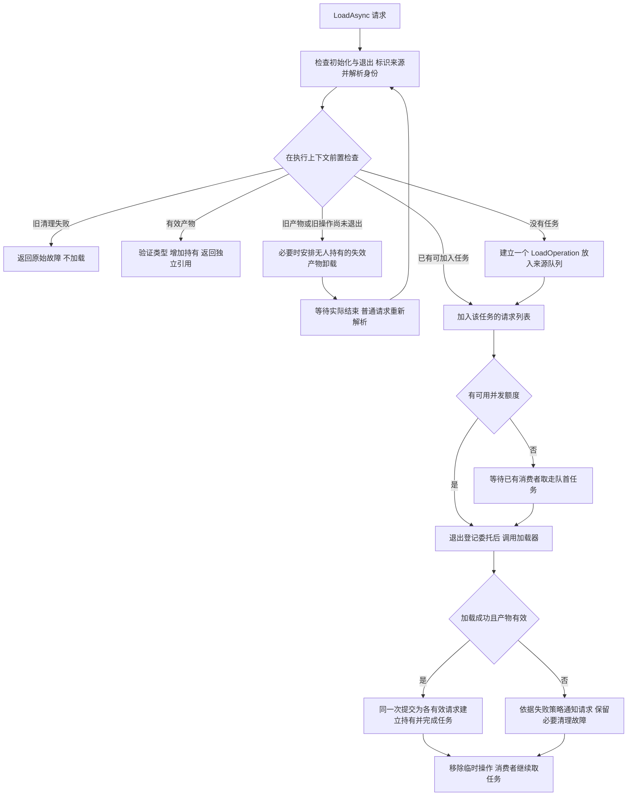
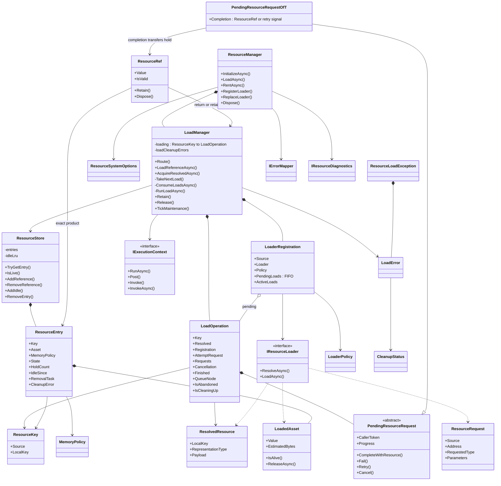
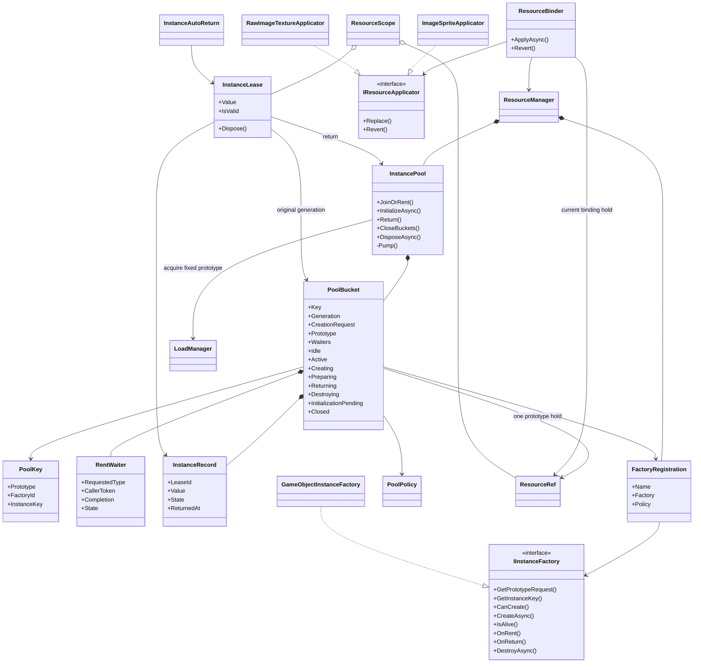
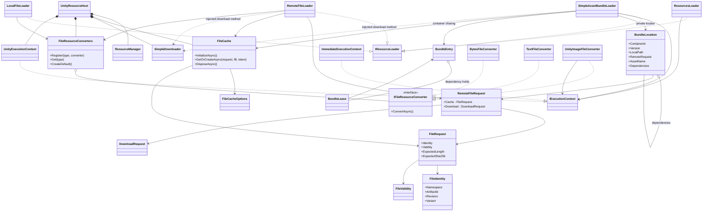
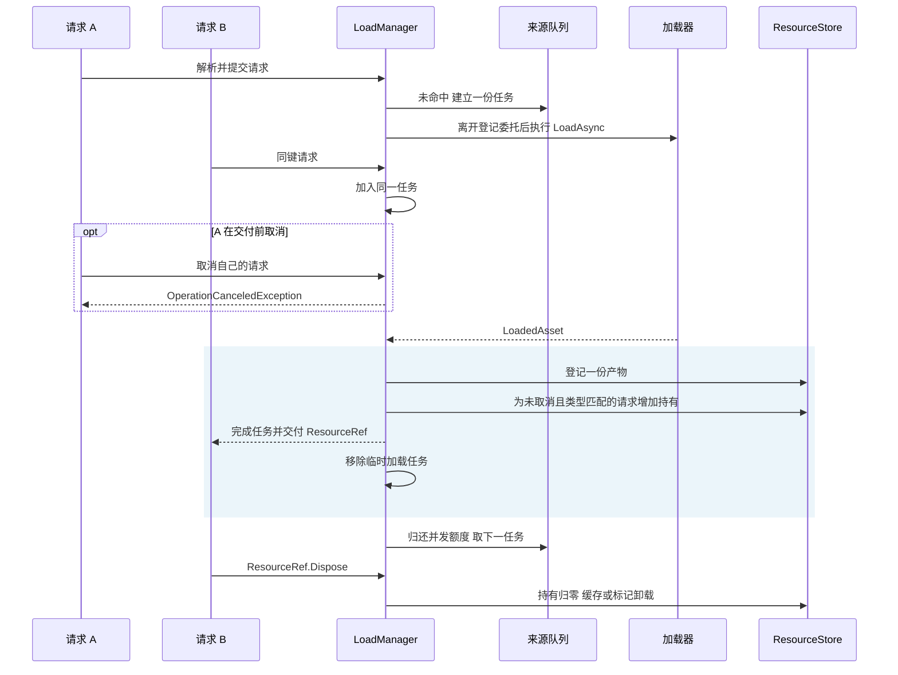
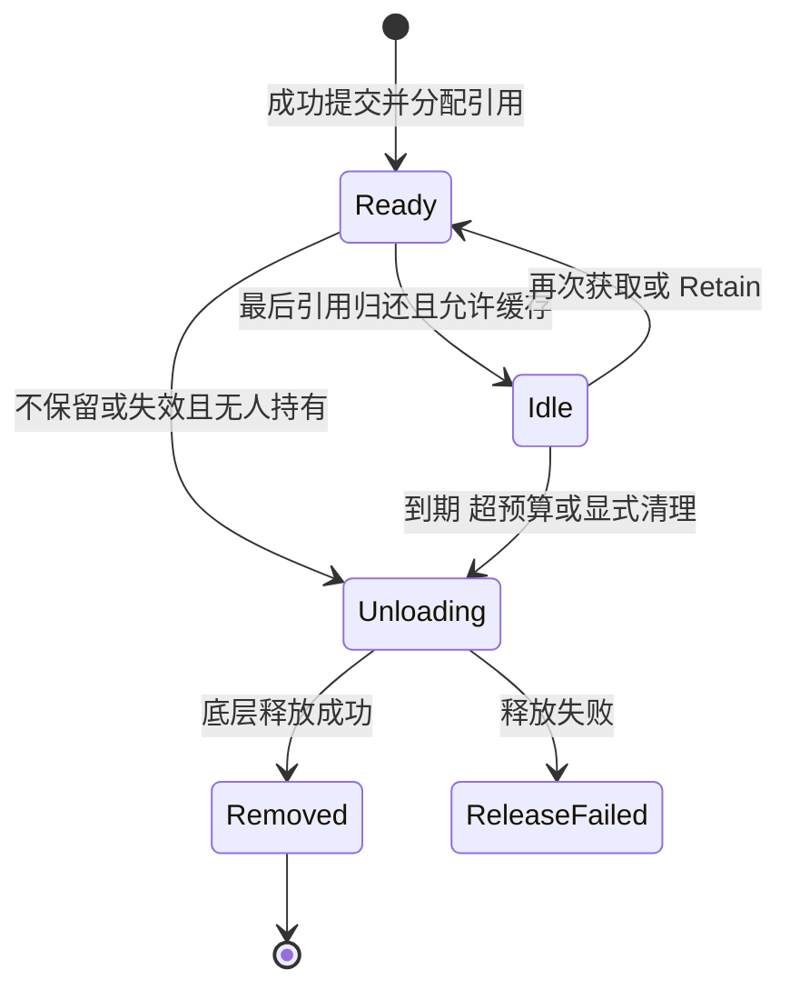
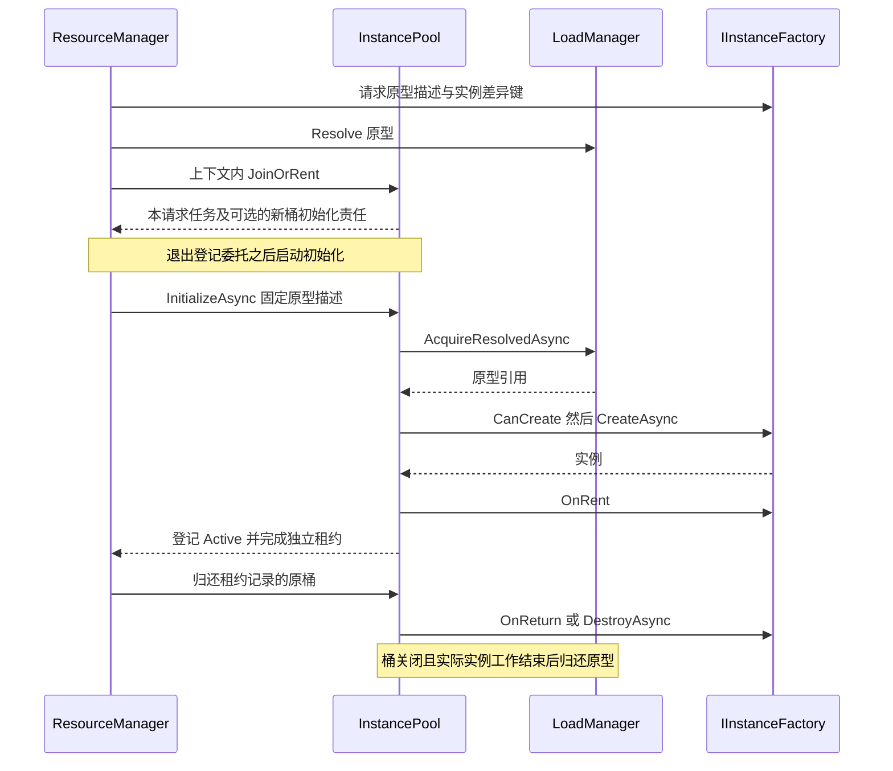
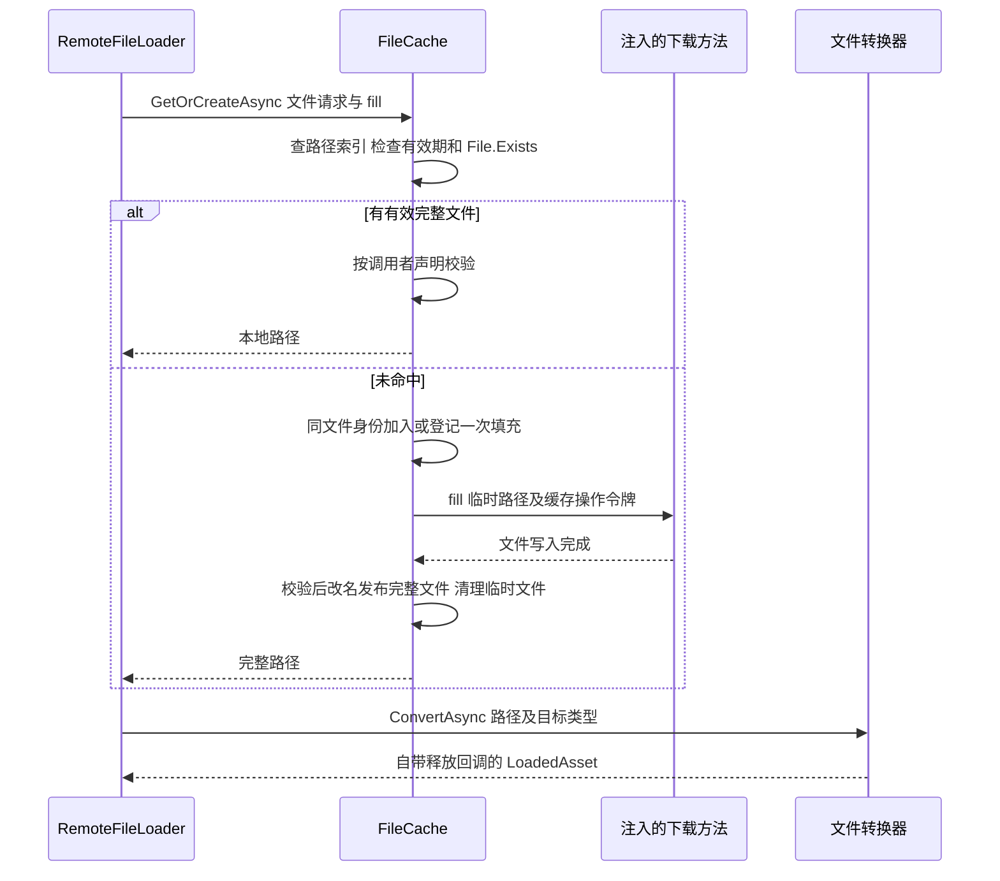

# 资源系统重写实施方案

现行设计，更新于 2026-10-13。资源请求由业务产生，`LoadManager` 合并同键请求并安排加载任务，加载器执行具体加载，完成时一次建立各请求的独立持有。已经加载的产物、下载文件、池中实例分别管理。

本文件统一描述现行流程、职责、接口和实现约束。此前包含多轮覆盖修订的版本保存在[历史方案](历史/资源系统重写实施方案_2026-10-13重构前.md)，仅用于追溯，不与本文件叠加执行。

## 1 需求边界与设计模式

| 需求 | 实现边界 |
|---|---|
| 统一加载、释放、池化和缓存 | 业务使用 `LoadAsync`、`RentAsync` 及各自凭证；来源显式指定 |
| 支持 Resources、AssetBundle、本地、远端 | 每个 `ResourceSource` 直接对应一个加载器，不经名称二次映射 |
| 用户可替换加载实现 | 组装时可替换；运行时可新增未注册来源，不支持已有来源热替换 |
| 不限制项目目录或清单形式 | 地址、路径、包依赖、catalog、manifest 由具体加载器解释 |
| 远端优先复用本地文件 | 有效缓存命中直接返回路径，未命中才调用填充方法下载 |
| 防止下载文件长期堆积 | 启动时扫描并按容量目标尽力删除；运行期无定时删除、容量硬上限或文件租约 |
| 独立取消与明确失败范围 | 单个请求取消不取消其他请求；本地共同失败、远端后继继续尝试由注册策略指定 |
| 简单且可维护 | 从流程确定职责；不为模式补空壳，也不把所有动作都包装成队列任务 |

主协作模型是**生产者—消费者**：业务产生资源需求，`LoadManager` 产生实际加载任务，加载器消费任务。消费者表示异步执行角色，不意味着另建线程。缓存命中与引用归还直接按职责处理。

辅助采用 GoF 的**策略、外观、适配器**，与主模型共 4 个：策略用于加载器和转换实现替换；外观由 `ResourceManager` 提供统一业务入口；适配器把 Unity、第三方资源框架和下载工具接入已有接口。生产者—消费者不属于 GoF 23 种。其他模式不增加独立结构，模式选择服从主流程。

不在当前范围：同步加载、通用场景加载、插件发现与热插拔、严格磁盘配额、自动恢复清理故障、等待全部业务归还的管理器关闭协议。

## 2 主流程与职责

### 2.1 加载主线

**路由与解析 → 前置检查 → 命中即交付，未命中合并或入队 → 消费执行 → 一次提交全部引用或失败 → 结束临时操作。**



每个业务调用是一份请求，同一身份的多个调用可以对应一份实际加载任务。请求等待自身完成任务，不排进“逐个取得执行权、再领取资源”的第二条队列。

### 2.2 角色与数据归属

| 类型 | 保存的事实和承担的职责 | 不承担的职责 |
|---|---|---|
| `ResourceManager` | 初始化、公开入口、超时与用户取消归类、工厂入口、退出释放 | 具体资源定位和加载算法 |
| `LoadManager` | 路由、前置检查、请求合并、来源队列、执行及批量交付、缓存维护与卸载编排 | HTTP、清单格式、Unity 具体加载细节 |
| `LoaderRegistration` | 来源、加载器、策略快照、`PendingLoads` 队列及 `ActiveLoads` 数量 | 业务持有和底层资源 |
| `LoadOperation` | 一次待消费或执行中的任务、固定解析结果、请求列表、操作取消、收尾完成信号 | 已交付产物的长期存储 |
| `PendingResourceRequest<T>` | 单次调用的类型、进度、取消令牌和 `TaskCompletionSource<ResourceRef<T>?>` | 底层共享操作所有权 |
| `ResourceStore` | 产物索引、引用计数、空闲索引、存活查询 | 调用加载器、排队、下载、卸载执行 |
| `ResourceEntry` | 实际产物、持有数、保留策略、空闲记录、卸载状态及完成通知 | 请求、解析输入、加载器依赖 |
| `ResourceRef<T>` | 对一份具体 `ResourceEntry` 的独立持有 | 按地址重新绑定新一代产物 |
| `InstancePool` | 原型引用、实例创建与租用编排、池代际、归还和销毁 | 通用资源加载算法 |
| `FileCache` | 完整文件路径复用、一次填充、校验、启动清理 | URL、HTTP、下载重试、转换 |

### 2.3 身份与所有权

- `ResourceKey = ResourceSource + ResolvedResource.LocalKey`。核心按 Ordinal 比较，不猜路径、不删查询参数、不改小写。影响内容、版本、表示或释放规则的参数必须由加载器纳入身份。
- `ResolvedResource.Payload` 仅由选中的加载器解释，作为本次执行快照；不能携带需要核心释放的未交付资源。
- 成功返回 `LoadedAsset` 是加载器向框架交出底层所有权的边界。此前失败由加载器回退中间资源；此后由框架负责至多一次释放。
- 成功完成请求任务是框架向调用者交付引用的边界。先增加持有，再完成任务；成功后发生的取消不能丢弃已经分配的引用。
- 临时任务在成功交付或失败通知完成后移除。无人接收、无效产物或取消后的迟到产物，必须由原操作完成释放后再退出，不能留给下一次请求补救。
- `ResourceRef<T>` 与 `InstanceLease<T>` 都是非池化的引用类型，Dispose 幂等，释放后的外部凭证永久失效。

## 3 公共接口与扩展契约

### 3.1 业务入口

```csharp
public sealed class ResourceManager : IDisposable
{
    public ResourceManager(IExecutionContext context,
        ResourceSystemOptions? options = null, IErrorMapper? errorMapper = null,
        IResourceDiagnostics? diagnostics = null, Func<double>? monotonicNow = null,
        FileCache? fileCache = null);

    public Task InitializeAsync(Action<ResourceManager>? configure = null,
        CancellationToken cancellationToken = default);
    public void RegisterLoader(ResourceSource source, IResourceLoader loader, LoaderPolicy? policy = null);
    public void ReplaceLoader(ResourceSource source, IResourceLoader loader, LoaderPolicy? policy = null);
    public void RegisterFactory(string name, IInstanceFactory factory, PoolPolicy? policy = null);

    public Task<ResourceRef<T>> LoadAsync<T>(string address, ResourceSource source,
        RequestOptions? options = null, CancellationToken cancellationToken = default) where T : class;
    public Task<InstanceLease<T>> RentAsync<T>(string address, ResourceSource source,
        string? factory = null, RequestOptions? options = null,
        CancellationToken cancellationToken = default) where T : class;

    public Task UnloadUnusedAsync(CancellationToken cancellationToken = default);
    public Task ClearPoolAsync(string address, ResourceSource source, string? factory = null,
        CancellationToken cancellationToken = default);
    public void Tick();
    public ResourceSnapshot GetSnapshot();
    public bool IsInitialized { get; }
    public bool IsDisposed { get; }
    public void Dispose();
}

public sealed class ResourceRef<T> : IDisposable where T : class
{
    public T Value { get; }
    public bool IsValid { get; }
    public ResourceRef<T> Retain();
    public void Dispose();
}

public sealed class InstanceLease<T> : IDisposable where T : class
{
    public T Value { get; }
    public bool IsValid { get; }
    public void Dispose();
}
```

`source` 必填，枚举为 `Resources / AssetBundle / Local / Remote`，不存在默认来源。`factory == null` 使用配置中的默认实例工厂。注册来源重复报错；`ReplaceLoader` 仅限初始化成功前。业务调用前须等待唯一初始化任务成功，加载入口不偷偷初始化。

`RequestOptions` 包含 `Timeout`、`Progress`、`Parameters`。超时覆盖整个调用的解析及等待；null 继承系统设置。参数在调用期间保持不变，核心不解释其内容。未知总量的进度使用 `TotalBytes = null`。

### 3.2 加载器

```csharp
public interface IResourceLoader
{
    Task<ResolvedResource> ResolveAsync(ResourceRequest request, CancellationToken cancellationToken);
    Task<LoadedAsset> LoadAsync(ResolvedResource resource,
        IProgress<ResourceProgress> progress, CancellationToken operationToken);
}

// ResourceRequest: Source, Address, RequestedType, Parameters
// ResolvedResource: LocalKey, RepresentationType, Payload
// LoadedAsset: Value, EstimatedBytes, IsAlive, ReleaseAsync
```

`ResolveAsync` 将业务地址解释为身份和执行输入，支持异步查询或加载器自己的清单缓存。它不加载并交出最终对象。`LoadAsync` 接收整个操作的独立取消令牌，不能把首个请求的个人令牌用作共享加载生命周期。

`LoadedAsset.IsAlive` 是无副作用的存活查询；Unity 实现使用 Unity 对象的存活语义。`ReleaseAsync` 完成表示本次底层所有权已归还。不能以“已经调用 Destroy/Release”代替必要的实际完成确认。

同键必须提供兼容的产物与释放语义。若同一对象按不同请求类型加载，各表示的后端所有权不能相互误卸载；具体后端需要共享底层持有或提供独立所有权。核心不推断第三方内部句柄关系。

### 3.3 实例工厂与文件转换

```csharp
public interface IInstanceFactory
{
    ResourceRequest GetPrototypeRequest(ResourceRequest instanceRequest);
    string GetInstanceKey(ResourceRequest instanceRequest);
    bool CanCreate(object prototype, Type instanceType);
    Task<object> CreateAsync(object prototype, ResourceRequest creationRequest, CancellationToken operationToken);
    bool IsAlive(object instance);
    void OnRent(object instance);
    void OnReturn(object instance);
    Task DestroyAsync(object instance);
}

public interface IFileResourceConverter
{
    Task<LoadedAsset> ConvertAsync(string path, Type resultType, string? conversionKey, CancellationToken ct);
}
```

工厂同步回调可能执行用户脚本，返回后须复查池、请求及管理器状态。重置失败的实例销毁；销毁失败保留隔离记录及原型。`OnRent/OnReturn` 不阻塞，不在返回后异步改变实例所有权。

转换器只将文件转换为目标对象，失败时回退中间对象。`FileResourceConverters` 是一张 `Type → IFileResourceConverter` 表，精确注册及查询，重复类型报错；不通过名称、遍历试探或文件后缀猜测实现。同一个本地或远端加载器支持多个目标类型。

## 4 UML 类图

以下三张图共同覆盖核心、实例/绑定和加载实现的职责关系。泛型类图省略类型实参，方法只列与流程有关的入口；运行中的列表、字典由其所属模块维护。

### 4.1 核心与加载调度



### 4.2 实例与业务绑定



### 4.3 文件、加载实现与 Unity 组装



`FileCache` 与下载器之间没有依赖边。填充委托由具体加载器组合，缓存只给出临时路径和缓存操作令牌。

## 5 加载算法与时序

### 5.1 前置检查

前置检查、命中时增加持有、未命中时登记请求在同一次执行上下文提交中完成，不能先查再在另一次提交里登记。

| 发现的事实 | 本次动作 |
|---|---|
| 保存有加载清理故障，或产物为 ReleaseFailed | 返回原故障，标记 `loadBlockedByPreviousCleanup=true` |
| 存在有效产物 | 验证请求类型，创建独立引用，直接完成 |
| 旧产物失效且无人持有 | 安排旧产物卸载，等待其 RemovalTask |
| 旧产物失效但仍被持有，或已经卸载中 | 等待旧条目退出，不强制夺走业务引用 |
| 旧加载已放弃，实际操作仍未收尾 | 等待 Finished，新请求不加入 |
| 已有可加入的 LoadOperation | 只添加本请求 |
| 没有产物、没有加载 | 建立任务并放到该来源的 FIFO 队列 |

等待旧状态成功结束后，普通加载重新 Resolve，允许版本已改变；池原型使用建桶时固定的 `ResolvedResource`。旧清理失败不自动重试或重置隔离。

### 5.2 共享成功与独立取消



`MaxConcurrentLoads` 限制每来源同时执行的实际任务，默认 4，0 表示不限制。一个同键任务只占一个位置。每次生产最多新增一份任务，因此入口最多领取并启动一个消费者；已有消费者执行完本轮、成功批量交付或完成失败收尾后，再取下一份。接续任务前 `await Task.Yield()`，切断前一个后端同步完成或取消回调的调用栈，不递归启动。它不承担专属线程、全局优先级、公平调度或持久化任务的保证。

同键互斥由阶段登记保证：加载时保留唯一操作，产物存在时由仓库登记，卸载中保留条目直到真实释放完成。`LoadManager` 不再叠加同键异步锁；通用 `KeyedAsyncLock` 组件继续供其他需要独立异步互斥的模块使用。

```text
AcquireReference(request):
    repeat:
        检查调用者取消
        resolved = Resolve(request)              // 池入口提供固定结果
        在上下文中:
            检查退出和旧清理故障
            有有效产物 → 验证类型、增加持有、返回新引用
            旧状态未退出 → 获取完成任务，必要时安排旧产物卸载
            否则:
                找到同键操作，或建立操作并加入来源队列
                添加本次请求
                有可用并发额度时取出一份待执行操作
        需要等旧状态 → 可取消地等待实际结束，再 repeat
        登记个人取消处理
        在登记委托之外启动已取出的一个消费者
        reference = 等待本请求 Completion
        reference 非空 → 返回引用
        收到重试信号 → repeat

ConsumeLoads(operation):
    while operation 存在:
        await ExecuteAndComplete(operation)
        在上下文中归还额度，并从同来源队首取得下一份任务
        有下一份任务 → await Task.Yield()，异步接续后再执行

ExecuteAndComplete(operation):
    使用操作令牌调用 Loader.LoadAsync
    在上下文中:
        失败 → 按失败策略通知，保存必要清理故障，移除操作
        成功且有效且操作未放弃:
            登记 ResourceEntry
            对所有请求分别判断个人取消和类型
            为可交付请求增加持有并完成其任务
            有持有者 → 移除操作并结束
            无持有者 → 撤下产物，仍由原操作暂管
        无效产物、已放弃或退出 → 标记本操作正在收尾
    若产物无人接收:
        await 释放本轮产物
        在上下文中记录清理故障或移除操作
```

在成功任务完成后不能再加一层“可取消等待”而丢掉已交付的引用。交付阶段不重新解析、不清理上一轮对象，也不自动重载；每个请求的类型不兼容只使该请求失败，不阻止其他兼容请求取得引用。

### 5.3 失败、重试与全部放弃

| 条件 | 请求完成方式 |
|---|---|
| `FailWaitingRequests` | 同轮仍在等待的请求共同失败；后续新请求可重新尝试 |
| `ContinueWaitingRequests` 且清理完成 | 发起本轮尝试的请求失败；其他未取消请求收到重试信号，重新解析后合并下一轮 |
| 清理状态为 Unknown 或 Incomplete | 所有本轮等待请求失败，保留同键故障，后续请求直接失败 |
| 单个请求取消或超时 | 只移除此请求；其余请求仍可接收本轮结果 |
| 所有请求放弃且任务仍排队 | 从来源队列移除任务，无须调用加载器 |
| 所有请求放弃且任务已执行 | 取消操作令牌，保留该操作直到后端真实结束，释放迟到结果 |

失败策略由注册配置决定，核心不根据 Local/Remote 名字推断。Unity 宿主注册远端文件加载器时明确使用 ContinueWaitingRequests；单独注册时应显式设置所需策略。这里的后继尝试不代表自动无限重试原失败请求。

取消分为两步：上下文内移除请求并标记操作放弃；离开提交委托后才通知底层取消令牌。取消回调可能让加载立即同步完成，不能把它当成不会执行外部逻辑的字段赋值。退出时也遵循这一顺序。

## 6 引用、内存缓存和卸载

`ResourceStore` 只同步维护一份事实。`LoadManager` 决定最后引用归还后缓存还是卸载。持有数从不包含“仍等着领取”的请求，成功提交已经完成所有持有分配。



`Loading / Draining` 来自临时任务的诊断投影，不是持久产物状态。`ReleaseFailed` 可来自条目释放失败，也可来自无产物的加载清理故障；后者不制造空的 `ResourceEntry`。

```text
Release(reference):
    外部凭证原子置为已释放，重复调用结束
    在上下文中对绑定的具体条目减少持有
    仍有引用 → 结束
    无效、退出或策略不保留 → 标记 Unloading，启动释放
    否则记录 IdleSince，加入空闲索引，检查全局预算

Unload(entry):
    保留仓库中的卸载记录，阻止同键新加载
    await entry.Asset.ReleaseAsync()
    在上下文中:
        成功 → 移除条目，完成 RemovalTask
        失败 → 保存 ReleaseFailed，RemovalTask 失败，报告诊断
```

运行期维护只处理空闲资源；字节预算使用加载器提供的估算值，未知按 0 统计，不宣称控制进程 RSS。空闲过期使用单调时钟。释放失败不重试回调、不把同键新加载当作恢复手段，其他键继续正常服务。

## 7 实例池与绑定

### 7.1 租用主线

`PoolKey` 由原型 `ResourceKey`、工厂名和 `InstanceKey` 组成。工厂可以把业务请求映射到不同来源的原型。每桶持有一份原型引用；后续同桶请求不能改变建桶时的解析结果和 `CreationRequest`。



```text
Rent(request):
    选工厂 → 获得原型请求 → 解析固定原型身份 → 计算 PoolKey
    在上下文中 JoinOrRent:
        检查同池清理故障
        已有桶 → 添加等待者，尝试交付，返回本请求任务
        新桶 → 登记 Initializing、等待者、业务地址关联
               返回本请求任务和初始化责任
    离开登记委托后:
        若承担初始化 → 启动固定原型获取
    等待本请求租约

PoolPump(bucket):
    尚未 Open、正在重入 Pump、没有有效等待者或配额不足 → 结束
    有闲置实例 → 检查存活、OnRent、复查状态、登记 Active 后交付
    没有闲置实例且未在创建 → 启动一次 CreateAsync
    创建完成回到上下文记账，再推进 Pump
```

首次租用取消不撤销它已经承担的桶初始化责任，其他等待者可能已经加入。Dispose 或 ClearPool 发生在登记后、初始化启动前，初始化仍须完成取消收尾，不能让 `InitializationPending` 悬挂。

### 7.2 实例与原型保护

实例处于 `Idle / Active / Preparing / Returning / Creating / Destroying` 中任何阶段，原型都不能提前归还。创建和销毁异步操作要观察到真实结束；取消后的迟到实例必须销毁或按合法归还流程处理。存活查询异常不等于确认对象已销毁。

每桶等待者按 FIFO 处理，每桶同时最多一次创建；活跃配额统计 `Active + Preparing + Creating`。空闲实例超量或到期销毁。`ClearPoolAsync` 捕获当时与 `(source, address, factory)` 关联的全部桶代际，关闭后拒绝这些桶的新租用；新租用可创建新代际，旧租约始终归还原桶。

`PoolState` 的 Closing/Closed 是具体池桶的局部关闭过程，与管理器生命周期不同。销毁失败隔离对应 `PoolKey`，保留原型和故障，不影响无关池。

### 7.3 业务绑定

`ResourceScope` 持有调用者交入的凭证并按逆序释放。`ResourceBinder` 以目标引用及 slot 为键，后发请求替代同 slot 的未完成请求；新资源应用成功后才释放旧持有。取消或失败保留旧显示，主动 Revert 先清除目标属性再释放引用。

`IResourceApplicator.Replace` 要求异常安全：失败时原属性保持原状。同 slot 同步重入受到保护，不把应用失败造成的未知 UI 状态当成功。`InstanceAutoReturn` 仅作为实例租约的自动归还便利层，不创建另一套引用机制。

## 8 文件加载与启动清理

### 8.1 缓存与 HTTP 解耦

```csharp
Task<string> FileCache.GetOrCreateAsync(
    FileRequest request,
    Func<string, CancellationToken, Task> fill,
    CancellationToken cancellationToken = default);

// FileRequest: FileIdentity + FileValidity + 可选长度/SHA256
// FileCacheOptions: Directory + StartupTargetBytes
// RemoteFileRequest: Cache(FileRequest) + Download(DownloadRequest)
```

`FileCache` 不引用 URL、请求头或下载错误类型。`RemoteFileLoader` 将文件请求与下载委托组合；默认复用项目 `SimpleDownloader.DownloadAsync`，HTTP 重试、连接并发和网络超时留在下载工具中，一次共享填充只调用一次 fill。



启动扫描只读文件名、长度等元信息建立路径索引，不把目录里的文件内容全部加载到内存。每次复用仍检查 `File.Exists` 及有效期；源文件在运行期被外部删除时不能仅凭启动索引认定命中。

### 8.2 文件生命周期

```text
InitializeFileCache:
    创建专用目录
    扫描本缓存识别的完整文件及临时文件
    删除识别出的临时残留和同身份旧副本
    按完成时间从旧到新尽力删除，直到 StartupTargetBytes 目标
    为保留的最新完整文件建立路径索引

GetOrCreate(fileRequest, fill, callerToken):
    未完成初始化 → 明确失败，不等待隐藏初始化
    短锁内:
        校验同身份的有效期约定
        有效路径 → 复用候选
        有填充 → 加入共享完成任务
        否则 → 登记一次填充
    锁外启动 fill(唯一临时路径, 缓存生命周期令牌)
    等待期间个人取消不取消共享填充
    每个调用者按自己的长度和摘要声明校验
    返回完整路径

FillAndPublish:
    await fill
    验证临时文件
    同目录改名为唯一完整路径并更新索引
    清理未发布的临时文件
    移除进行中的填充并通知全部等待者
```

文件名由身份摘要、完成时间及随机标识组成；只处理缓存认识的名称，不递归删除业务目录。调用方应为每个活动缓存实例分配独占专用目录，当前没有跨进程目录锁协议。

运行期不删除已交付的完整路径，因此无需文件租约。到期或校验失效后，新填充发布到新路径；旧路径留到下次启动清理。允许运行期超过启动容量目标，真正写满磁盘时报告本地存储故障并尽力删除临时文件。启动删除失败报告诊断，容量目标不是严格保证。

同文件身份为 `Namespace + ArtifactId + Revision + Variant`，与内存目标类型和转换参数分离。不同内容权限上下文必须使用不同身份。有效期为 Immutable 或 ExpiresAfter；同一身份不允许混用冲突的规则。

### 8.3 远端身份与转换

默认远端身份保留影响内容的端口和查询参数；无显式版本时默认 24 小时 TTL。若签名 URL 不同但内容相同，业务提供稳定身份的 requestBuilder 才能共享文件，核心不擅自删除鉴权或查询参数。

内存身份同时包含源文件身份、精确目标类型与 `FileLoadParameters.ConversionKey`。同一文件可转换为多个独立表示。默认转换表注册 byte[]、string；Unity 组装同一个图片转换器为 Texture2D 与 Sprite。转换器在 Resolve 时选定并放入本轮 Payload，加载时不二次路由。

转换失败不自动证明文件损坏，不删除下载缓存。`ConversionKey` 由具体转换器解释并进入内存身份；当前内置转换器使用固定转换行为，不把该字符串当转换器名称。

## 9 Unity 与第三方接入

`UnityResourceHost.Awake` 只组装 `UnityExecutionContext`、共享文件缓存、下载器、转换表和管理器，默认注册 Resources 加载器与 GameObject 工厂。统一 `InitializeAsync` 成功后开放 `Resources/Cache`；`Update` 驱动 Tick。

```csharp
await host.InitializeAsync(manager =>
{
    host.RegisterRemoteLoader();
    manager.RegisterLoader(ResourceSource.Local, new LocalFileLoader(host.FileConverters));
    manager.RegisterLoader(ResourceSource.AssetBundle, projectAssetLoader);
}, cancellationToken: ct);

var icon = await host.Resources.LoadAsync<Sprite>(url, ResourceSource.Remote, cancellationToken: ct);
image.sprite = icon.Value;
// 使用结束时，先断开目标对象对资源的使用，再归还凭证。
image.sprite = null;
icon.Dispose();

var enemy = await host.Resources.RentAsync<GameObject>("enemy", ResourceSource.AssetBundle);
Use(enemy.Value);
enemy.Dispose();
```

极简 AssetBundle 实现接收自定义 locator，返回 `BundleLocation`。该类的容器、版本、包内名称和依赖形式只属于内置实现，不是 `IResourceLoader` 的要求。用户可直接替换为 Addressables/YooAsset 适配加载器，保留来源、业务凭证与错误契约，无须模仿 BundleLocation。

内置 AB 加载器内部共享容器及依赖，独立处理容器等待、取消和卸载屏障；它与核心资源任务是不同层次的共享对象。不可中断的 Unity 请求须观察真实完成，迟到资产及容器按所有权回退。默认容器卸载使用 `Unload(true)`，自行从预制体创建实例的业务必须在实例使用期间保留原型引用；使用 InstancePool 时由池保证这条关系。

## 10 线程、初始化与退出

### 10.1 执行边界

状态变更在一个 `IExecutionContext` 内串行提交。Unity 实现绑定主线程，`RunAsync` 跨线程时返回可等待任务，不使用 `ManualResetEventSlim` 阻塞等待。加载器路由使用自己的短同步锁，查询不投递主线程，锁内不调用加载器。

直接 `LoadAsync/RentAsync` 路径先登记后启动实际加载；池登记返回初始化责任，避免同步完成的原型加载仍嵌套在建桶委托内。`ConfigureAwait(false)` 不保证切线程，`RunAsync` 在当前上下文也可内联。消费者不得因此统一包装成 Task.Run。

消费者继续取下一份任务时增加异步交接，保证不沿着前一个操作的同步完成/取消回调栈立即执行下一加载器。这不等同于保证别的线程已经离开所有状态提交；线程归属和状态修改仍由执行上下文约束。

工厂、存活查询与部分通知本来就可能在上下文内运行，允许的同步重入按各模块的状态复查处理。当前没有提供“任何外部回调重入的新请求都延后至最外层提交退出”的通用调度保证，不能把直接入口的验证扩大为该保证。

| 操作 | Unity 调用要求 |
|---|---|
| LoadAsync、RentAsync、UnloadUnusedAsync、ClearPoolAsync | 可任意线程发起，状态提交返回上下文 |
| 注册、InitializeAsync 发起、Tick、GetSnapshot | 主线程 |
| ResourceRef/InstanceLease 的 Value、IsValid，以及 Retain | 在执行上下文访问 |
| 凭证 Dispose、管理器 Dispose | 幂等，可任意线程调用，必要时投递 |
| Unity 对象创建、存活判断、应用、销毁 | 由对应集成实现回到主线程 |

### 10.2 统一初始化

```text
InitializeAsync(configure, callerToken):
    登记唯一初始化完成任务
    首次调用执行 configure
    await 注入的共享 FileCache.InitializeAsync
    再检查 Dispose，成功后开放业务入口
    重复无 configure 的调用等待同一任务
```

个人取消只取消这次初始化等待，不撤销其他调用者的共享初始化；再次提供 configure 报错。初始化失败保持失败事实，不把下一个资源请求变成重试初始化入口。配置在构造或注册时复制为快照，修改原 options 不热更新系统。

### 10.3 进程退出释放

资源管理器跟随游戏进程运行，只有 `IsInitialized` 与 `IsDisposed` 两个独立事实，不以资源是否全部归还或某次异常来改变全局服务状态。

Dispose 立即拒绝新请求、作废凭证并发起释放，不阻塞主线程、不等待业务归还。先取消待加载请求，再等待实际实例创建/销毁收尾，随后释放资源产物；迟到加载结果由其原操作清理。局部释放失败记录诊断，不阻止无关资源的释放。

文件缓存仍由创建方负责最终释放。Unity 宿主先发起管理器 Dispose，独立等待缓存实际填充及临时文件清理结束，再释放下载器。进程可以在异步操作结束前终止，`IsDisposed` 不表示所有 native 释放已经完成，框架不虚构退出完成保证。

## 11 配置范围

| 配置 | 默认值 | 实际作用 |
|---|---|---|
| RequestTimeout | 30 秒 | 单次资源/实例调用；系统配置 null 表示无默认超时 |
| MaintenanceInterval | 1 秒 | Tick 内存与实例维护间隔 |
| DefaultFactory | gameObject | 未指定实例工厂时使用；与来源默认值无关 |
| Memory.IdleLifetime | 10 秒 | 引用归零后的内存保留时间，0 立即卸载 |
| Memory.MaxIdleEntries | 128 | 全局空闲条目上限，0 不保留 |
| Memory.MaxEstimatedIdleBytes | null | 全局空闲估算字节预算，null 不按字节限制 |
| LoaderPolicy.MaxConcurrentLoads | 4 | 每来源的实际消费并发，0 不限制 |
| LoaderPolicy.FailurePolicy | FailWaitingRequests | 同轮失败影响范围 |
| Pool.MaxIdlePerResource | 32 | 每池桶闲置实例上限，0 归还即销毁 |
| Pool.IdleLifetime | 60 秒 | 闲置实例/空池保留时间 |
| Pool.MaxActivePerResource | null | 每桶 Active+Preparing+Creating 配额，0 非法 |
| FileCache.Directory | 必须指定 | 缓存专用目录；宿主默认 persistentDataPath/resource-cache |
| FileCache.StartupTargetBytes | 512 MiB | 仅启动清理目标；null 不按总量删除，0 尽力清空 |

工厂级 PoolPolicy 完整覆盖该工厂的池策略。LoaderPolicy.Memory 当前继承或覆盖条目 TTL，并支持局部 MaxIdleEntries=0 禁止保留；局部非零条目上限、局部字节预算尚未独立执行，实际总量限制来自系统 Memory。这是当前接口与执行范围的已知差异，不能把这些局部字段描述成已兑现的独立预算；本轮加载编排改动不扩大该能力。

负容量或非法时间初始化/注册时拒绝。null 与 0 按上表具体语义使用，不引入“所有 0 都代表无限”的统一隐式规则。下载并发和网络重试属于注入下载器配置，与来源加载并发分别约束各自工作。

## 12 两层错误与诊断

主 API 使用 `ResourceLoadException` 携带不可变 `LoadError`。用户取消抛 `OperationCanceledException`；请求超时返回 `request.timeout`，不伪装成网络错误或用户取消。

| 面向对象 | 数据 | 使用方式 |
|---|---|---|
| 最终用户 | UserErrorCode | 业务本地化为“网络问题”“资源暂不可用”“存储空间不足”等文案 |
| 开发者 | DiagnosticCode、Stage、Context、Cause、DiagnosticId | 识别 URL 无效、DNS、连接、TLS、HTTP 状态、本地 I/O、转换或释放问题 |
| 加载流程 | Cleanup、RelatedErrors | 判断本次所有权是否已回退，保留主因和相关清理失败 |

`CleanupStatus.Unknown=0 / Complete / Incomplete` 只表达本次取得但未交付资源的回退状态。未分类异常不能默认声称清理完成。网络事实来自下载器提供的异常与响应，不由核心把所有远端失败概括成 DNS 或 CDN 故障；磁盘写满、文件校验和转换故障保留各自类别。

`IErrorMapper` 在统一对外交付边界决定用户码，不改原始诊断身份。`IResourceDiagnostics` 提供诊断通知，观察者异常不得中断所有权记账。自定义后端可使用独立诊断前缀。旧 `asset.decode_failed` 字符串继续兼容既有日志筛选，源码名称与阶段已使用 AssetConversionFailed、Convert。

## 13 验证与后续修改准则

实现验收分别检查需求、行为、阅读成本。测试通过不单独证明流程简单；从公开入口应能直接读出登记、执行、交付和归还，不再靠等待者逐个获取锁及反查临时操作解释引用安全。

| 场景 | 必须观察到的行为 | 主要现有测试入口 |
|---|---|---|
| 同键成功、多类型请求 | 一次加载，各自独立凭证，不兼容类型独立失败 | ConcurrentLoadPolicyTests、ResourceAcquisitionFlowTests |
| 来源并发、排队取消 | 不超过配置额度，同键不重复排队，全部取消的排队任务不执行 | ProducerConsumerLoadTests |
| 失败策略与清理故障 | 本地共同失败、后继重解析、清理未知阻止同键重载 | ConcurrentLoadPolicyTests、LoadPreparationTests |
| 交付与取消相邻发生 | 交付前取消无持有；成功后取消不丢引用 | ResourceAcquisitionFlowTests |
| 旧产物卸载和失效 | 实际释放结束后才可重载；普通重解析、池固定解析 | LoadPreparationTests、ResourceAcquisitionFlowTests |
| 直接入口同步完成 | Load/Rent 后端启动不嵌套在各自登记委托中 | LoadStartBoundaryTests、RentStartBoundaryTests |
| 取消触发同步完成 | 后端取消通知在取消状态提交之外，不把下一任务启动带入该委托 | ConsumerCancellationBoundaryTests |
| 池取消、清理、代际与回调重入 | 归还原池，迟到对象不失踪，实际销毁前保留原型 | InstancePoolTests、ReviewFixCoreTests、ResourceDisposeTests |
| 启动及退出 | 唯一初始化、配置快照、退出作废凭证，释放失败不关闭无关功能 | ResourceStartupTests、ResourceDisposeTests |
| 远端本地复用与纯文件缓存 | 命中不下载，初始化已完成，运行期不回删完整路径 | FileCacheTests、FileLoaderTests、RemoteFileIdentityTests |
| 文件转换 | 按精确类型选择，复用同一源文件，转换失败不删缓存 | FileResourceConverterTests |
| Unity 与业务绑定 | 主线程操作、替换成功才归还旧持有、自动归还不重复释放 | UnityExecutionContextTests、绑定及 Unity 集成检查 |

2026-10-13 本轮相关 .NET 回归 **196/196 通过**，包括模拟 Unity 执行上下文、消费者取消续接与池入口边界。Unity 适配层 netstandard2.1 编译通过，0 错误。未运行真实 Unity PlayMode；这些结果不能替代实际对象销毁、AssetBundle 卸载及场景退出验证。

每轮落地后反问：“在保证需求的前提下，能否删除当前流程/代码的三分之一？”本轮已删除逐请求执行锁等待、成功后逐个领取、交付保护反查及临时结果长期留存；没有为生产者—消费者增加 Worker 类、线程管理器或全局调度平台。继续删减必须保留个人取消、实际完成前的所有权保护、失败策略以及固定池原型，不能靠删检查、压缩排版或取消已有保证凑比例。
