# 资源系统重写实施方案

## 2026-10-12 当前修订：旧状态前置检查与加载提交合并

**本节取代历史流程中“领取结果时继续处理旧产物并自动重载”以及“每个等待者分别登记启动、领取结果、退出等待”的安排。** 加载前统一处理旧状态；本轮加载完成后只判断本轮结果。加载器负责失败时回退自己的中间资源，原加载操作负责归还本轮产生但无效或无人接收的产物，不能等下一次请求来收尾。

主流程：按来源查询加载器 → 解析资源身份 → 前置检查旧状态 → 命中则取得引用；未命中则登记等待 → 按键取得执行权 → 启动本轮加载或领取已发布结果 → 结束本次等待。

| 前置检查发现的状态 | 处理方式 |
|---|---|
| 存在有效产物 | 在同一次执行上下文提交中检查有效性并增加持有，直接返回引用 |
| 旧产物失效且已无人持有 | 安排该产物卸载，等待实际释放结束后重新检查 |
| 旧产物失效但仍有引用、正在卸载，或旧加载已放弃但仍在收尾 | 等待旧操作或旧产物退出；不接管其清理，也不持有资源锁等待卸载 |
| 旧产物释放失败，或上次操作的清理未确认完成 | 本次同键加载直接失败，保留原始故障依据；不再次尝试加载或自动修复 |
| 无旧产物，已有可加入的加载 | 登记本请求并进入同键等待队列 |
| 无旧产物，也无本轮加载 | 建立临时加载上下文，登记本请求并进入同键等待队列 |

前置检查与未命中后的登记必须在同一次执行上下文提交中完成，避免检查结束到登记之间遗漏刚发布的资源。等待旧状态结束后，普通业务加载重新解析身份，再次进入前置检查；实例池原型继续使用建池时固定的解析结果，避免池身份与原型版本不一致。

```text
LoadReference(request):
    registration = 按来源直接查询加载器
    repeat:
        resolved = 解析身份（池原型使用固定解析结果）
        在执行上下文中进行前置检查：
            已有清理故障 → 直接失败
            命中有效产物 → 取得引用并返回
            旧状态尚未退出 → 取得其结束任务，必要时安排无人持有的失效产物卸载
            否则 → 加入或建立本轮加载，登记等待者并进入资源锁队列
        若需要等待旧状态：在上下文外等待结束，重新进入 repeat
        等待取得资源锁
        在同一次执行上下文提交中：
            本轮尚未启动 → 登记启动责任
            本轮已经完成 → 判断本轮错误或产物，取得引用，并移除本请求的等待记录
        若负责启动：在状态提交之外调用加载器并发布结果
            再在同一次执行上下文提交中判断结果、取得引用、移除等待记录
        若远端前次失败允许队列后继独立尝试 → 重新进入 repeat
        返回本次引用或失败
    取消或异常导致尚未完成领取提交 → 单独移除本请求的等待记录
```

- **路由无需投递 Unity 主线程。** 来源注册表的查询、新增与替换使用同一把短同步锁保护；锁内不等待、不调用加载器。运行期仍可新增尚未注册的来源；替换仍仅限初始化完成前。注册入口和初始化入口已有的执行上下文要求不因此扩大或改变。
- **状态提交合并，但所有权不合并。** 后继等待者取得锁后，同一次提交就能选择启动本轮或领取已有结果；不先做一次无效的启动检查，再单独领取。领取时的取消检查、产物身份验证、增加持有和移除等待记录一起完成；若此前已取消或抛错，仍需独立撤销登记，不能泄漏等待保护。
- **共享产物发布与业务领取仍是两个职责。** 发布结果由原加载操作完成；每个请求领取自己的引用时仍独立检查取消和具体产物身份。加载器的同步执行部分始终在状态提交之外，不把任意后端代码塞进临界区，也不统一使用 `Task.Run`。
- **领取阶段不再转入旧状态清理。** 若本轮已发布产物在领取前失效，本次请求直接得到 `AssetInvalidated`，不暗中重载。产物按其实际持有关系归还；无人接收的本轮产物由原流程释放。释放失败保留同键故障，后续请求在前置检查直接失败。
- **并发与取消语义保留。** 失败共享方式由注册的 `FailurePolicy` 决定：本地场景通常同批失败通知全部排队请求；远端场景通常在本次失败且清理完成后允许队列后继发起自己的尝试。核心不按来源名称暗中推断策略。单个请求取消不取消其他等待者；全部放弃时，实际操作仍持有执行权直到本轮真实收尾结束。
- `RunAsync` 在当前执行上下文中可直接执行；`ConfigureAwait(false)` 也不表示必定切换线程。这里减少重复的状态提交，不承诺所有分支固定两次切换或固定帧数。Unity 对象的存活检查、持有和具体 Unity API 仍遵守其主线程要求。

旧清理故障阻止加载时，返回错误保留原始错误 ID、原因和阶段，并在上下文中标记 `loadBlockedByPreviousCleanup=true`，表示本次未执行新的加载；存储的原始错误不变。框架不通过重试掩盖这类问题，也不新增恢复状态机或故障重置接口。

---

## 2026-10-12 当前修订：文件资源转换按目标类型选择

**本节及第 8.2 节取代历史图表中的 DecoderRegistry、IResourceDecoder、解码器名称选择和类型探测机制。** 文件加载器按来源取得文件，文件资源转换器把文件变成目标对象；同一个本地或远端加载器支持多种目标类型，不按 string、Texture2D、Sprite 组合出多个加载器。

```text
LoadAsync<T>(address, source)
    → 按 source 选择 LocalFileLoader 或 RemoteFileLoader
    → Resolve 按 typeof(T) 查询一次转换表，保存转换器与 ConversionKey
    → 本地取得源路径；远端先查文件缓存，未命中才下载
    → 选定转换器 ConvertAsync(path, typeof(T), conversionKey, ct)
    → 返回带自身释放操作的 LoadedAsset，交由资源系统管理持有和缓存
```

- `IFileResourceConverter` 只定义文件到目标资源的转换。`FileResourceConverters` 只有一张 `Type → IFileResourceConverter` 表：`Register(Type, converter)` 新增，`Get(Type)` 精确查询；不支持名称、遍历试探、热替换或注册表冻结。重复类型注册直接报错，缺少目标类型时在解析阶段报告 `UnsupportedRepresentation`。
- `FileResourceConverters.CreateDefault()` 注册 `byte[] → BytesFileConverter`、`string → TextFileConverter`。Unity 组装时再将同一个 `UnityImageFileConverter` 实例分别注册到 `Texture2D` 和 `Sprite`。转换器可以支持多个类型，但支持关系由组装处明确登记，无须另设 `CanDecode` 或 `IRepresentationDecoder`。
- `FileLoadParameters` 只保留 `ConversionKey`，表示该转换实现理解的参数，并参与内存资源身份；它不选择转换器。普通 `string` 不再被当成解码器名称。当前内置转换器没有可调转换选项；自定义实现可解释 ConversionKey，内置实现沿用固定转换行为。
- 源文件身份不包含目标类型或 `ConversionKey`：同一个已下载文件可以生成文本、字节或多个图片表示；不同目标类型和转换参数产生不同的内存资源身份。转换失败不自动证明源文件损坏，不因此删除下载缓存。
- `ResolveAsync` 选中的转换器直接保存在本轮 `ResolvedResource.Payload` 中；`LoadAsync` 直接使用它，不再查名称或重新选择。该执行依赖不会进入长期的 `ResourceEntry`。
- `ResourceManager` 仍只认识加载器。转换表由组装方传给本地和远端文件加载器，既不放进核心路由，也不要求其他来源采用文件转换接口。

Unity 宿主在 Awake 组装唯一的 `FileConverters`，包含字节、文本及图片转换；组装完成后即可在 configure 中访问。`RegisterRemoteLoader()` 使用这一份表，不再接收单独的 decoders 参数。新增本地来源也复用它：

```csharp
await host.InitializeAsync(manager =>
{
    host.RegisterRemoteLoader();
    manager.RegisterLoader(ResourceSource.Local, new LocalFileLoader(host.FileConverters));
    // 自定义目标类型：host.FileConverters.Register(typeof(MyData), myConverter);
}, cancellationToken: ct);

// 三次请求使用同一个远端加载器；由目标类型直接定位转换器。
var text = await host.Resources.LoadAsync<string>(textUrl, ResourceSource.Remote);
var texture = await host.Resources.LoadAsync<Texture2D>(imageUrl, ResourceSource.Remote);
var sprite = await host.Resources.LoadAsync<Sprite>(imageUrl, ResourceSource.Remote);
// 按各自使用期归还 text、texture、sprite。
```

本轮移除 `Decoding` 目录与旧接口名，使用 `Conversion`。错误阶段改为 `LoadStage.Convert`，诊断常量改为 `DiagnosticCodes.AssetConversionFailed`；其稳定字符串值继续为 `asset.decode_failed`，以保持既有日志和诊断筛选兼容，不保留旧的解码器 API。

---

## 2026-10-12 当前修订：统一初始化与进程退出释放

**本节取代旧版 Start、首次请求启动、注册表冻结，以及历史图表中的 ManagerState、ShutdownAsync、全局请求计数及关闭完成回调。** 资源系统通过一个入口完成初始化，随后随进程运行；不提供等待全部业务归还的独立关闭流程。

- `ResourceManager.InitializeAsync()` 是统一初始化入口，成功后才接受资源请求；不再提供 `Start()`。管理器和快照公开 `IsInitialized`、`IsDisposed`：前者来自唯一初始化任务是否成功，后者表示已发起退出释放，不表示异步清理全部成功或完成。不存在管理器级 Closing、Closed、Faulted。
- `Dispose()` 幂等且立即返回：立即禁止新请求、注册和 Retain，作废已有资源引用与实例租约，取消未完成交付，不等待业务主动归还。
- 退出时接管闲置和在用实例并安排销毁；正在执行的创建、租用/归还回调和销毁沿各自原路径收尾。内部只等待这些实际操作结束，再逐项尝试释放仓库中的全部产物，包括仍有业务持有的产物。
- 迟到加载结果不再交付或留作缓存，由该次加载自行释放。释放失败只保留相应资源/池的局部诊断，不汇聚为“系统关闭失败”，不自动重试，也不阻断其他独立产物的释放尝试。
- `ClearPoolAsync` 仍是运行期的局部维护：不强制收回在用租约，正常清池的原型保护和清理故障屏障继续保留。它与进程退出的 Dispose 不是同一契约。
- `UnityResourceHost.Dispose`、`OnApplicationQuit` 和 `OnDestroy` 进入同一幂等退出入口。文件缓存的 `DisposeAsync()` 只等待已经开始的初始化/填充 I/O 真正结束，以便随后释放宿主拥有的下载器；不等待文件租约或业务引用归还。

内部等待只用于“实际实例操作结束 → 释放原型”和“实际文件 I/O 结束 → 释放下载器”这两项依赖顺序，不形成新的管理器关闭状态或对外关闭结果。进程终止本身不承诺后台异步清理已经全部完成。

---

### 统一初始化流程与运行期新增注册

主流程只有一条：组装管理器及共享文件缓存 → 调用 `ResourceManager.InitializeAsync` → 执行一次 configure → 等待共享文件缓存初始化 → 完成唯一初始化任务 → 开放业务入口。Unity 桥接层只组装对象并转发这个入口，不再分别初始化管理器与文件缓存。资源请求只使用已就绪的系统，不承担初始化等待。

| 启动/退出事实 | 当前含义 |
|---|---|
| 初始化尚未成功，未 Dispose | 可新增注册，也可通过 `ReplaceLoader` 替换已注册来源的实现；不接受加载或租用 |
| 初始化成功，未 Dispose | 接受业务请求，也允许新增尚未注册的来源或工厂；不允许替换已注册来源 |
| 已 Dispose | 禁止业务访问、初始化与注册；初始化是否曾经成功不改变退出行为 |

- `RegisterLoader` 和 `RegisterFactory` 在 Dispose 前均可新增；来源或工厂名称重复时报错。新增不会改变已有来源、正在加载的任务或已经交付的产物。
- `ReplaceLoader` 保留为初始化完成前的组装能力，不提供运行中的替换，也不由首次请求隐式结束配置。
- `ResourceManager` 构造时可注入 `FileCache? fileCache = null`，加载器与管理器使用同一个缓存。管理器负责等待该缓存初始化；缓存和下载器的释放仍由创建方负责。无文件缓存的系统省略该参数，不额外建立初始化器接口或注册表。
- 管理器只保存一份初始化任务，先登记任务再执行 configure，避免回调重入造成重复初始化。重复无参调用等待同一任务；初始化开始后再传 configure 报错。失败保留在该任务中，不自动重试。
- `UnityResourceHost.Awake` 仅组装对象、注入共享缓存并注册默认 Resources 加载器和 gameObject 工厂。项目入口在主线程调用 `host.InitializeAsync(Action<ResourceManager>? configure = null, CancellationToken cancellationToken = default)`；宿主直接转发给管理器，不再保存另一份初始化任务或初始化生命周期取消源。Resources 与 Cache 根据管理器是否初始化成功开放。
- `FileCache.GetOrCreateAsync` 不再等待初始化；未初始化或初始化尚未结束时明确拒绝使用。启动扫描仍只执行一次，初始化等待者取消不取消共享扫描，退出时只等待扫描和填充的实际 I/O 结束。

直接组装与 Unity 接入都等待同一套管理器初始化流程。注册和初始化提交仍通过执行上下文串行处理，Unity 中从主线程发起。运行期新增加载器所需的第三方 SDK 等依赖仍由组装方先准备好。

```csharp
await host.InitializeAsync(manager =>
{
    host.RegisterRemoteLoader();
    manager.RegisterLoader(ResourceSource.AssetBundle, host.CreateBundleLoader(locator));
    // 如需替换默认 Resources 实现，在此调用 manager.ReplaceLoader(...)。
}, cancellationToken: ct);

// 初始化成功后才取得业务入口；运行期仍可新增其他来源。
var resources = host.Resources;
resources.RegisterLoader(ResourceSource.Local, new LocalFileLoader(host.FileConverters));
```

configure 可使用宿主的 Context、Downloader、FileConverters 及加载器组装方法；不要提前访问尚未开放的 Resources、Cache。单个调用者的 ct 只取消本次初始化等待，不取消共享初始化；管理器 Dispose 会取消自己的初始化等待并阻止后续就绪。共享缓存实际 I/O 的退出清理由创建方安排。初始化失败不会开放业务入口，也不会因再次调用而重新执行 configure 或扫描。

```text
InitializeAsync(configure, callerToken):
    在执行上下文中确认未 Dispose
    首次调用：登记唯一初始化任务，再执行一次 configure
    已有任务：若再次传 configure 则报错，否则复用该任务
    首次调用继续：等待注入的 FileCache.InitializeAsync（如有）
    回到执行上下文：确认未 Dispose，再完成初始化任务
    任一步失败或退出取消：将结果留在同一任务，不开放请求、不自动重试
    callerToken 仅控制本调用等待该任务
```

---

## 2026-10-11 修订：加载上下文与产物分开管理

**本节取代下文旧类图、状态图和算法中“ResourceEntry 贯穿加载与持有”“ResourceStore 编排加载”的设计。**下文保留早期方案供追溯，当前实现按以下职责和流程落地。

| 对象 | 所有者与职责 | 结束时点 |
|---|---|---|
| `LoadContext` | `LoadManager` 的私有临时数据：本轮解析输入、等待者、取消、错误、交付保护 | 结果交付结束，或失败/取消的实际收尾完成 |
| `ResourceEntry` | `ResourceStore` 的产物记录：具体 `LoadedAsset`、引用数量、缓存规则与卸载状态 | 该产物实际释放完成 |
| `ResourceRef<T>` | 业务的一次持有，绑定取得时的具体 `ResourceEntry` | Dispose 后永久失效，不会改绑同键的新产物 |

主流程：解析身份 → 查询仓库并检查产物有效性 → 命中则登记引用；未命中则加入/建立本轮加载上下文 → 按键取得执行权并调用加载器 → 成功产物进入仓库 → 等待者领取或取消 → 移除上下文 → 后续仅按产物引用和缓存规则决定保留/卸载。

- 仓库同时记录正在持有和闲置可复用的产物，加载未完成时不创建空产物条目。产物有效性通过 `ResourceStore.IsLive` 查询，包括具体条目身份及后端 `LoadedAsset.IsAlive`；检查和取得引用在同一次执行上下文提交中完成。
- 2026-10-12 补充：旧状态统一在加载前检查；查询未命中、登记本轮等待者和资源锁入队在同一次状态提交中完成。取得锁后，同一次提交选择启动本轮或领取已发布结果，领取同时移除等待记录。实际加载调用在提交段外执行，由加载器处理具体线程要求，不统一使用 `Task.Run`。启动责任登记后即使调用者取消，执行方法仍须进入并完成收尾；领取时发现本轮产物失效直接失败，不再回到旧产物清理分支。
- 交付期间，临时上下文的 `DeliveryResource` 保护该份产物，避免第一个调用者归还时，后续调用者尚未领取就被释放。它不计入业务引用数量，仓库与业务引用不反向持有加载上下文。
- 长期条目删除 `Resolved`、`OperationId`、加载任务、取消源、等待者、加载错误和 `HasBeenReferenced`。原“本轮无人成功领取则立即卸载”的行为仅在临时上下文中用 `DeliveredToCaller` 判断，不留下长期历史状态。加载任务保留为执行方法局部变量。
- 本地批次失败、远端后续请求独立尝试、单个请求取消及 `KeyedAsyncLock` 的既有语义保持。普通 Load 等旧产物退出后重新解析；实例池继续使用建池时固定的解析结果。
- 无产物且清理未确认完成时，`LoadManager` 仅保留资源键与错误证据，阻止同键重试；已有产物的卸载故障由仓库记录。取消等待不代表真实操作结束；退出后迟到产物仍由原操作释放，但不再建立全局排空任务。
- 快照由 `LoadManager` 合并临时加载、产物和清理故障，交付期间同键只显示一行。`WaitingCount` 表示待领取请求，`HoldCount` 只表示已经交付的引用。

相关实现：`Core/LoadManager.cs`、`Core/ResourceEntry.cs`、`Core/ResourceStore.cs`、`Core/ResourceRef.cs`。生命周期回归见 `ToolKit/Tests/ResourceSystem/LoadContextLifetimeTests.cs`，覆盖临时解析数据回收、全部取消后的迟到清理、同步触发关闭、无产物清理故障和失效产物重载。

---

本方案用于重写 GameToolKit 的资源系统。业务通过统一入口加载资源和租用实例；框架负责共享请求、持有关系、内存缓存与实例池；可替换加载器负责解释资源地址、处理来源内部的版本与依赖、执行实际加载和底层释放。远端文件默认先查本地缓存，未命中才下载，并受可核算的磁盘容量预算约束。

本文中的“必须”是实现契约，“默认”是可以通过配置替换的行为。接口草案使用 C# 语法，算法使用接近 C# 的伪代码；图中的关联、状态与算法应同时满足。方案不要求一次兼容全部旧接口，迁移期由明确的适配层承担兼容。

## 1 需求和设计决策

### 1.1 已确认的需求

| 编号 | 要求 | 落地边界 |
|---|---|---|
| R01 | 统一加载和释放 | AssetBundle、Resources、远端、本地资源使用同一业务持有流程 |
| R02 | 加载器可替换 | 内置极简 AB 实现可由用户的 Addressables、YooAsset 或自定义加载器替换 |
| R03 | 不预设项目结构 | 核心不拼项目路径，不规定包名或资源目录 |
| R04 | 不预设清单结构 | catalog、manifest、自定义映射和依赖关系属于具体加载器 |
| R05 | 远端优先本地 | 有效本地缓存命中不发 HTTP 请求，未命中下载到本地后使用 |
| R06 | 存储有上限 | 已下载文件、临时文件、失败残留与下载预留共同计入预算 |
| R07 | 简洁接口和丰富配置 | 常用入口只有加载、租用和释放；高级选项按职责分组 |
| R08 | 两层错误信息 | 最终用户看到可理解的类别；开发者获得阶段、证据、上下文和原始异常 |
| R09 | 从流程推导结构 | 每个模块对应完整职责，不为减少分支增加通用背书体系 |

### 1.2 固定决策

1. `ResourceRef<T>` 表示一次共享资源持有，`InstanceLease<T>` 表示一次实例租用。两者都是非池化的 `sealed class`，释放后永久失效。
2. 一个 `ResourceEntry` 对应一次底层加载所有权。业务创建十份引用，只增加该条目的持有数；底层加载器获得的所有权仍只释放一次。
3. 框架注册的是“加载器”，不建立独立的插件发现、插件生命周期或热插拔系统。
4. 管理器统一 InitializeAsync 成功后接受业务请求，运行期仍可新增未注册来源和工厂；重复注册报错。ReplaceLoader 仅用于初始化完成前的组装，不提供运行中的替换。
5. 加载器不返回业务引用，不操作框架引用计数。它返回 `LoadedAsset`，其中包含对象、有效性检查和异步释放操作。
6. 内存资源、下载文件、池中实例是三种不同对象，分别管理，不能用一个万能缓存接口掩盖差异。
7. 不把“保存到指定业务路径”混入共享加载。该需求使用独立下载导出操作，输出文件不自动参与缓存淘汰。
8. 主 API 失败时抛出 `ResourceLoadException`，携带统一 `LoadError`。用户取消抛 `OperationCanceledException`，不返回失败凭证。
9. 默认不做负缓存、不持久化未完成下载、不自动重试释放失败。运行期维护不强制销毁业务持有；进程退出 Dispose 则作废凭证并接管释放。
10. 本版统一使用 `Task`。同步加载、场景加载和自动识别任意文件格式不进入首版交付范围；可通过明确扩展单独实现。

### 1.3 术语

| 名称 | 定义 |
|---|---|
| 业务地址 Address | 调用方提供的字符串，由选中的加载器解释 |
| 资源来源 ResourceSource | 业务显式选择的 Resources、AssetBundle、Local、Remote；每种来源对应一个已注册加载器 |
| 资源身份 ResourceKey | ResourceSource 与加载器返回的 LocalKey 组成的不可变键 |
| 业务引用 | 一个 `ResourceRef<T>`，增加资源条目一次持有 |
| 空闲资源 | 加载成功但当前没有持有者的内存资源 |
| 文件租约 | 一个 `FileLease`，保护其路径对应文件不被缓存淘汰 |
| 实例租约 | 一个 `InstanceLease<T>`，记录实例及其所属的具体池对象 |
| 释放 Release | 某一持有者归还自己的所有权 |
| 卸载 Unload | 加载器执行底层清理；物理内存回收时机遵循对应后端 |

## 2 业务流程

### 2.1 加载并持有

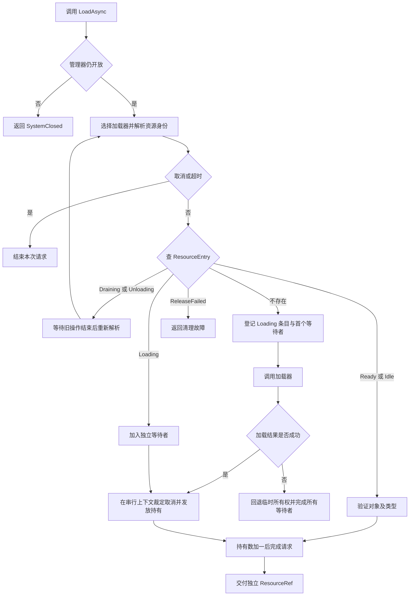

“交付成功”以等待者任务成功完成为界：先登记持有，再完成任务。不能先把加载对象广播给调用者，再等待调用者自行增加引用。

### 2.2 释放和空闲缓存

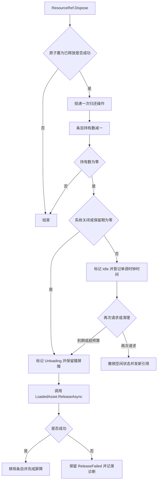

### 2.3 取得和归还实例

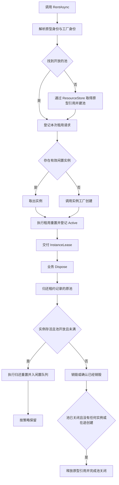

## 3 对外接口和数据契约

### 3.1 公共 API

```csharp
public sealed class ResourceManager : IDisposable
{
    ResourceManager(IExecutionContext context, ResourceSystemOptions? options = null,
                    IErrorMapper? errorMapper = null, IResourceDiagnostics? diagnostics = null,
                    Func<double>? monotonicNow = null, FileCache? fileCache = null);
    // 唯一初始化入口：执行配置、等待共享文件缓存、成功后开放请求。
    Task InitializeAsync(Action<ResourceManager>? configure = null,
                         CancellationToken cancellationToken = default);
    // 配置期和运行期均可新增；重复来源或工厂名称报错。
    void RegisterLoader(ResourceSource source, IResourceLoader loader,
                        LoaderPolicy policy = null);
    // 仅初始化完成前允许替换已经注册的来源。
    void ReplaceLoader(ResourceSource source, IResourceLoader loader,
                       LoaderPolicy policy = null);
    void RegisterFactory(string name, IInstanceFactory factory,
                         PoolPolicy policy = null);

    Task<ResourceRef<T>> LoadAsync<T>(string address,
        ResourceSource source, RequestOptions options = null,
        CancellationToken cancellationToken = default) where T : class;

    Task<InstanceLease<T>> RentAsync<T>(string address,
        ResourceSource source, string factory = null,
        RequestOptions options = null,
        CancellationToken cancellationToken = default) where T : class;

    // 立即启动所有可释放空闲条目的卸载，等待本批次完成；不影响活跃持有。
    Task UnloadUnusedAsync(CancellationToken cancellationToken = default);
    // 关闭在调用时捕获的全部池代际，覆盖该业务地址目前关联的已解析版本。
    Task ClearPoolAsync(string address, ResourceSource source,
                        string factory = null,
                        CancellationToken cancellationToken = default);
    // Unity 驱动器定时调用；后台任务也必须回到上下文提交状态。
    void Tick();
    ResourceSnapshot GetSnapshot();

    bool IsInitialized { get; }       // 唯一初始化任务已成功完成
    bool IsDisposed { get; }          // 已发起退出，不表示异步清理已完成
    // 进程退出时作废凭证并启动释放；立即返回，不等待业务归还。
    void Dispose();
}

public sealed class ResourceRef<T> : IDisposable where T : class
{
    T Value { get; }                   // 已释放、服务已 Dispose 或底层失效时抛异常
    bool IsValid { get; }              // 轻量存活查询，不延长持有
    ResourceRef<T> Retain();           // 新的一份持有；服务已 Dispose 时禁止
    void Dispose();                   // 幂等；永久失效
}

public sealed class InstanceLease<T> : IDisposable where T : class
{
    T Value { get; }
    bool IsValid { get; }
    void Dispose();                   // 幂等；归还原池；不提供 Retain
}
```

`source` 必须显式指定，不提供 DefaultLoader 或隐式来源；`factory == null` 使用默认实例工厂。核心不按文件后缀或注册顺序猜测加载器。加载前必须等待 InitializeAsync 成功，运行期新增来源仍通过 RegisterLoader 完成。

API 的取消参数控制调用者等待。维护 API 已启动的清理和池关闭不会因调用者取消等待而回滚。`GetSnapshot()` 以 `IsInitialized`、`IsDisposed` 表示初始化是否成功、是否退出，不汇总关闭成功或失败。

### 3.2 业务示例

```csharp
var fileConverters = FileResourceConverters.CreateDefault(); // byte[] 与 string；其他目标类型显式注册
var manager = new ResourceManager(context, options, errorMapper, diagnostics,
    fileCache: fileCache); // 与远端加载器共享；创建方仍负责最终释放缓存及下载器
manager.RegisterLoader(ResourceSource.AssetBundle, projectAssetLoader);
manager.RegisterLoader(ResourceSource.Resources, new ResourcesLoader(context));
manager.RegisterLoader(ResourceSource.Remote,
    new RemoteFileLoader(fileCache, downloader.DownloadAsync, fileConverters));
manager.RegisterFactory("gameObject", new GameObjectInstanceFactory(context));

// 只等待统一入口；管理器负责等待注入的文件缓存初始化。
await manager.InitializeAsync(cancellationToken: ct);
// 运行中仍可追加新来源；原来源不能被同名注册覆盖。
manager.RegisterLoader(ResourceSource.Local, new LocalFileLoader(fileConverters));

// projectAssetLoader 可以是内置 SimpleAssetBundleLoader，
// 也可以是项目自己的 AddressablesLoader 或 YooAssetLoader。
var icon = await manager.LoadAsync<Sprite>("ui/icon", ResourceSource.AssetBundle, cancellationToken: ct);
image.sprite = icon.Value;
// UI 不再使用时，先解除 UI 对象上的绑定，再释放这一份持有。
image.sprite = null;
icon.Dispose();

var enemy = await manager.RentAsync<GameObject>("enemy", ResourceSource.AssetBundle, cancellationToken: ct);
Use(enemy.Value);
enemy.Dispose();
```

### 3.3 请求和配置快照

```csharp
public sealed class RequestOptions
{
    TimeSpan? Timeout;                  // 整个调用，包括 Resolve 和排队
    IProgress<ResourceProgress> Progress;
    object Parameters;                  // 加载器专属、调用期间不可变的参数
}
public readonly struct ResourceRequest
{
    string LoaderId;
    string Address;
    Type RequestedType;
    object Parameters;
}
public readonly struct ResourceProgress
{
    LoadStage Stage;
    long CompletedBytes;
    long? TotalBytes;                   // 未知总量不得伪造百分比
}
public readonly struct ResourceKey
{
    string LoaderId;
    string LocalKey;                   // 比较规则：Ordinal；不统一改小写或删查询参数
}
public sealed class ResolvedResource
{
    string LocalKey;
    Type RepresentationType;           // 本记录实际承诺的资源表示
    object Payload;                    // 仅原加载器解释；不可变且不拥有待释放资源
}
```

框架把已注册 LoaderId 与 `LocalKey` 组合为实际键。加载器必须保证相同键得到兼容的资源表示、版本和底层释放规则；不同内容、子资源或影响结果的参数不得复用同一键。超时与进度监听器不进入键。

`RequestedType` 只有在改变实际对象或转换结果时影响 `LocalKey`。例如同一 Sprite 通过 Object 和 Sprite 访问，不能被拆成两个互不知情的单独卸载所有者。加载器应返回同一身份，或在内部共享底层所有权。内置文件加载器按精确目标类型创建不同表示，因此将目标类型纳入身份；不隐式按基类回退选择转换器。

`Parameters` 是用户加载器的扩展输入；核心不读取其中的目录、清单或依赖字段。加载器负责验证其类型、复制必要信息并形成不可变的 `Payload`。未支持的参数必须明确报错。

### 3.4 加载器契约

```csharp
public interface IResourceLoader
{
    Task<ResolvedResource> ResolveAsync(ResourceRequest request,
                                       CancellationToken cancellationToken);
    Task<LoadedAsset> LoadAsync(ResolvedResource resource,
                               IProgress<ResourceProgress> progress,
                               CancellationToken operationToken);
}

public sealed class LoadedAsset
{
    object Value { get; }
    long? EstimatedBytes { get; }
    // 纯查询；默认 value != null；Unity 加载器使用 Unity 的存活语义。
    Func<bool> IsAlive { get; }
    // 由框架最多启动一次；返回任务完成意味着此次所有权已正确归还。
    Func<Task> ReleaseAsync { get; }
}
```

`ResolveAsync` 负责定位和身份，不能交出需要框架释放的底层对象。加载器可以内部缓存清单和解析结果，也可以支持异步解析；清单来源与格式不进入此接口。解析可能被取消，加载器必须清理自身解析临时资源。

`LoadAsync` 收到框架独立创建的操作令牌，不能把任意一个业务调用者的取消令牌作为共享加载的生命周期。它可以在后台进行 I/O；Unity API 操作必须通过集成层的执行上下文。

成功返回 `LoadedAsset` 的瞬间，底层所有权转交框架。在此之前发生异常，加载器必须自行回退所有本次取得的资源。成功之后即使所有调用者取消，框架也会调用 `ReleaseAsync`，不能通过抛取消异常丢失已经创建的对象。

内置释放回调和适配加载器必须说明释放完成条件。异步销毁要等待确认完成才能释放其依赖。释放失败进入隔离状态，核心不猜测是否已经部分释放，也不自动调用第二次回调。

### 3.5 实例工厂契约

```csharp
public interface IInstanceFactory
{
    // 将租用请求转成原型请求，例如 GameObject 实例对应 GameObject 预制体。
    ResourceRequest GetPrototypeRequest(ResourceRequest instanceRequest);
    string GetInstanceKey(ResourceRequest instanceRequest);
    bool CanCreate(object prototype, Type instanceType);
    Task<object> CreateAsync(object prototype, ResourceRequest creationRequest,
                             CancellationToken operationToken);
    bool IsAlive(object instance);
    void OnRent(object instance);
    void OnReturn(object instance);
    Task DestroyAsync(object instance);
}
```

`OnRent/OnReturn` 在执行上下文同步完成，禁止阻塞和异步后台改变实例所有权。创建或重置失败的实例必须销毁；销毁失败保留原型和隔离记录。默认 GameObject 工厂支持游戏对象原型；byte[]、Sprite 等共享对象不默认进入实例池。用户可以提供其他工厂。

## 4 完整 UML 类图

> 历史结构图保留用于追溯。图中的管理器状态、ShutdownAsync、ActiveRequests 和全局完成回调已废止；当前入口和退出流程以顶部修订、3.1、5.4、7.4 为准。

以下图按职责分区共同构成本方案的完整 UML。配置记录、错误枚举和 DTO 在后续表格定义字段；标准库的 Task、Dictionary、CancellationToken、Stream 不作为自定义类展开。

### 4.1 核心和实例生命周期

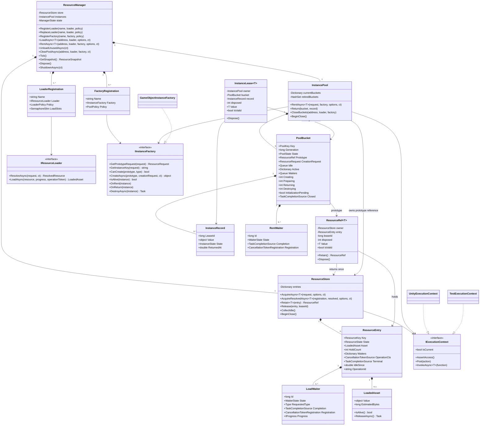

### 4.2 加载器实现和公共能力

> 历史关系图：其中 DecoderRegistry、IResourceDecoder 及其名称选择接口已由本页顶部的文件资源转换修订和第 8.2 节替代；FileLease 等旧文件缓存协议也不表示当前实现。此图仅用于追溯早期职责划分。

```mermaid
classDiagram
    direction TB
    class IResourceLoader {
        <<interface>>
    }
    class ResourcesLoader
    class SimpleAssetBundleLoader {
        -Dictionary bundleEntries
        -Func locator
    }
    class LocalFileLoader
    class RemoteFileLoader
    class AddressablesLoader {
        <<user adapter>>
    }
    class YooAssetLoader {
        <<user adapter>>
    }
    class BundleLocation {
        +string ContainerId
        +string Version
        +string LocalPathOrRemoteUri
        +string AssetName
        +List Dependencies
    }
    class BundleEntry {
        +string Identity
        +object Bundle
        +int Holds
        +List DependencyLeases
        +FileLease File
        +Task Terminal
    }
    class FileCache {
        +AcquireAsync(request, ct) FileLease
        +Invalidate(lease)
        +TrimAsync(targetBytes, ct) TrimResult
        +GetSnapshot() FileCacheSnapshot
        +ShutdownAsync(ct)
    }
    class FileLease {
        +string Path
        +Dispose()
    }
    class DecoderRegistry {
        +Register(id, decoder)
        +Resolve(request) IResourceDecoder
    }
    class IResourceDecoder {
        <<interface>>
        +string Id
        +bool RequiresSourceFile
        +DecodeAsync(path, resultType, parameters, ct) LoadedAsset
    }
    class BytesDecoder
    class TextDecoder
    class UnityImageDecoder
    class ResourceRequest
    class ResolvedResource
    class ResourceKey
    class RequestOptions
    class ResourceProgress
    class ResourceSystemOptions
    class MemoryPolicy
    class LoaderPolicy
    class PoolPolicy
    class FileCacheOptions
    class NetworkOptions
    ResourcesLoader ..|> IResourceLoader
    SimpleAssetBundleLoader ..|> IResourceLoader
    LocalFileLoader ..|> IResourceLoader
    RemoteFileLoader ..|> IResourceLoader
    AddressablesLoader ..|> IResourceLoader
    YooAssetLoader ..|> IResourceLoader
    SimpleAssetBundleLoader --> BundleLocation : private address contract
    SimpleAssetBundleLoader "1" *-- "0..*" BundleEntry
    SimpleAssetBundleLoader --> FileCache : remote container
    BundleEntry --> FileLease : pin while required
    RemoteFileLoader --> FileCache
    RemoteFileLoader --> DecoderRegistry
    LocalFileLoader --> DecoderRegistry
    DecoderRegistry --> IResourceDecoder
    BytesDecoder ..|> IResourceDecoder
    TextDecoder ..|> IResourceDecoder
    UnityImageDecoder ..|> IResourceDecoder
    IResourceLoader ..> ResourceRequest
    IResourceLoader ..> ResolvedResource
    ResolvedResource ..> ResourceKey : core adds LoaderId
    RequestOptions ..> ResourceProgress
    ResourceSystemOptions *-- MemoryPolicy
    ResourceSystemOptions *-- PoolPolicy
    LoaderPolicy *-- MemoryPolicy
    FileCache --> FileCacheOptions
    FileCache --> NetworkOptions
```

`BundleLocation` 只是内置 SimpleAssetBundleLoader 的地址适配输入，不属于 `IResourceLoader` 公共协议。用户替换加载器时无需实现它。公共接口不会暴露依赖清单格式。

### 4.3 Unity 业务适配和诊断

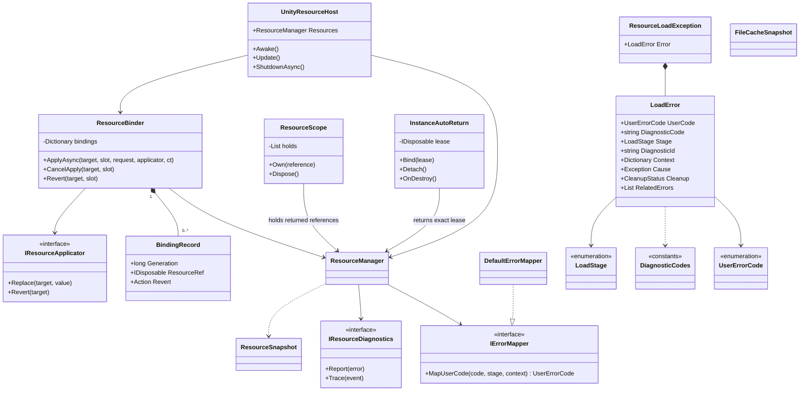

### 4.4 请求配置和状态数据

```mermaid
classDiagram
    direction TB
    class ResourceRequest {
        +string LoaderId
        +string Address
        +Type RequestedType
        +object Parameters
    }
    class ResolvedResource {
        +string LocalKey
        +Type RepresentationType
        +object Payload
    }
    class ResourceKey {
        +string LoaderId
        +string LocalKey
    }
    class PoolKey {
        +ResourceKey Prototype
        +string FactoryId
        +string InstanceKey
    }
    class RequestOptions {
        +TimeSpan Timeout
        +IProgress Progress
        +object Parameters
    }
    class ResourceProgress {
        +LoadStage Stage
        +long CompletedBytes
        +long TotalBytes
    }
    class ResourceSystemOptions {
        +string DefaultLoader
        +string DefaultFactory
        +TimeSpan MaintenanceInterval
        +TimeSpan RequestTimeout
        +MemoryPolicy Memory
        +PoolPolicy Pool
    }
    class MemoryPolicy {
        +TimeSpan IdleLifetime
        +int MaxIdleEntries
        +long MaxEstimatedIdleBytes
    }
    class LoaderPolicy {
        +int MaxConcurrentLoads
        +MemoryPolicy Memory
    }
    class PoolPolicy {
        +int MaxIdlePerResource
        +TimeSpan IdleLifetime
        +int MaxActivePerResource
    }
    class TransportContext {
        +Dictionary Headers
        +bool AllowRedirects
        +int MaxRedirects
    }
    class FileValidity {
        +ValidityMode Mode
        +TimeSpan Ttl
    }
    class TrimResult {
        +long FreedBytes
        +long RemainingBytes
        +bool TargetReached
        +List Errors
    }
    class ResourceSnapshot {
        +ManagerState State
        +int ActiveRequests
        +List ResourceRows
        +List PoolRows
        +List CleanupErrors
    }
    class FileCacheSnapshot {
        +FileCacheState State
        +long AccountedBytes
        +long ReservedBytes
        +long MaxBytes
        +int Pins
        +int Jobs
        +List FileRows
    }
    class ResourceEvent {
        +string Name
        +string OperationId
        +Dictionary Data
    }
    class ResourceRow {
        +ResourceKey Key
        +ResourceState State
        +int HoldCount
        +int WaitingCount
        +long EstimatedBytes
    }
    class PoolRow {
        +PoolKey Key
        +long Generation
        +PoolState State
        +int Active
        +int Idle
        +int InFlight
    }
    class FileRow {
        +string Key
        +long Generation
        +FileEntryState State
        +long Bytes
        +int Pins
    }
    class CleanupStatus {
        <<enumeration>>
        Complete
        Incomplete
        Unknown
    }
    class BindingResult {
        <<enumeration>>
        Applied
        Superseded
    }
    PoolKey --> ResourceKey
    RequestOptions --> ResourceProgress
    ResourceSystemOptions *-- MemoryPolicy
    ResourceSystemOptions *-- PoolPolicy
    LoaderPolicy *-- MemoryPolicy
    ResourceSnapshot *-- ResourceRow
    ResourceSnapshot *-- PoolRow
    FileCacheSnapshot *-- FileRow
    ResourceRequest ..> ResolvedResource
    ResourceRow --> ResourceKey
    PoolRow --> PoolKey
```

图中 TimeSpan/long 可空字段以第 3、9、10 节的字段表为准；为保持类图可读性省略 nullable 标记。Row 仅为不可变诊断快照，不暴露 ResourceEntry、PoolBucket 或实际资源对象。

## 5 状态和线程模型

### 5.1 执行上下文

ResourceEntry、PoolBucket 和等待者状态只在一个 `IExecutionContext` 内改变。Unity 默认实现绑定主线程；测试实现提供可手动推进的串行队列。来源加载器注册表使用短同步锁保护读写，因此请求查询来源无需投递主线程；其他组装和注册入口仍遵守各自的执行上下文要求。磁盘缓存使用自己的短临界区协调文件记录。

`LoadAsync/RentAsync` 可以从任意线程调用；加载路由和实际后端调用不为核心状态保护而投递主线程。涉及仓库有效性、持有和等待者登记时才提交执行上下文，具体 Unity API 的线程要求由后端落实。`Value/IsValid/Retain/Tick/GetSnapshot` 是同步操作，要求在上下文调用；错误线程立即抛出明确误用异常。需要后台观察快照时，通过 `context.InvokeAsync` 获取不可变快照。

`Dispose` 允许任意线程调用：先 `Interlocked.Exchange(disposed, 1)`，再 `context.Post` 一次归还。对象对外立即失效，条目计数可能在下一次调度下降。这份尚未处理的归还仍计入持有，保证不会提前卸载。上下文必须存活到所有归还、在途操作和清理完成。

规则：状态提交段不 `await` 外部操作；先登记状态，再启动异步操作，完成后重新投递提交。`TaskCompletionSource` 使用 `RunContinuationsAsynchronously`，防止完成任务时业务续体在状态修改中重入。取消注册回调只投递事件，不直接改字典。进度回调在状态提交之外执行，监听器抛异常不得让加载失败。

### 5.2 资源条目状态

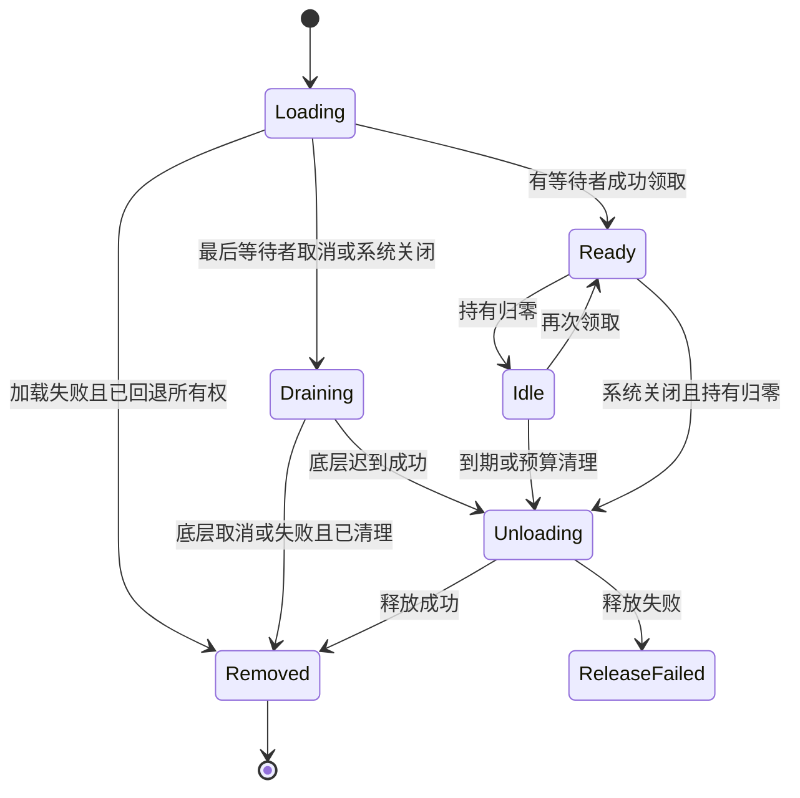

| 状态 | 不变量 | 新请求 |
|---|---|---|
| Loading | 持有数为零，底层操作至多一个，等待者可以多个 | 加入等待 |
| Draining | 取消已发出，不再接收新的等待者 | 等 Terminal 后重新解析 |
| Ready | Asset 有效，HoldCount 大于零 | 类型校验后发新持有 |
| Idle | Asset 有效，HoldCount 等于零 | 撤销空闲并发新持有 |
| Unloading | HoldCount 为零，释放已启动，键仍被占据 | 等 Terminal 后重新解析 |
| ReleaseFailed | 清理结果不确定，不能复用或重新加载同键 | 返回原清理故障的关联错误 |
| Removed | 已离开字典，Terminal 已完成 | 下次可以建立新条目 |

Ready 状态发现后端对象已被外部销毁时，标记对象失效，旧引用访问失败，新请求不能复用；等待现有持有归零后进入清理屏障，再允许新加载。此处状态可仍为 Ready 并设置 `AssetInvalid=true`，无需新增一套拥有者。

### 5.3 等待者状态

`Pending → Granted / Cancelled / Failed`，每个等待者只允许转换一次。取消事件与加载完成在串行上下文中裁定。完成处理在发放前也检查令牌是否已经取消；若已取消则不交付。若成功交付先发生，后来的取消不撤销已交付的引用，调用方负责释放。

禁止把“共享 Task 已完成”当成“调用方已经持有”。必须在 `Granted` 转换中先增加持有，然后完成该调用者专属的任务。

### 5.4 池和管理器状态

`PoolState = Initializing / Open / Closing / Closed / Faulted`。

管理器没有状态枚举，`IsInitialized` 直接查询唯一初始化任务是否成功，`IsDisposed` 单独表示退出事实；快照使用同名字段。Dispose 前可以新增未注册来源或工厂，初始化完成前才可以 ReplaceLoader。Dispose 立即作废业务入口及凭证，之后的异步清理失败只产生局部诊断，不改变初始化结果。池的 Closing/Closed/Faulted 仍用于局部清池和故障保护，不向上汇聚为管理器状态。

## 6 核心时序和伪代码

本节保留早期 `ResourceEntry` 贯穿加载的历史算法。当前加载以文首“旧状态前置检查与加载提交合并”和“加载上下文与产物分开管理”为准：不在领取结果时处理旧产物，不把共享产物发布等同于给全部等待者发放引用。

### 6.1 两个调用者共享加载并独立取消

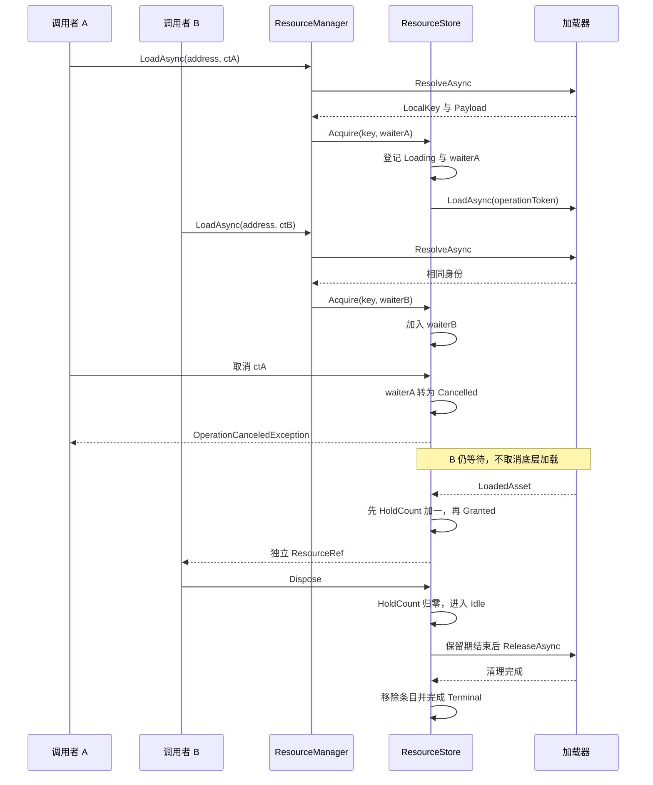

### 6.2 加载入口

```text
LoadAsync<T>(address, source, options, userCt):
    registration = Context.Invoke:
        检查管理器已经 Start 且仍开放；验证地址非空，不修改启动状态
        取得明确的 LoaderRegistration
        创建 RequestOptions 的快照
    linkedCt = Link(userCt, requestTimeout, managerDisposeCancellation)
    try:
        loop:
            linkedCt.ThrowIfCancellationRequested()
            resolved = await registration.Loader.ResolveAsync(request, linkedCt)
            校验 LocalKey 非空、RepresentationType 非空、与目标类型的契约合理
            reference = await LoadManager.AcquireResolvedAsync(registration, resolved, linkedCt)
            // 内部依次查产物、登记临时加载、按键取得执行权、加载、交付。
            // 普通加载若遇旧产物正在退出，等待其实际清理后回到 Resolve。
            return reference
    catch cancelled:
        若 userCt 取消 -> 抛带 userCt 的 OperationCanceledException
        若请求超时 -> 映射 RequestTimeout 错误
        若 manager 已 Dispose -> 映射 lifecycle.manager_disposed 错误
        其他底层取消 -> 依据当前操作取消原因处理，不伪装为用户取消
    catch e:
        保留已存在的 ResourceLoadException 和 DiagnosticId
        未分类错误归为 Unexpected，不笼统写成 NetworkIssue
    finally:
        释放 linkedCt 和超时资源
```

不维护用于全局关闭的请求计数。每次解析、等待和实际加载自行观察取消并收尾；退出后不能交付新引用，迟到产物由原加载路径释放。

### 6.3 命中与加入共享操作

```text
JoinOrAcquire(key, resolved, callerCt):  // 全程在 Context 内
    检查 manager 开放及 callerCt
    if entries 包含 key:
        e = entries[key]
        if e.State in [Draining, Unloading]: return WaitBarrier(e.Terminal)
        if e.State == ReleaseFailed: throw e.StoredCleanupError
        if e.State in [Ready, Idle]:
            if !e.Asset.IsAlive():
                e.AssetInvalid = true
                if e.HoldCount == 0: BeginUnload(e)
                return WaitBarrier(e.Terminal)  // 活跃旧持有需要先归还
            if !目标类型.IsInstanceOfType(e.Asset.Value): throw TypeMismatch
            e.HoldCount += 1
            e.State = Ready
            从空闲 LRU 和预算中移除 e
            lease = new ResourceRef<T>(store, e, NewLeaseId())
            登记诊断持有记录
            return Completed(lease)
        if e.State == Loading:
            return AddWaiter(e, callerCt)
    e = new ResourceEntry(key, Loading, new 独立 operationCts)
    entries.Add(key, e)
    callerTask = AddWaiter(e, callerCt)  // 必须先登记首个等待者
    StartLoadOutsideStateCommit(e, resolved)
    return callerTask

AddWaiter(e, callerCt):
    w = Pending waiter with async-continuation TCS
    e.Waiters.Add(w)
    w.Registration = callerCt.Register(() => Context.Post(() => CancelWaiter(e,w)))
    if callerCt.IsCancellationRequested: CancelWaiter(e,w)
    return w.Completion.Task

CancelWaiter(e,w):
    if w.State != Pending: return
    w.State = Cancelled; e.Waiters.Remove(w)
    解除取消注册；以本次调用的取消原因完成 w
    if e.State == Loading and e.Waiters.Count == 0:
        e.State = Draining
        请求取消 e.OperationCts
        // 不删 entries[key]。新请求必须等这次操作结束。
```

### 6.4 成功或失败的提交

```text
RunLoad(e, resolved):
    acquiredSlot = false
    result = null
    try:
        await registration.LoadSlots.WaitAsync(e.OperationToken)
        acquiredSlot = true
        result = await loader.LoadAsync(resolved, FanOutProgress(e), e.OperationToken)
    catch error:
        // loader 若未成功返回，必须先回退其自身中间所有权。
        await Context.Invoke(() => FailLoad(e, Normalize(error)))
        return
    finally:
        if acquiredSlot: registration.LoadSlots.Release()
    await Context.Invoke:
        // 正常返回 null 也必须提交，不能让条目永久停留在 Loading。
        // CompleteLoad 接管所有权，不允许异常逃出后再调用 FailLoad。
        // 提交内部异常也必须进入该条目的清理屏障并失败剩余等待者。
        CompleteLoad(e, result)

CompleteLoad(e, asset):
    assert entries[e.Key] 与 e 是同一对象
    e.Asset = asset
    if asset 为 null:
        失败全部 Pending 等待者为 loader.invalid_result
        移除 e；完成 Terminal
        return  // 没有向核心转交任何可释放结果
    if Value 为 null 或 !IsAlive:
        完成等待者为 loader.invalid_result；进入该非空结果的清理屏障
        return
    if e.State == Draining or manager 不开放:
        完成尚未裁定的等待者为 SystemClosed 或各自取消
        BeginUnload(e)
        return
    deliveries = 空列表
    for w in e.Waiters 的快照:
        if w 已取消或 w.Token 已请求取消: CancelWaiter(e,w); continue
        if !w.RequestedType.IsInstanceOfType(asset.Value):
            FailWaiter(w, TypeMismatch); continue
        e.HoldCount += 1
        w.State = Granted
        从 Pending 表移除 w；释放取消注册
        reference = 为 w 创建独立非池化 ResourceRef
        登记该 reference 的 leaseId
        deliveries.Add(w, reference)
    if e.HoldCount > 0: e.State = Ready
    else: BeginUnload(e)  // 无人接收的结果不进入缓存长期占用
    // 所有持有和条目状态都已提交，才可以唤醒业务。
    for (w, reference) in deliveries: w.Completion.SetResult(reference)

FailLoad(e, error):
    assert entries[e.Key] 与 e 是同一对象
    if 操作令牌已取消且 error 是正常取消且回退已完成:
        完成剩余等待者取消；移除 e；完成 Terminal
        释放 operationCts；return  // 不发故障日志
    if error.Cleanup in [Incomplete, Unknown]:
        e.State = ReleaseFailed; e.StoredCleanupError = error
        完成等待者失败；Terminal 以清理故障结束；保留同 key 故障屏障
    else:
        完成全部 Pending 等待者失败或取消
        仅当 entries[key] 仍等于 e 时移除
        e.Terminal.SetResult()
    记录一次操作级诊断；释放 operationCts
```

### 6.5 持有和卸载

```text
ResourceRef.Dispose():
    if Interlocked.Exchange(disposed, 1) == 1: return
    Context.Post(() => store.Release(entry, leaseId))

ResourceRef.Retain():
    Context.AssertAccess()
    检查本引用未释放、manager 开放、entry 为 Ready、Asset 存活
    entry.HoldCount += 1
    返回新的 ResourceRef，分配新的诊断 leaseId

Release(e, leaseId):
    若开启持有追踪则移除 leaseId，找不到时记录内部一致性错误
    // 凭证的一次性门闩和内部 entry 引用保证归还身份；诊断表不是释放授权表。
    assert e.HoldCount > 0
    e.HoldCount -= 1
    if e.HoldCount != 0: return
    if manager 不开放 or e.AssetInvalid or policy.IdleLifetime == 0:
        BeginUnload(e)
    else:
        e.State = Idle
        e.IdleSince = MonotonicNow()
        将 e 加入闲置 LRU；计入空闲内存预算
        执行超预算清理选择

BeginUnload(e):
    assert e.HoldCount == 0
    if e.State in [Unloading, ReleaseFailed]: return
    从空闲 LRU 移除；e.State = Unloading
    Start async:
        try:
            await e.Asset.ReleaseAsync()  // 最多启动一次
            Context.Invoke:
                若 entries[key] 仍是 e 则移除
                e.State = Removed; e.Terminal.SetResult()
                释放 operationCts
        catch cleanupError:
            Context.Invoke:
                e.State = ReleaseFailed
                e.StoredCleanupError = CleanupFailed with cause
                e.Terminal.SetException(e.StoredCleanupError)
                ReportOnce(e.OperationId, cleanupError)
```

同一键在取消排空和异步释放期间保持屏障，避免旧资源仍在卸载时创建另一份互相冲突的底层资源。释放故障需要加载器所有者排查；重建管理器不能自动证明旧底层资源已安全清理。

## 7 实例池算法和进程退出

### 7.1 池身份和计数

`PoolKey = 原型 ResourceKey + FactoryId + 实例表示标识`。实例表示标识由工厂的 `GetInstanceKey` 根据结果类型和影响实例内容的参数提供稳定值；普通 GameObject 工厂使用固定值。桶保存不可变的 `CreationRequest`，并在 CreateAsync 中传入，避免工厂依赖隐式可变状态。同 PoolKey 必须对应等价的创建描述。`Generation` 只区分同键池的不同生命周期，不是业务 token。

每个桶持有一份原型引用。`Idle` 保存闲置 InstanceRecord；`Active` 保存已交付记录；`Creating` 包括创建及其结果回调；`Preparing/Returning` 保护租用与归还回调；`Destroying` 只表示实际销毁操作仍未结束的数量，成功或失败后都减一。初始化及同步交付回调尚未结束时也不能释放原型。正常清池遇到销毁失败保留 Faulted 和原型；进程退出只等实际操作结束，再尝试释放所有资源，不把失败计数伪装成仍在执行的操作。

首版每个桶同时最多执行一次创建，等待者按 FIFO 分配；跨桶可以并发。这样先保证语义和可测试性，后续有测量依据再增加桶内创建并发。

### 7.2 租用和归还时序

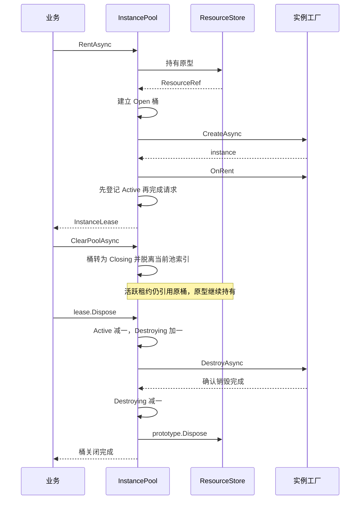

### 7.3 租用伪代码

```text
RentAsync<T>(request, factory, callerCt):
    检查 manager 初始化成功且未 Dispose
    prototypeRequest = factory.GetPrototypeRequest(request)
    通过加载器解析原型身份，形成 PoolKey
    Context:
        若没有当前桶：先登记 Initializing 桶，再启动 AcquireResolvedAsync<object>
        // 使用刚才得到的同一 registration/resolved 快照，不能重新解析后混用不同版本的 PoolKey。
        若当前同键桶是 Faulted：直接返回其清理故障，不加入等待
        保存 CreationRequest 快照；InitializationPending = true（仅新桶）
        将请求登记为 RentWaiter，注册独立取消
        记录原始 (loader,address,factory) 到该桶的关联，用于 ClearPool 捕获旧版本
    原型加载完成时在 Context:
        InitializationPending = false
        若桶已 Closing：立即归还原型，不再发放；检查桶关闭
        若加载失败或 !factory.CanCreate：失败所有等待者，回退原型，移除桶
        否则保存 Prototype；State = Open；Pump(bucket)
    返回该调用者的独立任务

Pump(bucket):
    移除已取消等待者，保持其取消结果
    if bucket.State != Open: return
    while 有 Pending waiter 且有 Idle instance 且 Active.Count + Preparing < MaxActive:
        取出 instance
        if !factory.IsAlive(instance): 丢弃记录；continue
        instance.State = Preparing；bucket.Preparing += 1
        try:
            factory.OnRent(instance)
            验证实例实际类型可以赋给 waiter.RequestedType，不符则销毁并失败该请求
            在最终交付前再次检查 manager、bucket 和 waiter
            若请求已取消或桶已关闭：从 Preparing 原子转为 Returning 或 Destroying；continue
            bucket.Preparing -= 1
            instance.State = Active
            bucket.Active.Add(instance)
            先记录租约再完成 waiter
        catch resetError:
            从 Preparing 原子转入 Destroying；安排 DestroyAsync
            失败本次 waiter 为 InstanceResetFailed
    if 有 Pending waiter 且 bucket.Creating == 0 且 Active.Count + Preparing + Creating < MaxActive:
        bucket.Creating = 1
        以桶操作令牌启动 factory.CreateAsync(prototype, bucket.CreationRequest, token)
        完成回 Context:
            bucket.Creating = 0
            若返回实例为 null 或无效：失败队首等待者，继续 Pump
            若 manager 或 bucket 已关闭：销毁实例
            否则把实例作为一个未交付记录加入候选队列，继续 Pump
            若已无人等待：按闲置容量 OnReturn 后保留，或销毁
        失败回 Context:
            if error.Cleanup in [Incomplete,Unknown]:
                FaultBucket(bucket,error)；保留在途残留记录及原型；return
            Creating = 0；清理工厂未交付对象的责任在工厂
            失败当前队首有效等待者，继续 Pump，避免无限无请求重试

Return(bucket, record):
    必须通过 lease 一次性门闩进入；确认 record 在原 bucket.Active
    Active.Remove(record)
    if !factory.IsAlive(record.Value):
        标记 Destroyed；Pump(bucket)；CheckBucketClosed(bucket)；return
    if bucket.State == Open and manager 开放 and Idle.Count < MaxIdle:
        record.State = Returning；Returning += 1
        try OnReturn(record.Value)
        catch:
            从 Returning 原子转为 Destroying，安排销毁并记录重置错误；return
        回调后再次检查 manager、bucket 和容量
        若已关闭或容量已满：从 Returning 转为 Destroying；安排销毁；return
        Returning -= 1
        record.State = Idle；ReturnedAt = MonotonicNow()
        Idle.Enqueue(record)；Pump(bucket)
    else:
        record.State = Destroying；Destroying += 1
        await factory.DestroyAsync(record.Value)
        成功回 Context: Destroying -= 1；标记 Destroyed；Pump(bucket)；CheckBucketClosed(bucket)
        失败回 Context: Destroying -= 1；标记 CleanupFailed；FaultBucket(bucket,error)；检查实际操作是否结束
```

所有工厂回调都可能触发用户脚本，必须在回调返回后重查 manager、桶状态和等待者状态。创建和销毁的实际副作用在约定上下文执行。已被外部 Destroy 的对象仍需等租约归还才能删除 Active 记录；Unity 的自动归还组件可以补上这次归还。

### 7.4 局部清池与进程退出

正常 `ClearPoolAsync` 只维护指定池，仍等待在用租约归还及实例销毁确认；退出 `Dispose` 接管所有实例，不等待业务归还。

```text
CloseBucket(bucket):
    若已 Closing / Closed / Faulted: 返回同一局部 Closed.Task
    转为 Closing，从 currentBuckets 移除
    结束未交付 waiter，取消未完成的创建
    销毁全部 Idle 实例；Active 等待正常归还
    初始化、交付回调和全部实例操作结束且无 Active/Idle 时：
        归还原型引用，移除桶，完成局部 Closed.Task
    若清理失败：保留同键故障和原型，局部 Closed.Task 报错

ResourceManager.Dispose():
    原子标记 IsDisposed；重复调用直接返回
    // 所有业务入口、ResourceRef、InstanceLease 立即据此失效
    投递到执行上下文：
        取消请求和未交付加载
        启动内部资源释放流程
    立即返回，不阻塞线程，不返回关闭任务

内部资源释放流程:
    关闭各桶，结束未交付租用
    从 Active 移除并安排销毁全部在用实例
    Preparing / Returning 不重入销毁，由当前回调完成后收尾
    等待已启动的创建、结果处理及销毁操作实际结束
    // 某次失败不能让这个等待提前完成；此处也不保证全部销毁成功
    逐项尝试释放仓库的全部 LoadedAsset，不再等待业务引用归零
    后续迟到的加载结果由其原加载路径自行释放
    每项失败局部报告，不汇总系统结果，也不自动重试
```

管理器不拥有注入的第三方 SDK 全局生命周期，也不擅自 Dispose 共享 FileCache。装配根负责释放自己拥有的组件。实例池内部完成任务只保证实际操作结束，故障后的其他在途操作仍须结束；它不复用可能提前报错的局部 `Closed.Task`，也不进入管理器快照。

宿主调用同一 `Dispose` 入口后，资源清理与文件 I/O 收尾分别进行。缓存先停止新填充并取消已有填充，`FileCache.DisposeAsync()` 等待初始化和填充实际结束后，宿主再释放自己拥有的下载器；不检查资源引用、实例租约或文件租约是否已经归还。

### 7.5 历史关闭时序（已废止）

> 此图保留用于追溯，不再是实现要求。当前退出没有等待业务归还、Shutdown 成功结果或全局排空；实际流程见 7.4。

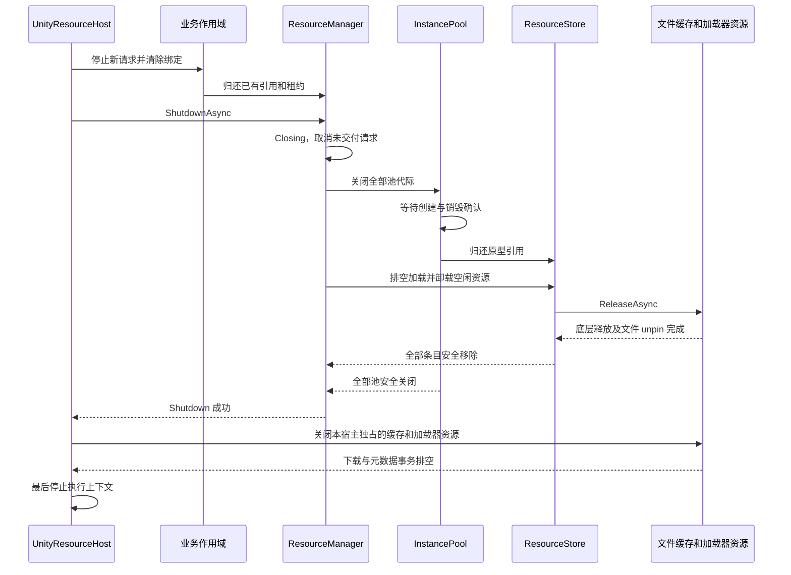

## 8 内置加载器和用户适配实现

### 8.1 能力划分

| 实现 | 输入解释 | 获取方式 | 最终清理 |
|---|---|---|---|
| ResourcesLoader | Resources 内地址和目标类型 | Unity Resources API | 可单独卸载的类型执行对应 API；其余归还管理引用并交由显式全局回收阶段处理 |
| SimpleAssetBundleLoader | 自己的 locator 返回 BundleLocation | 本地文件或 FileCache 下载，再读取包内对象 | 归还包持有，包与依赖均无人使用后清理 |
| LocalFileLoader | 文件路径、目标类型及 ConversionKey | 本地文件路径交给选定转换器 | 转换产物自带释放操作；不删除用户源文件 |
| RemoteFileLoader | URL 或加载器私有逻辑地址、目标类型及 ConversionKey | FileCache 优先本地，缺失时下载，再将路径交给选定转换器 | 转换产物自带释放操作；下载文件保留供后续复用 |
| AddressablesLoader | 用户项目地址与版本映射 | 调用 SDK 的资源加载接口 | 通过 SDK 的对应资源释放接口归还该次加载 |
| YooAssetLoader | 用户项目地址与版本映射 | 同上，由用户实现 | 同上，由用户实现 |

本地和远端描述文件位置；AB 和 Resources 描述资源读取方式。SimpleAssetBundleLoader 可以使用远端文件获取组件，不需要增加 RemoteAssetBundleLoader 或把远端 Bundle 先交给业务下载。

### 8.2 文件资源转换契约

本地和远端各一个文件加载器，共用 `FileResourceConverters`。转换表直接按请求目标类型选择实现，不需要分别编写文本、纹理、精灵加载器，也不通过转换器名称或类型探测选择实现。

```csharp
public interface IFileResourceConverter
{
    Task<LoadedAsset> ConvertAsync(string path, Type resultType,
        string? conversionKey, CancellationToken cancellationToken);
}

public sealed class FileResourceConverters
{
    public void Register(Type resultType, IFileResourceConverter converter);
    public IFileResourceConverter Get(Type resultType);
    public static FileResourceConverters CreateDefault(); // byte[]、string
}

public sealed class FileLoadParameters
{
    public readonly string? ConversionKey;
    public FileLoadParameters(string? conversionKey = null);
}
```

一个类型只能注册一个实现，重复注册报错；新增类型可直接注册，不设冻结状态或替换入口。`Get` 精确查询类型，未注册时报告 `UnsupportedRepresentation`。默认转换器为 `BytesFileConverter` 和 `TextFileConverter`；Unity 的 `UnityImageFileConverter` 同时支持 `Texture2D` 和 `Sprite`，在组装时用同一个实例分别注册两个类型。

`ConversionKey` 是传给该转换实现的参数，不是转换器选择名称。若请求需要传它，使用 `FileLoadParameters`；直接传 `string` 或其他不支持的参数对象会被拒绝。转换器必须明确验证自己支持的目标类型和参数。空字符串 ConversionKey 在构造时归一化为 null，确保相同身份传入相同转换参数。影响产物的 `ConversionKey` 和目标类型进入加载器 `LocalKey`，原始文件 `FileIdentity` 不包含二者，多种转换复用同一下载文件。

```text
文件加载器.ResolveAsync(request):
    校验来源地址和 FileLoadParameters
    converter = converters.Get(request.RequestedType)
    建立内存身份：源文件身份 + 目标类型 + ConversionKey
    将文件定位信息、converter、ConversionKey 放入本轮 Payload
    返回 ResolvedResource

LocalFileLoader.LoadAsync(resolved, progress, operationCt):
    payload = resolved.Payload
    return await payload.Converter.ConvertAsync(
        payload.Path, resolved.RepresentationType, payload.ConversionKey, operationCt)

RemoteFileLoader.LoadAsync(resolved, progress, operationCt):
    payload = resolved.Payload
    path = await fileCache.GetOrCreateAsync(
        payload.Request.Cache,
        fill = 下载委托将 payload.Request.Download 写入缓存提供的临时路径,
        operationCt)
    return await payload.Converter.ConvertAsync(
        path, resolved.RepresentationType, payload.ConversionKey, operationCt)
```

缓存命中时 `fill` 不执行；转换失败不会自动删除或失效已下载文件。两个加载器直接返回转换器给出的 `LoadedAsset`，不增加另一层释放包装或文件租约。产物创建成功后，由 `LoadedAsset.ReleaseAsync` 负责释放；本地源文件归项目所有，远端源文件仍归文件缓存管理。

转换器失败或取消时负责清理自己创建的中间对象。受控失败报告实际 `CleanupStatus`；未分类异常由加载器保留原异常并报告 `AssetConversionFailed / Convert / Unknown`，不推断清理已完成。内置 `byte[]` 遵循共享只读约定，需要修改的调用者自行复制。

核心管理器不注册、选择或持有转换器；转换器是文件加载器的执行依赖，仅由本轮解析结果持有，不进入长期产物记录。

### 8.3 极简 AssetBundle 实现

SimpleAssetBundleLoader 接收一个由用户配置的 `locator(ResourceRequest) -> BundleLocation`。可以使用旧的 `bundlePath::assetName` 格式作为该加载器的一个默认解析器，也可以接函数或字典；核心 API 不认识此格式。

`BundleLocation` 包含容器身份、明确版本、本地路径或远端 FileRequest、包内名称及可选依赖位置。它属于此实现的私有协议。默认无依赖；配置了依赖时，加载器负责加载顺序、持有与卸载顺序。首版极简实现检测并拒绝依赖环；需要完整构建清单或复杂依赖的项目通过替换加载器处理。

```text
SimpleAssetBundleLoader.ResolveAsync(request, ct):
    location = await locator(request, ct)
    校验容器身份、版本、包内资源名和资源表示
    return ResolvedResource(
        LocalKey = Encode(location.ContainerId, location.Version, assetName, representation),
        RepresentationType = 实际资源表示,
        Payload = 不可变 location)

LoadAsync(resolved, progress, operationCt):
    rootLease = null
    try:
        rootLease = await AcquireBundleGraph(resolved.Location, operationCt)
        value = await UnityContext.LoadAssetAsync(rootLease.Bundle, assetName, requestedType)
        if value 无效: throw AssetNotFound
        return LoadedAsset(value, estimate, UnityAlive,
                           () => rootLease.ReleaseAsync())
    catch:
        if rootLease != null: await rootLease.ReleaseAsync()
        保留原始失败与回退失败的诊断链，不覆盖首个原因
        throw

AcquireBundleGraph(location, callerCt):
    在加载器上下文检查当前解析路径，检测循环
    使用容器身份和版本查 BundleEntry
    对已有 Loading 容器加入独立等待者；共享操作有独立取消令牌
    对已有可用容器增加容器持有并交付 bundleLease
    对缺失容器：先登记 Loading 屏障，再执行以下作业
        按依赖位置取得每一份 dependencyLease
        本地路径直接使用；远端位置取得 FileLease
        在 Unity 上下文打开 Bundle
        完整成功后先登记等待者容器持有，再完成等待者
        失败时反向释放已取得的依赖和文件，保留同键屏障直到回退结束
    // 容器共享任务的取消、交付、卸载屏障完全遵守第 6 节模式

ReleaseBundleEntry(entry):
    归还一次容器持有
    if still referenced: return
    标记 Unloading，阻止同容器身份新开包
    await UnityContext.UnloadBundleAsync(entry.Bundle, unloadLoadedObjects=true)
    成功后依次释放依赖 leases
    最后释放仍需保护的 FileLease
    完成屏障并移除 entry；任何不确定清理失败都保留隔离记录
```

默认卸载已加载对象，前提是包的所有资产持有、池原型和其他包依赖持有都已经结束。业务若自行从预制体实例化，必须在实例存活期间继续持有对应 ResourceRef；推荐使用框架 RentAsync。不能用 `Unload(false)` 代替完整的对象所有权管理，并把留下的对象视为已经回收。

### 8.4 第三方适配要求

适配器负责 SDK 原生句柄与 `LoadedAsset` 的一对一归还。框架的业务 Retain 不自动映射为每次调用 SDK Retain；框架共享条目整体拥有一次 SDK 加载结果。

适配器可以使用 SDK 自带的本地缓存。此时同一目录不再交由框架 FileCache 移动、删改或登记。远端本地优先与容量要求仍需由该适配实现配置或补足；无法满足时必须在适配器能力说明与初始化校验中明确拒绝相应配置。

核心使用自己的 IInstanceFactory 从加载到的原型创建实例，第三方适配器不默认调用 SDK 的实例化 API。项目希望使用 SDK 原生实例化时，应提供对应工厂并明确其创建/销毁契约，不能混用两种释放路径。

## 9 配置和默认行为

### 9.1 配置结构

| 配置类型 | 字段 | 默认值或限制 |
|---|---|---|
| ResourceSystemOptions | DefaultLoader | 必须是已注册名称，可由装配入口提供 |
| ResourceSystemOptions | DefaultFactory | gameObject；没有注册时 Rent 报明确配置错误 |
| ResourceSystemOptions | MaintenanceInterval | 1 秒，使用单调时钟 |
| ResourceSystemOptions | RequestTimeout | 30 秒，可按次覆盖；null 表示无请求级超时 |
| MemoryPolicy | IdleLifetime | 10 秒；0 表示归零即卸载 |
| MemoryPolicy | MaxIdleEntries | 128；0 表示不保留空闲资源 |
| MemoryPolicy | MaxEstimatedIdleBytes | null；非 null 时为估算预算，不宣称控制全部 Unity 原生内存 |
| LoaderPolicy | MaxConcurrentLoads | 4；按已解析不同资源的实际加载计数，不按业务等待者计数 |
| LoaderPolicy | Memory | 未提供则采用系统默认的不可变快照 |
| PoolPolicy | MaxIdlePerResource | 32；0 表示归还即销毁 |
| PoolPolicy | IdleLifetime | 60 秒；无人租用的空池到期关闭并释放原型 |
| PoolPolicy | MaxActivePerResource | null；设定时超出请求等待，排队同样受请求超时约束 |
| FileCacheOptions | Directory | 装配根提供，Unity 集成可给可覆盖的运行时默认目录 |
| FileCacheOptions | MaxBytes | 512 MiB，包含数据、临时文件和缓存管理文件；必须为正 |
| FileCacheOptions | TrimToRatio | 0.8；满足申请为硬要求，达到回收目标为尽力行为 |
| FileCacheOptions | ChunkBytes | 256 KiB；未知长度逐块申请预算 |
| FileCacheOptions | MetadataAllowanceBytes | 每文件最大 16 KiB，超出拒绝提交并清理，不隐式突破预算 |
| NetworkOptions | MaxConcurrentDownloads | 4 |
| NetworkOptions | ConnectTimeout | 10 秒 |
| NetworkOptions | ResponseTimeout | 30 秒，表示等待响应头及两次有效读取之间的空闲超时 |
| NetworkOptions | MaxRetries | 2，首次之外最多两次；总尝试数为 1 + MaxRetries；只重试明确瞬态错误 |
| NetworkOptions | RetryBaseDelay | 0.5 秒，指数退避并加随机抖动 |

以上是首版工程默认值，项目可通过性能与资源规模测试调整。加载器的加载并发与 FileCache 的网络并发作用于不同阶段；不能在取得网络槽位之前持有跨组件的排他锁。

### 9.2 规则优先级

系统默认值在初始化时合并到具名加载器/工厂的配置快照。可选“资源组”覆盖由初始化时的纯函数根据 ResourceKey 选择一个不可变策略，第一次建立该条目时冻结；同键条目存活期间不得因另一个请求覆盖而改变。

请求级只覆盖超时、进度与加载器专属输入。影响结果的参数由加载器纳入身份；不会改变结果的请求参数不能修改共享缓存 TTL 或池容量。

同一对象只受一套权威策略管理。FileCacheOptions 不强制施加到第三方 SDK 缓存；若使用后者，则其适配器负责将项目意图转换为 SDK 支持的配置并执行能力校验。

### 9.3 内存与实例维护伪代码

```text
Tick():
    Context.AssertAccess()
    if 距上次维护不足 MaintenanceInterval: return
    从内存闲置 LRU 中选择到期条目，BeginUnload
    若 MaxIdleEntries 或可统计字节超限：从最旧闲置条目继续 BeginUnload
    未知 EstimatedBytes 的资源仍受条目上限和 TTL 控制，不冒充零字节
    对每个开放池：销毁到期闲置实例
    若无 Active、无等待者、无在途工作且池已空闲到期：CloseBucket
    MaxActive 配额按 Active + Preparing + Creating 计算
    在归还或销毁确认后 Pump 仍待处理的租用
    报告长期未归还引用的诊断快照，不自动强制回收
```

估算内存预算只统计由加载器报告的资源成本；共享底层依赖由加载器避免重复计量，不能把统计值当成进程 RSS 或 GPU 显存的严格上限。

## 10 磁盘缓存实施契约

本章中的组件供内置加载器和用户加载器按需复用。加载器也可以使用自己的下载与缓存；同一文件目录只能由一个缓存管理方负责。`ResourceManager.LoadAsync` 不接收下载目标路径，也不规定远端清单、目录布局、URL 组织方式。

### 10.1 职责与调用约定

远端加载器调用 `FileCache.AcquireAsync(request, cancellationToken)`，取得 `FileLease`；随后使用其 `Path` 加载资源。`FileLease` 是对实际本地文件的一次占用，`Dispose` 释放这份占用。读取完成后即可释放；如果底层加载方式在资源存活期间仍依赖该文件，加载器必须保留 lease 到底层释放完成。

`IFileTransport` 只执行一次流式远端读取，不缓存文件、不决定保存目录、不操作缓存索引。重试、并发下载合并、存储容量和本地命中由 `FileCache` 负责。内置 `HttpFileTransport` 实现该契约，用户可以提供其他传输实现。

业务明确要保存文件时使用独立的 `DownloadToAsync(source, destination, options, ct)`：目标文件归调用方，不登记为自动淘汰缓存。该入口可以复用流式传输能力，但不得向通用 `LoadAsync` 增加 `destination` 参数。若导出功能通过 `FileCache` 取得现有文件，应持有 `FileLease` 完成复制，不能把缓存内部路径转交调用方长期持有。

### 10.2 必需数据与状态

```csharp
readonly record struct FileRequest(
    FileIdentity Identity,
    Uri Source,
    TransportContext TransportContext,
    FileValidity Validity,
    long? ExpectedLength,
    string? ExpectedSha256);

readonly record struct FileIdentity(
    string Namespace,
    string ArtifactId,
    string Revision,
    string Variant);

// Namespace + ArtifactId + Revision + Variant 经明确的长度前缀编码后 SHA-256。
// 禁止使用 GetHashCode() 或有歧义的字符串拼接作为持久化键。

sealed class FileLease : IDisposable {
    string Path { get; }       // Dispose 后访问抛 ObjectDisposedException
    FileIdentity Identity { get; }
    void Dispose();           // 幂等；对象不池化；始终归还同一 FileEntry
}

interface IFileTransport {
    Task<TransportResponse> OpenReadAsync(
        FileRequest request, CancellationToken cancellationToken);
}

sealed class TransportResponse : IAsyncDisposable {
    Stream Body { get; }       // 只前进读取；不隐藏整文件内存缓冲或磁盘缓存
    long? ContentLength { get; }
    int? StatusCode { get; }
    string? ETag { get; }
    void Abort();             // 尽力停止底层 I/O，不代替完成后的清理
}
```

`TransportContext` 承载请求头、鉴权上下文、允许的重定向策略等传输数据；其原文不进入磁盘索引和日志。`Variant` 承载会改变文件内容的稳定上下文标识，例如租户、语言、权限域、压缩或表示形式；使用业务提供的非敏感稳定标识或摘要，不能以原始令牌作为缓存键。不同上下文可访问不同内容时必须产生不同身份。

`TransportContext` 的首版字段为只读 Headers、AllowRedirects 和 MaxRedirects，默认允许最多 5 次 HTTP 重定向且拒绝跨主机转发敏感鉴权头。业务身份隔离由 FileIdentity.Variant 决定，不能把不同用户的私有内容放入同一身份。

同一内容可以有不同的临时签名 URL，故 `Source` 与缓存身份分开。明确版本的请求以版本隔离；动态 URL 没有版本时必须配置有效期，或由加载器在业务更新时切换 Revision。`FileValidity` 仅定义两种第一版模式：`Immutable`（调用方承诺身份对应内容不变）和 `ExpiresAfter(ttl)`。不得把未版本化可变地址默认当作永久有效内容。TTL 内有效命中零网络；TTL 到期视为未命中，第一版重新下载，不实现条件请求和断点续传。

文件 TTL 控制下一次 FileCache.AcquireAsync 是否可复用磁盘文件，不会自动替换仍在内存缓存或被业务持有的对象。内存表示的刷新由加载器改变版本身份，或等待旧条目按内存策略退出后重新加载。需要明确的在线内容更新时，加载器应返回新的版本 LocalKey；仅设置文件 TTL 不承诺业务对象按该周期热更新。

`FileEntry` 字段：

| 字段 | 含义 |
|---|---|
| `Identity / Key` | 文件身份及持久化键 |
| `Generation` | 同一身份的本地文件代次，lease 绑定具体代次 |
| `State` | `Ready / Retired / Deleting / Garbage` |
| `Path / MetadataPath` | 根目录内的实际文件和提交元数据 |
| `Length / Digest` | 校验完成后的文件长度与内容摘要 |
| `StoredAtUtc / ValidUntilUtc` | 持久化有效性信息 |
| `LastAccessUtc` | 淘汰排序依据，命中时更新 |
| `PinCount` | 实际文件使用者数量 |
| `DeleteError / NextDeleteAttempt` | 删除失败保留的诊断和退避时间 |

`Ready` 可交付；`Retired` 因过期、替换或清理请求停止交付，但 pin 未归零时仍保留；`Deleting` 已从可查索引中移除并正在删除；`Garbage` 删除失败或启动发现的未提交文件，只占用容量、不交付。`Ready -> Retired -> Deleting -> 消失` 是正常删除路径，`Deleting -> Garbage -> Deleting` 是重试路径。禁止 `Deleting -> Ready`，禁止把同一个条目重置为另一份文件。

`DownloadJob` 字段：

| 字段 | 含义 |
|---|---|
| `Key / Generation / Request` | 合并下载用的身份、尝试代次和请求快照 |
| `State` | `Queued / Opening / Downloading / Verifying / Committing / Succeeded / Failed / Abandoning / Cleaned` |
| `Waiters` | 等待者表，等待者独立状态为 `Pending / Granted / Cancelled / Failed` |
| `PartPath / CandidatePath` | 本次临时文件和最终不可变代次路径 |
| `WrittenBytes / ReservedBytes` | 已计量磁盘占用与尚未写入的容量预留 |
| `Attempt / OperationId` | 重试次数和诊断关联编号 |
| `CancellationSource` | 所有等待者退出或系统关闭时取消底层作业 |
| `Terminal` | 本次作业 I/O 结束并完成容量记账后的屏障，取消后的新请求等待它 |

等待者使用异步完成 continuation，禁止在状态提交锁或串行调度回调中直接执行用户代码。一个等待者最多获得一个结果；完成与取消由同一个状态调度器裁定。等待者终结后必须注销 cancellation registration；可能等待回调完成的 Dispose 操作放到状态调度事务外，避免相互等待。

### 10.3 完整组件类图

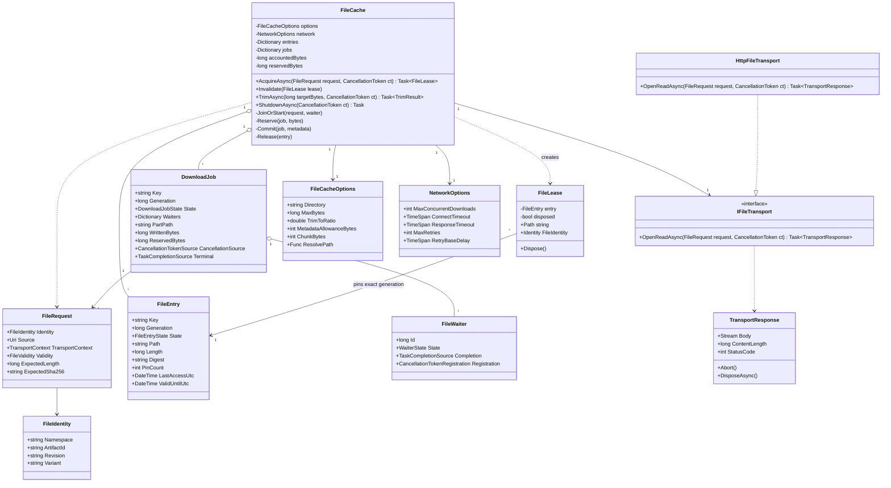

`Dictionary` 的 key/value 在实现时分别采用 `CacheKey -> FileEntry`、`CacheKey -> DownloadJob`、`WaiterId -> FileWaiter`。必要的时间、文件系统和调度依赖可以注入以便测试，不要求先建立一组只转发 API 的抽象层。

### 10.4 命中与下载时序图

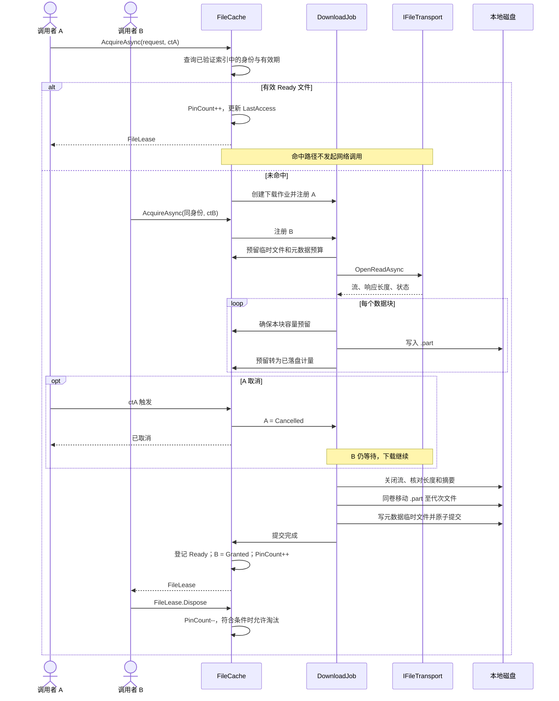

### 10.5 容量算法及不变量

设：

```text
A = 根目录中已存在文件的已计量字节总和
    包括 Ready、Retired、Garbage、下载 .part、元数据和遗留文件
R = 所有作业尚未落盘的容量预留之和
U = A + R
M = 配置的 MaxBytes
```

正常运行时每次新的写入授权都必须满足 `U <= M`。缓存预算以文件逻辑长度计量，不等同于文件系统实际分配块数；实际磁盘空间不足仍由 I/O 错误单独处理。元数据大小必须有上限并提前预留；锁文件等固定管理开销启动时计入。禁止持久化无界日志到缓存目录。

写入 n 字节前已有至少 n 字节预留；写入完成后执行 `A += n, R -= n`，因此总计量不增加。失败或部分写入后，以文件实际长度重新核对 A，不能根据抛异常就认定一个字节都没写入。释放“尚未写入的预留”可以减少 R；删除文件只有在文件已确认不存在后才能减少 A。

启动时磁盘占用可能已经超过新的 M；此时进入只允许命中、释放与回收的状态，拒绝新的写入预留，直到回收满足预算。pin 文件始终保留。一次回收后是否满足预算以当前 A、R 重新计算，不能相信预计可释放量。

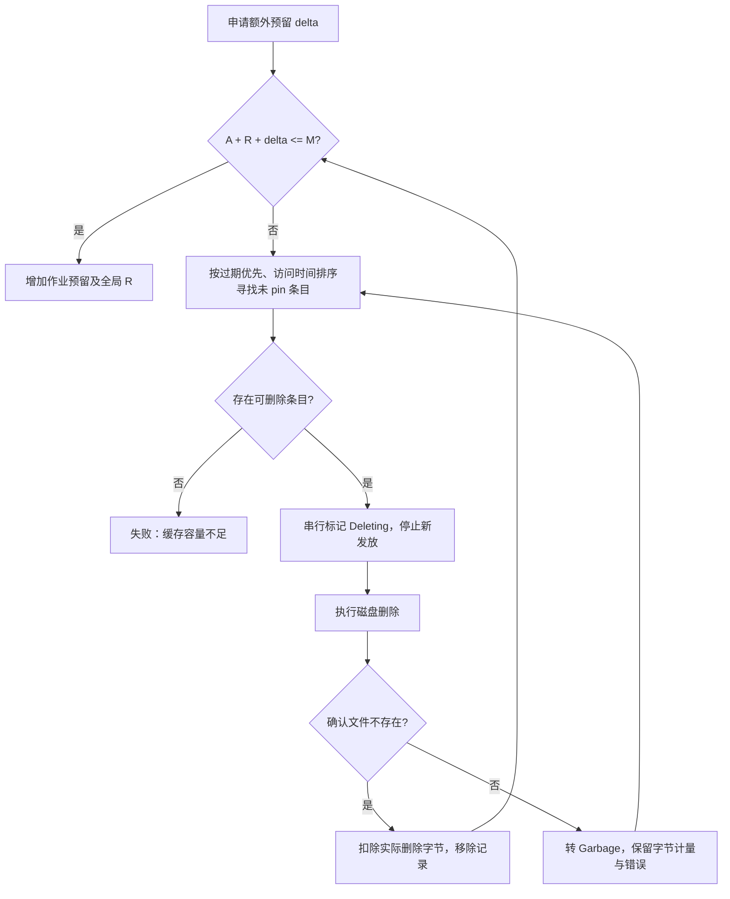

回收目标可以设为 `M * TrimToRatio` 以腾出余量，但不能为达到目标删除 pin 文件。为一个块申请容量时只要求满足该块；回收目标是优化，不构成额外失败条件。

### 10.6 核心伪代码

所有缓存身份、条目状态、等待者、pin、A/R 更新在同一个串行状态调度器 S 中执行。网络和文件 I/O 在外执行，完成后回到 S 提交。下列 `S { ... }` 表示一次不可被其他状态变更插入的事务，不允许在其内部等待 I/O。

```text
AcquireAsync(request, callerToken):
    ValidateRequest(request)
    key = EncodeAndHash(request.Identity)
    loop:
        callerToken.ThrowIfCancellationRequested()
        waiter = new FileWaiter(State=Pending, Job=null)
        register cancellation => Post S { CancelWaiter(waiter) }
        barrier = null
        S:
            if cache closing: fail waiter with SystemClosing
            else if callerToken cancelled: CancelWaiter(waiter)
            else:
                if ready[key] exists:
                    AssertCompatibleDescriptor(entry, request) // 包括不可变摘要与有效性规则
                if ready[key] exists and ValidFor(request, entry):
                    entry.PinCount++
                    entry.LastAccessUtc = clock.UtcNow; entry.DirtyAccess = true
                    waiter.State = Granted
                    complete asynchronously with new FileLease(entry)
                else:
                    if ready[key] exists:
                        remove ready[key]; mark old entry Retired // old pin 继续使用
                    if jobs[key] exists and job is not accepting:
                        barrier = job.Terminal // 本轮 waiter 不进入作业
                    else:
                        if jobs[key] missing:
                            job = new DownloadJob(key, freshGeneration, request)
                            jobs[key] = job
                        AssertCompatibleDescriptor(job.Request, request)
                        waiter.Job = job; add waiter to job
                        若是新 job，enqueue RunJob(job) // 必须在加入首个 waiter 后
        if barrier != null:
            注销本轮取消注册
            await WaitOnly(barrier, callerToken)
            continue
        try: return await waiter.Task
        finally: 注销取消注册

CancelWaiter(waiter):
    if waiter.State != Pending: return
    waiter.State = Cancelled
    remove from accepting waiters
    complete cancellation asynchronously
    if job exists and has zero Pending waiters:
        job.State = Abandoning
        signal job cancellation
        # 保留 jobs[key] 为非接收状态，后来同身份请求等待 Terminal。
        # 旧预留和 .part 在清理完成前仍计入容量；不同时开启第二个同身份下载。

RunJob(job):
    slotAcquired = false
    try:
        await global download slot with job cancellation
        slotAcquired = true
        await RunAttempts(job)
    catch earlyError:
        // 包括等待下载槽位时取消，不能让 job 和 Terminal 悬挂。
        在 S 中终结仍 Pending 的等待者，保留正常取消语义或准确错误
    finally:
        await 关闭本次响应和写句柄，清理尚未转交 FileEntry 的临时路径
        在 S 中核对残留实际长度，未删除字节继续计入 Garbage 和 A
        释放尚未写入预留
        S:
            remove jobs[key] ONLY IF it still points to this job
            job.Terminal.TrySetResult()  // 清理残留已经入账，不代表每个垃圾文件都删除成功
            检查缓存关闭完成条件
        if slotAcquired: release global download slot

RunAttempts(job):
    for attempt in 1..(1 + MaxRetries):
        if job Abandoning: goto CLEANUP
        create exclusive unique empty .part in owned staging directory
        EnsureReservation(job, MetadataAllowanceBytes)
        if request.ExpectedLength known:
            EnsureReservation(job, request.ExpectedLength + metadata need)
        response = await transport.OpenReadAsync(request, job.Token)
        ValidateStatusAndHeaders(response, request)
        if response.ContentLength known:
            EnsureReservation(job, response.ContentLength + metadata need)
        loop:
            chunk = await response.Body.ReadUpTo(ChunkBytes, job.Token)
            if chunk empty: break
            EnsureReservation(job, chunk.Length + metadata need)
            # EnsureReservation 的参数是当前至少需要的剩余预留，
            # delta = max(0, requiredRemaining - job.ReservedBytes)
            write chunk to .part; update rolling hash
            S: move actual newly written length from R to A
            if written exceeds ExpectedLength: fail IntegrityMismatch
        close and flush data stream
        verify final length against both trusted ContentLength and ExpectedLength when present
        verify ExpectedSha256 when supplied
        S: if job Abandoning or cache closing: goto CLEANUP
        validate candidate path; move .part to unique candidate in same volume
        create bounded metadata temp; count its bytes using same reservation rule
        metadata includes key, full identity fields, generation, relative path,
            final length, computed digest, timestamps, metadata schema version
        atomically move metadata temp to unique committed metadata name
        S:
            if Abandoning or closing:
                account candidate and metadata as Garbage; goto CLEANUP
            entry = Ready(candidate, metadata, pin=0)
            retire any prior Ready generation for key
            ready[key] = entry
            for each waiter still Pending:
                if waiter.Token 已取消: CancelWaiter(waiter); continue
                entry.PinCount++
                waiter.State = Granted
                queue completion(new FileLease(entry))
            release unused reservation
            job.State = Succeeded
            将 committed data/metadata 从 job 的临时路径表转交 FileEntry 所有
            若最终没有成功交付者：entry 转为 Retired 并安排删除
        return
      on failure error:
        capture observed fact, stage, operation id and original exception
        await CloseResponseAndReconcileWrittenLength()
        await DeleteAttemptFilesOrKeepAsGarbage()
        release only remaining unwritten reservation
        if job Abandoning: goto CLEANUP
        if retryable AND attempts remain:
            wait bounded exponential backoff with cancellation
            continue                         # 从零重新下载，重新申请容量
        S:
            job.State = Failed
            fail every Pending waiter with structured error
        return
    CLEANUP:
        await close response and all write handles
        await reconcile actual lengths and delete attempt files
        S:
            retain failed-delete files in Garbage and A
            release unused reservation
            fail/cancel any still Pending waiter as appropriate
            job.State = Cleaned
        return  // 作业最外层 finally 统一完成屏障与归还下载槽位
```

`EnsureReservation` 可以执行异步回收；决定候选和标记 `Deleting` 在 S 内，实际删除在 S 外，结果回到 S 更新计量。必须循环重新检查，因为其他下载可能先取得预算。无可删除候选时结束，不等待使用者无限期释放，也不无限重试同一个删除失败文件。

```text
EnsureReservation(job, requiredRemaining):
    loop:
        S:
            检查 job 尚可执行，预留值非负
            delta = max(0, requiredRemaining - job.ReservedBytes)
            if A + R + delta <= MaxBytes:
                R += delta; job.ReservedBytes += delta; return
            candidate = 最旧的到期或闲置未 pin 文件，跳过正在删除或删除退避中的条目
            if candidate 不存在: throw cache.capacity_exceeded
            candidate.State = Deleting；停止新发放；登记删除事务
        await 删除 candidate 的已验证受管路径
        S:
            对确认已消失的文件扣减 A
            失败残留设 Garbage 并设置 NextDeleteAttempt，不立即重复选择
            结束删除事务
        // 回到循环重新检查当前 A/R，其他作业可能已获得预算。
```

已知长度可以提前保留整文件预算；未知长度只在内存中读取一个有上限的数据块，然后先取得该块磁盘预算再写入。`ChunkBytes` 和下载并发上限共同限制网络缓冲的内存占用。HTTP Content-Length 与实际写入长度必须对应同一种字节表示；第一版 HTTP 实现关闭隐式内容解压，若加载器需要解压，作为下一步加载处理并使用不同资源身份。

```text
Invalidate(lease):
    S:
        require lease belongs to this cache and is not disposed
        entry = lease.originalEntry
        if ready[key] points to entry: remove ready[key]
        if entry.State == Ready: entry.State = Retired
        # 此时 lease 仍 pin 该文件；调用方随后 Dispose 才允许回收

ReleaseLease(lease):
    if AtomicExchange(lease.disposed, true) was true: return
    S:
        entry = lease.originalEntry
        assert entry.PinCount > 0
        entry.PinCount--
        if entry.PinCount == 0 and entry.State == Retired:
            enqueue deletion
        if closing and all jobs drained and all pins zero:
            complete cache shutdown and release directory ownership lock

DeleteCandidate(entry):
    S:
        if entry.PinCount != 0: return NotEligible
        if entry.State already Deleting: return AlreadyInProgress
        remove matching ready index reference
        entry.State = Deleting
        capture exact owned paths and their counted lengths
    outside S:
        close any owned handle before delete
        delete each owned file; inspect which paths are confirmed absent
    S:
        subtract A only for confirmed absent counted files
        if all absent: remove entry
        else: entry.State = Garbage; retain residual size and delete error
```

取消与交付以先在 S 中完成的状态变更为准：取消先发生，则不发放 lease；交付先发生，则调用者取得 lease 并负责 Dispose，稍后取消不能暗中撤销已经发出的文件持有。底层操作即使不能及时停止，也必须执行迟到结果清理。

两个等待者声明相同身份，却提供冲突的预期长度、摘要或身份有效性语义，返回 `IdentityConflict`，不任意采用第一份配置。签名 URL 或临时凭证更新不自动构成内容冲突；运行中的下载使用启动时的传输快照，新的有效凭证由加载器在本次作业结束后的新请求中提供，运行中的作业不静默变更请求上下文。

上述描述兼容性校验同样适用于 Ready 命中：同一不可变身份与不同摘要/长度的请求是身份冲突，不能把旧版本悄悄当成过期文件替换。TTL 到期可创建新代次，但同一身份的有效性规则必须一致。

### 10.7 原子提交、重启恢复与目录约束

文件提交采用“数据文件完成后提交元数据”的顺序。数据文件与元数据不能假定跨两个文件原子提交；**只有完成原子重命名的元数据记录才是提交标记**。数据文件采用不可变代次路径，禁止覆盖旧代次。因此存在以下恢复规则：

| 启动发现的状态 | 处理 |
|---|---|
| 提交元数据有效，数据文件存在且长度/身份合法 | 重建 Ready 条目 |
| 元数据存在，但文件缺失、长度不符或路径非法 | 不交付，移除无效元数据并记录诊断 |
| 数据文件存在，但没有已提交元数据 | 作为 Garbage 计入容量并回收 |
| `.part` 或临时元数据残留 | 第一版不恢复下载，计入容量并回收 |
| 同身份多个已提交代次 | 按有效提交时间与代次选择最新有效项，其余转 Retired 待回收 |
| 删除失败 | 保留占用，后续退避重试 |

启动次序：取得目录独占锁 → 枚举受管理文件并统计占用 → 校验元数据、建立索引 → 清理孤立文件 → 容量回收 → 对外接受请求。内存索引可以完全由提交元数据重建，不要求一个全局数据库成为唯一真相。默认校验长度和元数据结构；可信本地目录中，摘要在首次下载时验证并记录，可配置启动完整摘要校验。运行期间只允许 FileCache 修改根目录，因此命中使用已验证索引，不在状态调度器内等待磁盘扫描。若加载器打开缓存文件时仍遇到文件缺失或校验失败，应通过 FileCache.Invalidate(FileLease) 将该具体代次标记 Retired，然后释放 lease 并按加载器重试策略重新获取；Invalidate 不删除 pin 文件，也不使已发出的 lease 改指新文件。并发外部写入不受支持。

访问时间在内存中立即更新并标记 DirtyAccess，默认每 60 秒或正常关闭时批量持久化。更新一个元数据时先持有内部 pin、按同一预算预留临时元数据空间，写完后原子替换该代次的元数据并核对 A/R；数据文件永不覆盖。删除与其他元数据更新不能和这一事务并发。没有空间写访问元数据时可暂缓，不能为记录一次命中触发加载失败。异常退出最多丢失最近一批访问记录，重启按最近已持久化的访问时间排序。元数据事务也计入关闭等待，全部完成后才释放目录锁。

容量按管理文件的逻辑字节长度核算，文件系统块分配和目录项开销不属于精确可控预算；真实磁盘空间耗尽仍通过 `cache.disk_full` 报告。控制文件和已有索引文件的实际长度必须进入 A，不能以缓存预算推断操作系统还有足够空间。

根目录是专用目录。第一版同一根目录只允许单进程、单 `FileCache` 实例写入：持有 OS 独占锁直到下载排空、pin 全部归零、缓存关闭完成。第二实例无法取得锁时启动失败。进程异常终止由 OS 释放锁，下次启动执行恢复。不同进程共享写入需另行设计，不通过忽略锁错误实现。

自定义路径映射只返回相对于根目录的路径，实际文件名应包含框架生成的 key 与 generation 后缀避免覆盖。所有最终路径必须：

1. 拒绝绝对路径、`..` 跳出、根目录本身、保留管理文件名以及非法文件名；
2. 经规范化后以 `root + separator` 为目录边界比较，Windows 按实际文件系统规则处理大小写；
3. 拒绝根目录和目标祖先中的符号链接、junction/reparse point，防止重定向到目录外；
4. 在创建、移动、删除前重新验证路径归属，独占缓存目录不得被外部进程修改；
5. 临时文件和最终文件位于同一卷，并采用不覆盖已有文件的提交方式。

日志不得输出鉴权头、Cookie、签名查询参数；URL 可保留 scheme/host/path 和脱敏后的必要字段。索引只保存可重建资源身份和文件信息，不保存传输凭证。

### 10.8 网络错误的双层表示

文件组件使用第 11 章的同一 LoadError 和稳定诊断码。传输 URI 错误、DNS、连接、TLS、网络超时、HTTP 状态、文件系统失败、磁盘配额和校验失败分别归类；例如 `network.dns_failed` 映射为 NetworkProblem，`cache.capacity_exceeded` 映射为 StorageFull。不能把后续磁盘或转换失败归为网络错误。

每次下载作业的 OperationId 用于串联尝试记录；最终失败的 DiagnosticId 用于错误去重，两者通过诊断 Context 关联。作为资源加载的子操作时，由上层资源操作统一发布最终故障，文件组件只附加证据。主动取消不映射为网络故障；调用者超时只取消自己的等待，传输阶段超时影响该下载尝试。

伪代码中的 `IdentityConflict`、`IntegrityMismatch`、`SystemClosing` 等短名分别使用 `cache.identity_conflict`、`cache.integrity_failed`、`lifecycle.manager_disposed` 常量，不建立另一套错误枚举。

### 10.9 验收用例

- 有效文件已存在时传输层调用次数为 0；过期后只触发一次共享下载。
- 同一版本不同签名 URL 正确共用缓存；不同租户或内容表示不能混用。
- 多个等待者只下载一次；一个取消不影响其他；全部取消后迟到结果被清理。
- 取消与提交在两种执行顺序下都只完成等待者一次，pin 无泄漏或负数。
- 同时下载多个已知/未知长度文件，每次写入授权后 `A + R <= M`。
- 部分写入失败、删除失败、重试期间旧临时文件残留时容量记账正确。
- 只有 pin 文件可回收时返回容量错误，任何清理操作都不能强删 pin。
- 在每个提交步骤强制终止进程，重启后不交付半文件，索引可以重建。
- 过期文件仍被 lease 使用时可加载新代次，旧 lease 只归还旧代次。
- 根目录第二写入者被拒绝；路径映射越界及 junction 跳转被拒绝。
- 文件保留期、版本与用户错误映射可配置；错误日志不泄露传输凭证。


## 11 两层错误契约

### 11.1 对外行为

`LoadAsync`、`RentAsync` 等资源操作失败时，统一抛出 `ResourceLoadException`，其 `Error` 为不可变 `LoadError`；不再返回失败 ResourceRef，不允许调用方既检查凭证状态又捕获资源异常。主动取消返回 `OperationCanceledException`，不映射成用户错误，也不生成故障级日志。参数为空、重复注册、访问已释放凭证等编程错误按标准 .NET `ArgumentException`、`InvalidOperationException`、`ObjectDisposedException` 及时暴露；它们不伪装成加载过程失败。

```csharp
public enum UserErrorCode
{
    NetworkProblem,       // 网络问题，请稍后重试
    ResourceUnavailable, // 资源暂时无法加载
    StorageFull,         // 存储空间不足
    LocalAccessProblem,  // 无法读取或保存本地资源
    ResourceDamaged,     // 资源校验失败，请重试
    OperationUnavailable,// 当前无法完成此操作
    Unknown              // 加载失败，请稍后重试
}

public enum LoadStage
{
    ValidateRequest, Route, Resolve, WaitForLoad,
    CacheLookup, ReserveCapacity, Download, ValidateContent,
    ReadFile, Convert, LoadAsset, Instantiate, ApplyBinding,
    ReleaseAsset, ReturnInstance, DestroyInstance,
    CacheEvict, Shutdown
}

public enum CleanupStatus { Unknown = 0, Complete = 1, Incomplete = 2 }

public sealed class LoadError
{
    public UserErrorCode UserCode { get; init; }
    public string DiagnosticCode { get; init; }
    public LoadStage Stage { get; init; }
    public string DiagnosticId { get; init; }
    public IReadOnlyDictionary<string, object> Context { get; init; }
    public Exception Cause { get; init; }
    public CleanupStatus Cleanup { get; init; }
    public IReadOnlyList<LoadError> RelatedErrors { get; init; }
}

public sealed class ResourceLoadException : Exception
{
    public LoadError Error { get; }
    // Message 为技术摘要，不是直接显示给用户的文案。
    // InnerException = Error.Cause。
}

public interface IErrorMapper
{
    UserErrorCode MapUserCode(
        string diagnosticCode,
        LoadStage stage,
        IReadOnlyDictionary<string, object> context);
}
```

`init` 仅为伪代码表达不可变；实现时使用目标 Unity/C# 版本支持的只读字段与构造函数即可。`UserErrorCode`、`LoadStage` 的上述取值是第一版完整集合；没有 `None` 和 `Cancelled`，因为 `LoadError` 只描述真正的失败。持久化错误码使用稳定名称，不依赖枚举序号。

`DiagnosticCode` 采用稳定字符串常量而非封闭 enum，原因是用户加载器需要添加自己的诊断码而不修改框架。框架内置常量类 `DiagnosticCodes`；第三方实现使用 `addressables.*`、`yooasset.*` 或公司前缀。框架对未知码映射为 `Unknown` 并原样保留诊断。

`Cleanup` 描述本次操作已经取得但尚未交付的所有权是否完成回退。纯校验失败、查无资源等没有取得任何所有权的失败设 Complete；清理明确失败设 Incomplete；无法确认设 Unknown。所有内置组件必须显式赋值，不用枚举零值推断。`RelatedErrors` 保存回退过程的关联失败，主错误码与原始原因保持不变。Release 本身失败时 Cleanup 必须为 Incomplete 或 Unknown。

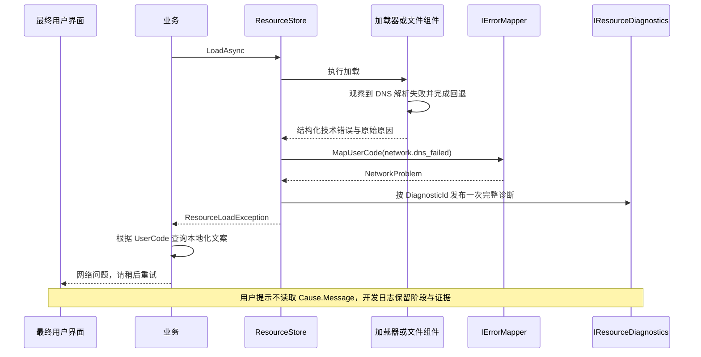

### 11.2 默认诊断码与映射

| DiagnosticCode | 证据/含义 | 默认 UserCode | 默认 Stage |
|---|---|---|---|
| `loader.not_registered` | 指定加载器不存在 | OperationUnavailable | Route |
| `loader.resolve_failed` | 地址无法解析，已保留具体原因 | ResourceUnavailable | Resolve |
| `loader.invalid_result` | 返回 null、缺失结果或违反接口契约 | OperationUnavailable | LoadAsset |
| `asset.not_found` | 已确认查不到目标资源 | ResourceUnavailable | LoadAsset |
| `asset.type_mismatch` | 实际类型与请求类型不兼容 | ResourceUnavailable | LoadAsset |
| `asset.version_mismatch` | 加载结果不对应所解析版本 | ResourceUnavailable | ValidateContent |
| `asset.decode_failed` | 转换器拒绝内容或报告格式问题 | ResourceDamaged | Convert |
| `asset.unsupported_representation` | 未注册目标类型对应的转换器 | ResourceUnavailable | Convert |
| `asset.load_failed` | 后端明确报告加载失败，但无更细证据 | ResourceUnavailable | LoadAsset |
| `network.invalid_uri` | 远端地址格式/协议非法 | NetworkProblem | Resolve |
| `network.dns_failed` | 域名解析失败 | NetworkProblem | Download |
| `network.connect_failed` | TCP/传输连接建立失败 | NetworkProblem | Download |
| `network.tls_failed` | TLS 握手/证书校验失败 | NetworkProblem | Download |
| `network.timeout` | 已知连接、响应头或响应体阶段超时 | NetworkProblem | Download |
| `network.interrupted` | 连接已建立后中断，正文未完整接收 | NetworkProblem | Download |
| `network.http_not_found` | HTTP 404/410 | ResourceUnavailable | Download |
| `network.http_denied` | HTTP 401/403；不自动推定需要用户登录 | ResourceUnavailable | Download |
| `network.http_throttled` | HTTP 429，保留 Retry-After | NetworkProblem | Download |
| `network.http_server_error` | HTTP 5xx | NetworkProblem | Download |
| `network.http_unexpected` | 其他不符合下载协议的 HTTP 状态 | ResourceUnavailable | Download |
| `network.protocol_error` | 分段、内容长度或响应协议不符合约定 | NetworkProblem | Download |
| `request.timeout` | 本调用者等待超过请求时间预算 | NetworkProblem（远端）或 ResourceUnavailable | WaitForLoad |
| `file.not_found` | 本地文件不存在 | ResourceUnavailable | ReadFile |
| `file.access_denied` | 明确的文件系统权限错误 | LocalAccessProblem | ReadFile/Download |
| `file.io_failed` | 未能进一步分类的本地 IO 错误 | LocalAccessProblem | 对应实际阶段 |
| `cache.capacity_exceeded` | 缓存预算不足且无足够可回收空间 | StorageFull | ReserveCapacity |
| `cache.disk_full` | 操作系统报告实际磁盘空间不足 | StorageFull | Download |
| `cache.entry_too_large` | 单文件已大于允许容量 | StorageFull | ReserveCapacity |
| `cache.path_invalid` | 自定义路径无效、越出受管目录或冲突 | LocalAccessProblem | CacheLookup |
| `cache.identity_conflict` | 相同身份声明不兼容的摘要、长度或有效期规则 | OperationUnavailable | CacheLookup |
| `cache.root_in_use` | 同一缓存根目录已有写入管理方 | OperationUnavailable | CacheLookup |
| `cache.integrity_failed` | 长度/内容校验失败，文件不能交付 | ResourceDamaged | ValidateContent |
| `cache.index_failed` | 缓存记录读取/持久化失败 | LocalAccessProblem | CacheLookup |
| `cache.commit_failed` | 临时文件无法提交为已完成文件 | LocalAccessProblem | ValidateContent |
| `cache.delete_failed` | 淘汰文件删除失败 | LocalAccessProblem | CacheEvict |
| `instance.unsupported` | 当前工厂不能实例化目标原型 | OperationUnavailable | Instantiate |
| `instance.pool_closed` | 本次租用等待期间原池已关闭 | OperationUnavailable | Instantiate |
| `instance.create_failed` | 实例工厂未创建成功 | ResourceUnavailable | Instantiate |
| `instance.reset_failed` | 租用/归还重置失败 | OperationUnavailable | Instantiate/ReturnInstance |
| `instance.destroy_failed` | 销毁失败，仍需保留诊断与相关持有 | OperationUnavailable | DestroyInstance |
| `binding.apply_failed` | 将新资源应用到目标失败 | OperationUnavailable | ApplyBinding |
| `binding.revert_failed` | 清除或还原目标属性失败 | OperationUnavailable | ApplyBinding |
| `lifecycle.manager_disposed` | 服务已发起退出，拒绝业务访问与新交付 | OperationUnavailable | Dispose |
| `lifecycle.release_failed` | 底层释放回调失败，结果状态未知 | OperationUnavailable | ReleaseAsset |
| `sdk.load_failed` | SDK 报告失败但没有结构化证据进一步分类 | ResourceUnavailable | LoadAsset |
| `sdk.release_failed` | SDK 释放调用失败 | OperationUnavailable | ReleaseAsset |
| `bundle.dependency_cycle` | 内置极简加载器检测到不支持的依赖环 | ResourceUnavailable | Resolve |
| `observer.callback_failed` | 进度、日志或业务接收回调自身抛异常 | OperationUnavailable | 发生时的阶段 |
| `internal.unexpected` | 无法分类的未预期异常 | Unknown | 发生时的阶段 |

映射允许由业务替换。例如面向最终玩家，404 与 DNS 故障可以都显示“网络问题”；开发诊断仍必须分别保留 404 和 DNS 错误。网络组件记录的实际错误阶段优先于表中默认值。不能因为请求最初来自 URL，就把随后发生的磁盘满、转换错误或编程缺陷统一归为网络错误。

### 11.3 上下文、事实与推断

每条错误至少带 `loaderId`、请求/资源身份（如已知）、操作编号、耗时以及对应阶段。按故障增加以下上下文：

| 场景 | 应记录字段 |
|---|---|
| 网络 | 脱敏 URL、主机、HTTP 状态、系统/传输错误码、超时阶段、超时预算、尝试次数、收到字节数 |
| 文件/缓存 | 相对受管路径、预期/实际大小、预算、已完成占用、临时占用、预留空间、可回收量 |
| 类型/转换 | 请求类型、实际类型、ConversionKey、版本、校验类型与结果 |
| SDK | SDK 名称/版本、原始错误码、操作标识、原始异常链 |
| 生命周期 | 共享记录标识、当前状态、持有数、待交付数、池实例标识、在用/闲置/销毁待完成数 |

`Context["facts"]` 保存可观察事实，例如 `DnsFailure`、`HttpStatus=404`、`ConnectElapsedMs=10000`。`Context["hypotheses"]` 可保存排查建议，例如“检查域名配置或 DNS 可用性”，它不能覆盖事实或进入自动决策。DNS 失败不能直接命名为“CDN 配置错误”；404 不能直接断言“URL 写错”。

URL 日志默认移除用户信息、认证参数、签名和令牌。公共展示层只读取 `UserCode` 与可选 `DiagnosticId`，不得展示 `Cause.Message` 或完整 `Context`。默认文案是业务本地化表的一部分，不写死在加载器中。日志序列化 Cause 的异常类型、消息和堆栈，而不把 Exception 对象直接写入磁盘索引。

### 11.4 取消、超时、重试与日志

- 调用者取消：仅移除该等待者，向该调用者抛 OCE，不记故障日志。
- 调用者超时：仅移除该等待者，向该调用者抛带 `request.timeout` 的异常；保留其他等待者。
- 底层超时：下载器/SDK 操作确实超过预算，记录 `network.timeout` 或 SDK 的准确诊断，按共享操作失败处理。
- 底层任务抛 OCE，但关联操作令牌并未取消：不能静默当作用户取消；保留原因并分类为 `sdk.load_failed` 或 `internal.unexpected`。
- 自动网络重试只在下载组件执行；Manager、Store、加载器适配层不得各自叠加重试。默认仅重试有限次数的暂时性连接中断、超时、429、可重试 5xx；地址错误、404、权限错误、磁盘不足不自动重试。具体策略可替换。
- 最终失败只由操作负责人发布一次诊断事件。ResourceStore 负责共享资源操作，FileCache 负责不隶属资源操作的独立下载；作为子操作时只补充上下文，由上层统一发布。共享加载 N 个等待者失败时，保留同一个 DiagnosticId、产生一条最终失败日志，所有调用者各收到异常。
- 重试过程写 trace/attempt 事件，重试后成功不产生最终错误日志。UI 可显示提示但不再次完整记录同一个故障。进度监听器和日志监听器抛异常不得使已成功资源加载失败；捕获为独立观察者故障，不重入原故障日志链。

```text
RunOwnedOperation(operation):
    try:
        result = await operation()
        return result
    catch OCE when operationToken.IsCancellationRequested:
        rollbackOwnedIntermediates()
        throw
    catch ResourceLoadException known:
        rollbackOwnedIntermediatesPreservingPrimary(known.Error)
        owner.PublishFinalFailureOnce(known.Error.DiagnosticId)
        throw                           // 保留原始堆栈与 DiagnosticId
    catch Exception unexpected:
        error = classifyFromStructuredEvidence(unexpected, currentStage)
        // 无证据时 internal.unexpected；禁止默认 NetworkProblem
        rollbackOwnedIntermediatesPreservingPrimary(error)
        owner.PublishFinalFailureOnce(error.DiagnosticId)
        throw ResourceLoadException(error)
```

### 11.5 SDK 与清理失败

用户加载器的 LoadAsync 只有两种成功/失败结果：成功转交一个 `LoadedAsset` 的所有权；失败时自行回退尚未转交的 SDK handle、Bundle 依赖和 FileLease，然后抛准确异常。框架只调用 `LoadedAsset` 的释放回调，不直接 Release 第三方 handle，也不对 SDK 对象执行 Unity Destroy。SDK 内部事件如果已记录日志，适配器优先配置成只由统一诊断出口输出，或关联 DiagnosticId 避免重复上报。

一次失败回退过程中又发生清理异常：原始加载错误仍为主错误；清理异常加入同一故障的关联诊断，不能用 `finally` 的新异常覆盖它。

`ResourceRef.Dispose`、`InstanceLease.Dispose`、`FileLease.Dispose` 幂等且不能把可恢复的后台清理失败重新抛到已成功运行的业务流程。它们提交释放意图，由执行上下文完成清理并发布诊断；显式维护接口报告本次维护的未完成项；进程退出 Dispose 只报告局部诊断。

底层资源释放回调默认至多执行一次。释放抛异常时，将记录标记为释放失败、禁止复用，保留残留信息；不盲目重试可能已经部分完成的 SDK Release，也不宣称已经回收了内存。文件删除失败则仍计入磁盘占用，可以在下一次维护中重试删除；文件系统删除适配器需要将“文件已不存在”视作成功。实例销毁失败时，不得提前释放其原型；保留待处理记录，直到确认实例已失效或由应用明确终止运行。

## 12 Unity 绑定和生命周期

### 12.1 Binder 是业务便利层，不再创造第二种持有机制

绑定记录键为 `(目标引用, SlotId)`。同一 Image 的 sprite 是一个 slot，同一 Renderer 的 material 是另一个 slot；slot 由应用器明确定义，不能以应用器对象的偶然实例身份替代。每个 slot 持有一份 `ResourceRef<T>` 和请求代号 generation。

```text
ApplyAsync(target, slot, request, applicator):
    generation = invalidatePreviousPendingRequest(target, slot)
    candidate = null
    try:
        candidate = await manager.LoadAsync<T>(request, slotWaiterToken)
        return await Context.Invoke:
            if targetInvalid OR generation != slot.Generation:
                candidate.Dispose()
                return Superseded              // 不展示过期请求错误
            验证该 slot 不在 Mutating 中并置 Mutating = true
            try:
                applicator.Replace(target, candidate.Value)
                // Replace 必须具备异常安全保证：失败时旧属性保持不变。
                old = slot.CurrentRef
                slot.CurrentRef = candidate
                candidate = null                   // 所有权交给 slot
                old?.Dispose()                     // 切换成功后释放旧持有
                return Applied
            finally: slot.Mutating = false
    catch OCE:
        // 保留当前绑定；遵循 API 的取消契约返回取消。
        throw
    finally:
        candidate?.Dispose()               // 应用抛错也不能泄漏新资源

Revert(target, slot):
    invalidatePendingRequest(target, slot)
    if targetStillAlive:
        applicator.Revert(target)  // 先解除 UI 对资源的引用
        // Clear 失败且目标仍在引用旧对象：保留 CurrentRef，报告错误。
    old = slot.CurrentRef
    slot.CurrentRef = null
    removeSlotRecord()
    old?.Dispose()
```

`Replace` 由应用器负责回滚自身修改。若需要设置多个属性，先保存旧状态，全部成功才视为成功；失败恢复旧状态后再抛。首版只支持能提供该强异常安全保证的应用器；无法回滚的自定义应用过程不接入这个 Binder，应由业务独立管理引用。Replace/Revert 期间禁止同步重入同一 slot 的 Apply/Revert/Cancel，Binder 通过 Mutating 门闩拒绝；其他 slot 不受影响。

同一个 slot 的旧请求失败时，若已被更新请求取代，Binder 返回 Superseded 而不再弹窗；共享加载最终诊断仍按统一规则记录。取消本次申请或申请失败默认保留旧资源。`CancelApply` 只作废未完成申请，`Revert` 清除展示并释放当前持有。Revert 必须在 Context 内执行并使用同一 Mutating 门闩；属性清除失败时保留记录和引用。

### 12.2 Unity 适配需要完整的销毁时序

- Awake 只组装并将同一个 FileCache 注入管理器与远端加载器；宿主 InitializeAsync 直接转发管理器的统一初始化，Resources/Cache 只依据管理器的初始化结果开放，不另设初始化任务或生命周期取消源。
- Unity 对象访问与实例工厂回调都在生命周期执行上下文的 Unity 主线程适配中运行。
- 自动释放组件绑定具体的不池化引用/租约，不再用可变 token 判断对象是否被复用。
- 主动归还实例前先清除该实例上的自动释放绑定；下次租用绑定新租约，避免池自身销毁时反向重复归还。
- 实例被业务直接 Destroy 后，自动组件把相应租约标记归还；工厂 `IsAlive=false` 的实例不能进入闲置池。
- Unity Destroy 可能延后完成，原型引用至少保留到工厂确认实例销毁；维护 `destroyPending`，不能在刚发出销毁请求时就释放最后一份原型引用。
- 宿主公开 Dispose，OnApplicationQuit 与 OnDestroy 都调用同一幂等入口：立即停止使用并取消初始化/未交付请求，由管理器作废凭证及安排清理。主线程不阻塞，不等待业务引用归还；文件 I/O 完成后才释放下载器。进程退出不承诺异步后端一定有时间完成全部清理。
- 回调/协程只是 Task API 的适配。成功、失败、取消三个出口互斥；没有成功接收者、接收者已销毁或回调未接受所有权时，适配层释放结果。成功回调一旦正常返回即完成所有权转移；业务回调抛异常时由适配层释放尚未完成转移的引用并报告回调错误。

## 13 现有代码迁移

以下路径相对仓库根目录；`CoreOld` 指 `Unity/Assets/ToolKit/Tools/Common/ResourceSystem/`，`UnityOld` 指 `Unity/Assets/UnityToolKit/Runtime/Resource/`。这是源码位置说明，资源系统不依据这些目录加载业务资产。

| 旧文件/接口 | 处理 | 新职责/迁移要求 |
|---|---|---|
| `CoreOld/ResourceManager.cs` | 重写 | 统一入口、注册、请求/关闭流程；移除凭证对象池与失败凭证；不暴露底层句柄 |
| `CoreOld/Loading/SharedAssetSource.cs` | 重写为 ResourceStore | 以加载器命名空间+解析身份+类型语义为键；显式共享操作/等待者、引用、空闲淘汰、迟到结果回收 |
| `CoreOld/Core/ResourceRef.cs` | 重写为 ResourceRef<T> | 非池化，一次持有，永久释放；类型在交付前检查 |
| `CoreOld/Core/AssetHandle.cs`、`Definition/IAssetHandle.cs` | 删除公共契约并迁移责任 | LoadedAsset 只装载对象与底层释放回调；ResourceEntry 内部管理共享持有，不给业务 Retain/Release |
| `CoreOld/Core/AssetBacking.cs`、`Definition/InstanceBacking.cs` | 删除 | 资源引用直接关联 ResourceEntry；实例租约直接关联具体池及实例，不再抽象为同一 backing |
| `Definition/IBackingSource.cs`、`IRefBacking.cs`、`AcquireResult.cs`、`ERefKind.cs` | 删除 | 独立资源获取与实例租用流程；无“失败凭证”或带 kind 的统一凭证 |
| `Definition/ELoadType.cs` | 移出核心路由 | 替换为加载器注册标识+默认加载器；旧枚举仅临时兼容层映射 |
| `Definition/ILoader.cs` | 替换为 IResourceLoader | ResolveAsync + LoadAsync，加载器不创建 AssetHandle，不计业务引用 |
| `Definition/ELoadStatus.cs` | 内部化/替换 | 使用新状态机，不将可变共享状态暴露给业务 |
| `Definition/ELoadError.cs`、`LoadError.cs`、`ResourceException.cs` | 重写 | 两层错误信息、单一资源失败异常、取消独立 |
| `Instancing/PooledInstanceSource.cs` | 重写为 InstancePool | 具体池身份、Open/Closing/Closed、在用/闲置/销毁待完成计数；关闭后归还销毁 |
| `Definition/IInstanceProvider.cs` | 替换为 IInstanceFactory | 基于类型明确的原型创建、重置、存活检查、销毁确认；不读取旧 IAssetHandle |
| `Loaders/LocalFileLoader.cs` | 保留读盘基础、重写契约 | 去除第二套 byte[] LRU，内存复用归 ResourceStore；路径解释归本加载器 |
| `Loaders/RemoteFileLoader.cs` | 拆出可复用 FileCache | 下载、校验、配额、持久记录、文件租约；加载器持有文件到读取/后端使用结束 |
| `CoreOld/ResourceBinder.cs`、`Definition/IApplicable.cs` | 移为上层 Binding 能力 | 按 target+slot、最新请求生效、应用异常回滚、先解绑再释放 |
| `UnityOld/Loaders/ResourcesLoader.cs` | 改为新契约 | 主线程 SDK 操作、取消后迟到结果处理；保留不同 Unity 对象可回收能力的后端差异 |
| `UnityOld/Loaders/AssetBundleLoader.cs` | 改为 SimpleAssetBundleLoader | 旧 `bundlePath::assetName` 可作为内置加载器自身地址约定；不写入核心协议；包共享/依赖处理留在加载器内 |
| `UnityOld/GameObjectInstanceProvider.cs` | 改为 GameObjectInstanceFactory | 适配创建/重置/销毁；池根节点的创建与销毁有明确归属 |
| `UnityOld/GResourceManager.cs` | 缩减为 Unity 宿主/可选旧 API 适配 | 初始化配置与 Tick、主线程、关闭；不继续增加按来源复制的协程 API |
| `UnityOld/ResourceRefAutoRelease.cs` | 改为实例租约/作用域自动释放适配 | 绑定真实租约、处理外部 Destroy；移除池化 ResourceRef token 补丁 |
| `UnityOld/ResourceBindingAutoRevert.cs` | 接入 ResourceScope 清理回调 | 与 Binder 同一个 target+slot 标识，销毁前清绑定并取消等待 |
| `UnityOld/Applicators/*.cs` | 保留表现行为、改类型与失败契约 | ImageSprite/RawImageTexture 实现 Replace/Revert；必须报告不兼容而不是静默成功 |
| `UnityOld/Extension/ResourceRefExtension.cs` | 删除类型读取包装 | 泛型引用直接 `.Value`，不再 GetSprite/GetGameObject |
| `UnityOld/Extension/UResourceManagerExtension.cs` | 保留业务便捷方法并重接 Binder | `SetSprite` 等使用具名 slot；空实现不得继续作为已完成能力暴露 |
| 公共 `ObjectPool`、`BytesPool`、下载模块 | 审查后复用 | 池化实例/临时传输缓冲可保留；业务凭证不池化；下载模块需补结构化诊断与容量预留协议 |
| `ToolKit/Tests/ResourceSystem/*` | 保留工具测试，重写资源契约测试 | 不继续固化失败凭证、裸句柄和强制销毁在用资源等旧行为 |
| `Unity/Assets/Tests/PlayMode/ResourceTest/*`、ManualMode 场景 | 更新调用并补生命周期验收 | 覆盖真实 Unity 销毁、UI 切换、关闭与协程适配 |

### 13.1 已确认需要迁移时纠正的旧行为

1. 凭证对象池复用会改变旧变量对应的对象状态；移除 `_refPool`，不迁移 token 复用补救逻辑。
2. SharedAssetSource 的共享缓存仅按 address，且先查缓存再路由；不同加载器同地址可能错误复用。新键必须隔离加载器、解析身份与类型语义。
3. PooledInstanceSource 在关闭池时删除 live count 并释放原型；新实现保留旧池直到全部归还和销毁完成。
4. RemoteFileLoader 以 File.Exists 判定缓存有效、无容量管理，且下载阶段的所有异常都包装为 NetworkError；新 FileCache 与结构化诊断替换这段逻辑。
5. LocalFileLoader 另有 byte[] 缓存，易与全局内存缓存重复计量；移除该隐藏缓存。
6. ResourceBinder 目前仅按 target 记录，Revert 先释放资源再清目标属性，Apply 抛错可能遗留新凭证；新 Binding 契约修正顺序与异常安全。
7. GResourceManager.OnDestroy 只清单例，未关闭持有系统；ApplyRemoteFileAsync 实际传 Resources 类型；协程以 IsCompleted 判断成功会包含 fault/cancel；成功回调为空时结果无人接收。这些都列为明确回归项。
8. 当前 DEBUG 与 RELEASE 对泄漏强制回收不同；重写后两者拥有相同生命周期语义，只允许诊断详细程度不同。

### 13.2 分阶段实施及退出条件

| 阶段 | 交付内容 | 退出条件 |
|---|---|---|
| P0 契约冻结 | 接口、状态机、所有权、错误码、默认值、验收测试桩 | 每种资源/文件/实例只有一个负责释放的所有者；任何未交付结果有清理路径 |
| P1 核心共享流程 | ResourceManager、ResourceStore、ResourceRef<T>、FakeLoader、执行上下文 | 核心加载/取消/竞态/关闭用例通过，无 Unity 依赖 |
| P2 内存与错误 | 空闲缓存预算、时钟、IErrorMapper、统一诊断 | 到期/预算淘汰、类型错误、一次日志、清理失败用例通过 |
| P3 实例 | InstancePool、InstanceLease<T>、FakeInstanceFactory | 关闭池、旧租约归还、外部销毁、创建/重置失败通过 |
| P4 文件与下载 | FileCache、FileLease、磁盘索引、配额、传输适配 | 本地命中不联网、并发容量、崩溃恢复、校验、删除失败通过 |
| P5 加载器与 Unity | Resources、本地/远端、极简 Bundle、GameObjectFactory | 同一核心测试套件可接不同加载器，Unity PlayMode 场景通过 |
| P6 Binding 与调用迁移 | 泛型 Binder、UI 生命周期、协程适配 | 最新请求生效、目标销毁、失败保留旧图、回调所有权通过 |
| P7 切换与清理 | 切换项目入口、删除旧所有权体系、更新文档和示例 | 无旧凭证/裸句柄调用、全部验收通过、一次完整运行关闭无残留 |

新旧系统可以在独立命名空间中短期并行验证，但同一业务资源集合不要同时交给两套生命周期管理。旧兼容层只能转调新系统、持有真实新引用，不能复制旧句柄计数或保留旧凭证池。兼容层明确标注弃用期限，正式切换后删除。

## 14 验收矩阵

### 14.1 测试设施

纯逻辑测试放在现有 `ToolKit/Tests/ResourceSystem/`，测试项目为 `ToolKit/Tests/Tests.csproj`。采用可手动完成的 `GatedLoader`、可控 `ManualClock`、串行 `TestExecutionContext`、记录调用次数的 `FakeInstanceFactory`、可注入错误的 `FakeFileSystem`、`FakeTransport`、`DiagnosticCollector`。竞态测试通过栅栏/TaskCompletionSource 控制先后，不用真实 Sleep 碰运气。所有计数在排空执行上下文后断言。

文件组件另增加真实临时目录集成测试以验证原子提交、路径边界和启动恢复；网络测试使用本地测试服务或 FakeTransport，不依赖真实 CDN。Unity 行为放在现有 `Unity/Assets/Tests/PlayMode/ResourceTest/`，通过 Unity Test Runner 执行。

### 14.2 核心资源与竞态

| ID / 建议测试名 | Given | When | Then |
|---|---|---|---|
| C01 SharedLoadOnce | 同加载器/资源/类型 20 个等待者，底层加载被 gate 阻塞 | 同时提交后放行 | LoadCount=1，得到20个不同 ResourceRef，Value 共享，持有数20 |
| C02 IndependentOwners | A 与 Retain 得到 B | Dispose A | B 仍可读；最终 Dispose B 后只释放底层一次 |
| C03 OldRefNeverRevives | A 已 Dispose，随后加载 B | 再 Dispose A、访问 A.Value | B 持有数不变；A.Value 抛 ObjectDisposedException |
| C04 DuplicateDisposeRace | 同一凭证两路释放 | 同时触发并排空上下文 | 只减一次持有，计数不负数 |
| C05 LoaderNamespaceIsolation | 两加载器使用同一 address | 分别加载 | 各 LoadCount=1，Value 不串用 |
| C06 VersionIsolation | 同逻辑地址解析得到 v1 后又得到 v2，v1仍持有 | 加载v2 | 新旧共享记录独立，v1正常结束 |
| C07 ResultTypeMismatch | 加载器返回与请求不兼容的对象 | 完成加载 | ResourceLoadException/type_mismatch；无凭证交付；结果释放一次 |
| C08 OneWaiterCancels | A/B共享加载且均未完成 | 取消A，再完成加载 | A收到OCE，B成功，底层不因A取消而中止 |
| C09 AllWaitersCancelLateSuccess | 全部等待者已取消，后端不能立即取消 | 后端迟到成功 | 无业务交付，LoadedAsset最终释放一次 |
| C10 CancelDeliveryRace | 取消与完成各在同一交付临界点等待 | 按两个顺序分别放行 | 每个等待者只得到成功或取消之一；引用数匹配成功交付数 |
| C11 NewRequestAfterAbandon | 旧操作已无人等待并标记放弃但尚未结束 | 新请求相同资源，旧结果随后到达 | 新请求不能接入已放弃操作；旧结果不覆盖或删除新记录 |
| C12 FailureThenRetry | 第一次底层失败 | 第二次请求同资源后成功 | 失败不留可命中项；第二次实际重新加载 |
| C13 IdleReuse | 资源归零，尚未过空闲保留期 | 再次加载 | 复用原结果、清除待淘汰状态 |
| C14 EvictionWithOwners | 存在在用和空闲资源，预算不足 | 触发回收 | 只淘汰空闲项；在用项仍有效 |
| C15 IdleDeadline | 空闲保留10秒，ManualClock推进9秒再1秒 | 每次Tick | 9秒不释放，10秒只释放一次 |
| C16 RetainVsDispose | 同一 ResourceRef 的 Retain 与 Dispose 在执行边界竞争 | 两种顺序运行 | 先Retain则新引用有效；先Dispose则Retain失败；无复活 |
| C17 UnloadVsAcquire | 某空闲记录已进入不可复用释放状态 | 同地址新请求 | 新请求创建新记录；旧释放完成不移除新记录 |
| C18 DisposeDuringLoad | 加载尚未完成 | Dispose 后底层返回成功 | 不发新引用，迟到结果自行释放，不建立全局关闭结果 |
| C19 DisposeWithLiveOwner | 有有效资源引用或实例租约 | Dispose 后不归还 | 凭证立即失效；主动销毁实例，实际实例操作结束后释放资源，不等待归还 |
| C20 ReleaseThrows | 底层释放回调抛错 | Dispose最后引用并回收 | 凭证永久失效；回调不盲重试；记录隔离，产生一次 release_failed |

### 14.3 实例池与 Unity

| ID / 建议测试名 | Given | When | Then |
|---|---|---|---|
| P01 RentReturnReuse | 池容量1，租用实例A | 归还再租用 | 同实例再次交付，但租约为新对象，旧租约失效 |
| P02 CloseWithOutstanding | 池有1个闲置和1个在用 | 关闭池，再归还在用实例 | 闲置立即进入销毁，在用归还销毁；最后销毁确认后释放原型 |
| P03 OldPoolReturn | 旧池关闭，新池同地址建立 | 归还旧租约 | 只影响旧池，不计入新池闲置或在用数 |
| P04 CreateFailure | 工厂Create失败，原型已持有 | 租用 | 无租约交付，计数回退，多余原型引用释放 |
| P05 ResetFailure | 闲置实例OnRent或归还OnReturn抛错 | 操作完成 | 实例不得进入可复用队列；销毁并报告；计数一致 |
| P06 ExternalDestroy | 已交付GameObject由业务Destroy | 自动适配归还租约 | 不重复销毁、不回池，LiveCount归零 |
| P07 PoolCapacity | 池最多留2个闲置，3个实例在用 | 全部归还 | 2个闲置，1个销毁；销毁确认期间原型保持 |
| P08 DestroyDelayed | 工厂Destroy分请求与确认两个阶段 | 关闭最后实例所属池 | 确认前原型仍持有，确认后释放一次 |
| P09 DestroyFailure | Destroy失败且实例仍存活 | 清池或关闭 | 保留待清理记录和原型；Close报告未完成，不宣称已关闭 |
| P10 UnityMainThread | 后端从工作线程完成 | 创建、重置、释放Unity对象 | 相关回调都执行在指定Unity主线程 |

### 14.4 文件缓存、容量与恢复

| ID / 建议测试名 | Given | When | Then |
|---|---|---|---|
| F01 LocalHitNoNetwork | 有有效完整缓存文件 | 获取FileLease | 网络调用数0，文件pin计数1，访问时间更新 |
| F02 DownloadMiss | 无缓存 | 下载完成并校验通过 | 先临时写入再提交，返回的路径是完整文件 |
| F03 SameFileDownloadOnce | 两加载器请求同一缓存身份的文件 | 同时获取 | 下载一次，各得独立FileLease |
| F04 PartialNeverHit | 遗留半个临时文件 | 查询缓存 | 不返回命中；按恢复策略继续或清理，占用正确 |
| F05 CapacityLRU | A/B/C闲置，B最近访问，达到预算 | 下载需回收 | 从最久未访问可淘汰项起回收，顺序确定 |
| F06 PinProtectsFile | 最老文件仍有FileLease | 容量回收 | 不删除该文件；不能回收足够空间时明确capacity_exceeded |
| F07 ParallelReservations | 剩余100，两个下载各需80 | 并发预留 | 不允许总承诺160；一方回收/等待/失败按固定策略处理，不突破预算 |
| F08 UnknownLength | 无Content-Length且预算有限 | 流式下载持续增长 | 每次扩容先申请预算；达到上限后中止并清理/计量残留 |
| F09 EntryTooLarge | 文件已知大于总预算 | 获取 | 下载前entry_too_large，网络正文不开始 |
| F10 ActualDiskFull | 逻辑预算充足但写入返回磁盘满 | 下载 | cache.disk_full，不误报network；临时占用不丢失 |
| F11 IntegrityFailure | 返回长度或hash与预期不符 | 下载结束 | 不提交缓存，不交付文件，返回integrity_failed |
| F12 DeleteFailure | 淘汰时文件系统拒绝删除 | 回收 | 占用不下降、不谎称容量充足；记录delete_failed |
| F13 CommitRace | 下载完成同时最后等待者取消 | 执行提交和取消两个顺序 | 完整文件可按缓存策略保留或清理；不发失效租约，无临时文件重复计量 |
| F14 StartupReconcile | 索引缺失/损坏、文件缺失、残留临时文件 | 重启缓存 | 重建或隔离，计量真实文件，不返回不存在路径 |
| F15 PathEscape | 自定义路径返回根目录外路径/重复占用路径 | 获取 | path_invalid；不写入、不删除外部文件 |
| F16 VersionChange | URL相同但版本身份不同 | 请求新版本 | 不误用旧文件，旧租约继续有效 |
| F17 CacheClearWithPins | 有闲置文件和被pin文件 | ClearDiskCache | 仅清闲置，报告跳过的pin项；不破坏活跃后端 |
| F18 CallerOwnedDownload | DownloadTo到调用方指定目标文件 | 清理资源缓存 | 不删除调用方文件 |

### 14.5 错误分层与 UI

| ID / 建议测试名 | Given | When | Then |
|---|---|---|---|
| E01 DnsMapping | 传输层提供确定DNS错误 | 远端加载失败 | UserCode=NetworkProblem，DiagnosticCode=network.dns_failed，有主机与原始码，无“CDN配置错误”伪结论 |
| E02 Http404Mapping | 服务器返回404 | 下载失败 | 保留404，不误报DNS/超时；用户文案由映射决定 |
| E03 IOErrorNotNetwork | 下载过程中本地写盘权限失败 | 错误向上传播 | LocalAccessProblem/file.access_denied，不被通用catch改成network |
| E04 UnknownPreservesCause | 自定义加载器抛未分类异常 | 加载失败 | internal.unexpected，原始异常与堆栈保留 |
| E05 SingleFinalLog | 20等待者共享一次失败，下载重试3次 | 最终失败 | 1条最终故障，20个异常共享DiagnosticId，尝试记录独立 |
| E06 CancelIsNotFailure | 一个等待者主动取消 | 取消完成 | OCE，故障日志数0，无用户错误提示 |
| E07 CleanupPreservesPrimary | 加载失败且回退释放也失败 | 异常返回 | 加载错误仍主错误，清理错误作为关联诊断保留 |
| E08 SdkStructuredMapping | SDK给出可识别HTTP状态或明确子异常 | 适配 | 依据结构化证据映射；只有错误文本时保留sdk.load_failed，不猜测根因 |
| E09 LatestBindingWins | target+slot先发A后发B | B先完成，A后完成 | 仅B应用，A引用释放，旧请求无过期弹窗 |
| E10 BindFailureKeepsOld | slot已有A，候选B的Replace失败且成功回滚 | 结束申请 | A仍展示且保持持有，B释放，抛binding.apply_failed |
| E11 UnbindOrder | UI当前指向资源A | 解绑 | 先清属性，再底层释放；释放回调观察不到仍绑定A |
| E12 DestroyTargetDuringLoad | UI申请尚未结束 | 销毁目标后加载完成 | 无Unity对象访问异常，迟到引用释放 |
| E13 IndependentSlots | 同target有两个不同slot | 更新/解绑其中一个 | 另一个slot的引用与展示不受影响 |
| E14 CoroutineExits | Task分别成功、失败、取消 | 协程适配完成 | 只有对应一个回调触发，IsCompleted不被当作成功条件 |
| E15 NoConsumerRelease | 成功回调为空或目标已销毁 | 加载完成 | 适配层释放无人接收结果，无活跃持有残留 |
| E16 RedactedDiagnostics | URL包含签名/token | 错误记录与UI提示 | 日志脱敏，UI不显示URL/堆栈；DiagnosticId可关联排查 |
| E17 ReleaseBuildParity | 相同泄漏与关闭场景 | DEBUG/RELEASE各执行 | 所有权与回收行为一致，仅诊断详细程度可不同 |

实施阶段执行纯逻辑测试入口：`dotnet test ToolKit/Tests/Tests.csproj`；Unity 部分通过项目现有 PlayMode 测试程序集执行。旧用例 `LoadRef_Failure_ReturnsFailedRefWithError` 改为异常契约，`Dispose_WithOutstandingRef_UnloadsHandle` 按进程退出契约验证凭证立即失效和资源释放；局部 ClearPool 另行验证在用租约及原型保护。

### 14.6 交付一致性补充验收

| ID | Given | When | Then |
|---|---|---|---|
| X01 NullLoaderResult | fake loader 正常返回 null | 完成加载 | 等待者收到 loader.invalid_result，条目退出 Loading，后续可以重试 |
| X02 QueuedDownloadCancel | 下载并发槽位已占满，另一个作业排队 | 排队作业全部等待者取消 | 即使未取得槽位也完成 Terminal，不遗留作业或预留 |
| X03 IncompleteFactoryRollback | 工厂创建中失败且残留对象无法销毁 | 尝试关闭原池 | Closed 任务明确失败，原型仍保持，后续租用不悬挂 |
| X04 ActiveLimit | MaxActive=1，已有活跃租约 | 继续 Rent | 第二个请求等待，归还后才交付，不突破配额 |
| X05 FactoryDescriptor | 相同原型但两份不同创建参数 | 分别创建实例 | 池身份不同，工厂收到对应不可变请求，不读隐式全局参数 |
| X06 DisposeFailureIsolation | 一项销毁/释放失败，另一项尚未结束 | 进程退出 Dispose | 失败仅局部诊断；实际操作等待不提前完成，其他资源仍分别尝试释放 |
| X07 MemoryAndDiskTtl | 文件 TTL 到期但同版本内存资源仍被持有 | 再次 Load | 依照内存共享契约复用；新版本身份请求才取得独立新对象 |
| X08 AccessTimeRestart | 命中已缓存文件并完成访问时间刷写 | 重启缓存 | LRU 从最新持久化访问时间恢复，刷写临时文件也计入预算 |
| X09 BinderReentry | 应用器在 Replace 中再次修改相同 slot | 执行 Apply | Mutating 门闩明确拒绝，应用器回滚旧展示，新引用无泄漏 |
| X10 MetadataBudget | 空间仅够数据文件、不够提交元数据 | 提交下载 | 不发布 Ready 文件，残留仍记账，返回明确容量错误 |

## 15 实施清单和补充定义

### 15.1 建议文件组织

以下是代码组织建议，不是运行时资源目录约定。按现有程序集边界落地即可；DTO 可以合并成少量文件，不要求每个图形节点都占一个源文件。

```text
ToolKit/Tools/Common/ResourceSystem/
  ResourceManager.cs
  Core/ResourceStore.cs                 ResourceEntry / LoadWaiter 可以作为内部类型
  Core/ResourceRef.cs
  Instancing/InstancePool.cs            PoolBucket / InstanceRecord / RentWaiter 为内部类型
  Instancing/InstanceLease.cs
  Definition/IResourceLoader.cs         ResourceRequest / ResolvedResource / LoadedAsset
  Definition/IInstanceFactory.cs
  Definition/IExecutionContext.cs
  Definition/ResourceOptions.cs         系统、内存、加载器、池配置
  Definition/ResourceErrors.cs          LoadError / 异常 / 稳定诊断常量 / 错误映射
  Definition/ResourceDiagnostics.cs     诊断接口与只读快照
  Files/FileCache.cs                    FileEntry / DownloadJob / FileWaiter 为内部类型
  Files/FileLease.cs
  Files/FileContracts.cs               FileRequest / 身份 / 传输 / 缓存选项
  Files/HttpFileTransport.cs
  Loaders/LocalFileLoader.cs
  Loaders/RemoteFileLoader.cs
  Conversion/IFileResourceConverter.cs
  Conversion/FileResourceConverters.cs
  Conversion/BytesFileConverter.cs
  Conversion/TextFileConverter.cs
  Binding/ResourceBinder.cs             BindingRecord 可为内部类型
  Binding/ResourceScope.cs

UnityToolKit/Runtime/Resource/
  UnityResourceHost.cs
  UnityExecutionContext.cs
  GameObjectInstanceFactory.cs
  InstanceAutoReturn.cs
  Loaders/ResourcesLoader.cs
  Loaders/SimpleAssetBundleLoader.cs    BundleEntry / BundleLocation 属于此实现
  Conversion/UnityImageFileConverter.cs
  Applicators/                         ImageSprite / RawImageTexture 的异常安全实现

项目自有代码/
  AddressablesLoader.cs                仅项目选择该 SDK 时实现
  YooAssetLoader.cs                    不要求同时引入两个 SDK
```

完整重写先在新命名空间 `ToolKit.Tools.Common.ResourceV2` 中实现并测试，避免与旧 `ResourceRef`、`LoadError` 的同名类型冲突。迁移完成并删除兼容入口后，再统一最终命名空间。`CoreOld` 等标识只用于迁移表，不是建议建立的实际目录。

### 15.2 状态枚举与维护结果

| 类型 | 完整取值 |
|---|---|
| 管理器事实（非枚举） | 快照 IsInitialized / IsDisposed；初始化结果来自单一任务，无全局退出成功或失败终态 |
| ResourceState | Loading, Draining, Ready, Idle, Unloading, ReleaseFailed, Removed |
| WaiterState | Pending, Granted, Cancelled, Failed |
| PoolState | Initializing, Open, Closing, Closed, Faulted |
| InstanceState | Preparing, Active, Returning, Idle, Destroying, Destroyed, CleanupFailed |
| FileCacheState | Initializing, Open, Closing, Closed, Faulted |
| FileEntryState | Ready, Retired, Deleting, Garbage |
| DownloadJobState | Queued, Opening, Downloading, Verifying, Committing, Succeeded, Failed, Abandoning, Cleaned |
| ValidityMode | Immutable, ExpiresAfter |
| BindingResult | Applied, Superseded |
| CleanupStatus | Unknown=0, Complete=1, Incomplete=2 |

`TrimResult` 包含 FreedBytes、RemainingBytes、TargetReached 与 Errors；无法达到回收目标不等于可以删除活跃文件。`FileCache.TrimAsync(targetBytes,ct)` 的 targetBytes 是期望清理后 A+R 不超过的数值，范围为 0 到 MaxBytes；主动清空传 0，只删除当前可删除项，返回结果说明仍被保护的占用。ct 只取消调用者等待，已标记 Deleting 的文件事务仍必须完成计量。

`ResourceManager.GetSnapshot` 返回只读记录，只记录 IsInitialized/IsDisposed 和资源/池的局部信息，禁止包含可改变持有关系的条目对象。历史图 4.4 的全局状态和 ActiveRequests 不再适用。当前 `FileCache.DisposeAsync()` 仅取消并等待实际初始化/填充 I/O，为下载器释放保证顺序；已完成缓存文件保留供下次启动，不等待文件租约归还。

`ResourceScope` 支持 `Own(IDisposable)` 和 `Own(Action cleanup)`，按注册的逆序执行清理，逐项收集异常，不因一个清理失败跳过其余项。对于界面应先注册资源归还，再注册解除展示的回调，使关闭时先清展示。它不提供新的资源获取机制。

### 15.3 关键合同的实现细则

1. 所有新增字段有明确初始化值。MaxActive=null 视为无上限；0 为非法初始化配置，不代表无限。负容量或负时间直接拒绝。
2. MaxIdle=0、IdleLifetime=0 分别表示不保留闲置实例、不保留闲置资源；不沿用旧 ObjectPool 中“容量小于等于零代表无限”的隐含约定。
3. `IsAlive`、`CanCreate`、`GetInstanceKey` 必须无副作用且不阻塞；若用户实现抛出异常，按实际阶段归类并走当前流程的清理路径，不能吞掉错误继续发放。
4. `AcquireResolvedAsync` 接收固定 registration/resolved 快照，供实例池初始化取得与 PoolKey 一致的原型。它复用同一 ResourceEntry 和等待者算法；等待同键屏障后继续使用该不可变版本描述。普通业务 LoadAsync 在屏障后重新 Resolve。
5. 资源、文件和实例归还都凭原始所属对象执行；不能重新按可变化的地址、当前版本或全局默认加载器寻找释放目标。
6. 操作级 ID、租约诊断 ID 只用于追踪。非池化引用自身的一次性释放门闩是防重复归还机制，不能再把可变 token 作为一套权威授权体系。
7. 时钟可通过内部构造参数传入单调时间与 UTC 时间委托，测试精确推进；内存 TTL 用单调时间，跨启动文件有效期用 UTC。不使用真实延时来碰运气验证竞态。
8. FileCache 默认完全下载再校验，不恢复 .part。断点续传、条件 GET、多进程同目录写入、运行时热替换加载器不是本次实施项，后续需求应单独增加契约和测试。
9. FileCache 的访问时间刷新间隔默认 60 秒，可覆盖；严格数据预算与元数据预留必须对刷新事务同样生效。配置组必须能打印“实际生效配置”，便于排查默认值覆盖。
10. 异步工厂创建返回类型必须在交付前校验。若接收者在成功交付后自行取消，租约仍归其持有，框架不能把已交付实例偷偷还池。

### 15.4 实现交付门槛

实现者提交代码时必须同时提供：新接口及示例、状态机测试、真实 Unity PlayMode 验证、磁盘故障注入测试、加载器替换示例、旧 API 迁移记录。第 14 章用例是实施验收要求，不是本文已经执行的代码测试结果。

首个可交付版本必须完成完整闭环：加载器解析与共享加载 → 独立持有 → 空闲缓存 → 底层释放；随后用同一闭环支撑实例池、远端缓存和 Unity 绑定。任何优化不得改变“持有先于交付、归还绑定原所有者、清理完成才解除屏障、预算确认后才写入”的不变量。

### 15.5 引擎行为参考

- [Unity AssetBundle 依赖与卸载](https://docs.unity3d.com/6000.0/Documentation/Manual/AssetBundles-Dependencies.html)：依赖的加载与卸载需要由相应实现维护；本方案将其封装在加载器内。
- [Unity AssetBundle Unload](https://docs.unity3d.com/6000.0/Documentation/ScriptReference/AssetBundle.Unload.html)：卸载容器与销毁已加载对象是不同操作，加载器须明确最终释放契约。
- [Unity Resources UnloadAsset](https://docs.unity3d.com/6000.0/Documentation/ScriptReference/Resources.UnloadAsset.html)：不同对象类型的可单独回收能力由 ResourcesLoader 处理，核心不伪造立即回收承诺。
